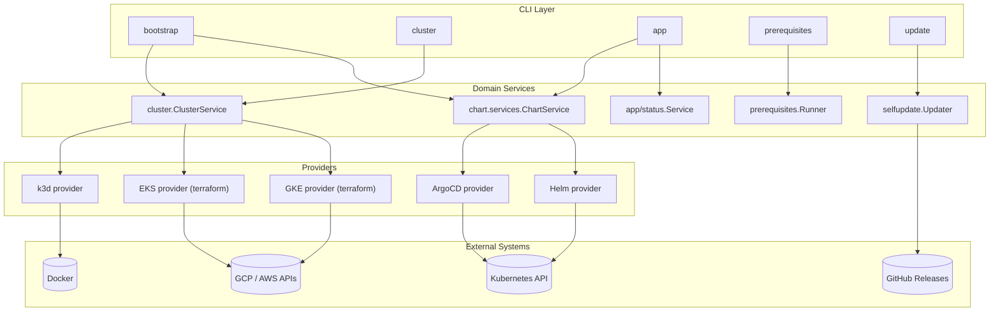

<div align="center">
  <picture>
    <source media="(prefers-color-scheme: dark)" srcset="https://shdrojejslhgnojzkzak.supabase.co/storage/v1/object/public/public/doc-orchestrator/logos/1771371901777-lc3cse-logo-openframe-full-dark-bg.png">
    <source media="(prefers-color-scheme: light)" srcset="https://shdrojejslhgnojzkzak.supabase.co/storage/v1/object/public/public/doc-orchestrator/logos/1771372526604-k3y1w-logo-openframe-full-light-bg.png">
    
  </picture>
</div>

<p align="center">
  <a href="LICENSE.md"></a>
</p>

# OpenFrame CLI

OpenFrame CLI (`openframe`) is the Go-based command-line tool that bootstraps and manages the lifecycle of the [OpenFrame](https://openframe.ai) platform by [Flamingo](https://flamingo.run). It provisions Kubernetes clusters — locally via k3d, or in the cloud via GKE/EKS through Terraform — and deploys the OpenFrame platform onto them using ArgoCD's app-of-apps pattern. It also handles prerequisites, status monitoring, upgrades, teardown, and its own self-update, with both interactive wizards and non-interactive flags for CI/automation.

The platform's application code itself lives in a separate repository, [`flamingo-stack/openframe-oss-tenant`](https://github.com/flamingo-stack/openframe-oss-tenant), which this CLI clones and deploys onto the clusters it provisions.

Per the organization's dependency graph, this repository publishes a single Go module artifact — `github.com/flamingo-stack/openframe-cli` — with no recorded upstream dependencies and no downstream consumers among internally-published artifacts. It is a standalone, user-facing CLI binary distributed via GitHub Releases and `go install`, not a library consumed by other repositories.

## Features

- **One-command bootstrap** — `openframe bootstrap` chains cluster creation and platform installation into a single staged flow with progress tracking.
- **Multiple cluster backends** — create clusters locally with k3d (Docker-based), or in the cloud on GKE or EKS via Terraform, all behind the same `openframe cluster` command surface.
- **ArgoCD-driven platform deployment** — the platform is installed and kept in sync through ArgoCD and an app-of-apps Helm chart, with support for deploying a specific branch or release tag via `--ref`.
- **Prerequisite automation** — `openframe prerequisites check` and `install` detect and (on macOS/Linux) auto-install the tools each cluster backend needs: Docker, k3d, Helm, Terraform, gcloud, the AWS CLI.
- **Status visibility** — `openframe app status` reports cluster reachability and ArgoCD application sync/health, with `--watch` for a live-refreshing view and `--interactive` for a k9s-style terminal UI.
- **Safe, ordered teardown** — `openframe app uninstall` and `openframe cluster delete` remove the platform or the cluster in a deliberate order, asking for confirmation unless `--yes`/`--force` is given.
- **Verified binaries everywhere** — tool binaries the CLI downloads (k3d, Helm, mkcert, Terraform, infracost) are pinned to exact versions and checksum-verified before use. The CLI's own self-update additionally verifies releases with Sigstore/cosign signatures.
- **Automation-friendly output** — most read commands support `--output json|yaml`, and `--non-interactive` skips every prompt for CI pipelines.
- **Windows support via WSL2** — on Windows, the native build re-executes itself inside WSL2 before any cluster command runs, since the local cluster (Docker + k3d) and the Kubernetes client need to share a network namespace a native Windows process cannot reach reliably.

## Architecture

The CLI is organized around three core abstractions — **cluster** (provisioning), **app** (platform deployment via ArgoCD), and **prerequisites** (tool verification/installation) — plus shared infrastructure for UI, command execution, verified downloads, and self-update.



The platform this CLI deploys — the app-of-apps chart and its underlying services — lives in the separate [`flamingo-stack/openframe-oss-tenant`](https://github.com/flamingo-stack/openframe-oss-tenant) repository, cloned at install/upgrade time.

## Technology stack

- **[spf13/cobra](https://github.com/spf13/cobra)** — command routing and flag parsing across the entire `cmd/` tree.
- **[kubernetes/client-go](https://github.com/kubernetes/client-go)** — native Kubernetes API access (health checks, resource queries, context resolution).
- **[pterm/pterm](https://github.com/pterm/pterm)** — terminal rendering: tables, spinners, boxes, themed status printers.
- **[charmbracelet/huh](https://github.com/charmbracelet/huh)** and **[charmbracelet/bubbletea](https://github.com/charmbracelet/bubbletea)** — interactive prompts/wizards and the `app status --interactive` TUI.
- **[sigstore/sigstore-go](https://github.com/sigstore/sigstore-go)** — cosign keyless signature verification for self-update integrity.
- **golang.org/x/mod/semver** — semantic version comparison driving update/downgrade decisions.
- **sigs.k8s.io/yaml** — JSON/YAML round-tripping for machine-readable command output.
- **Terraform** (shelled out) — provisions GKE/EKS clusters.

At runtime the CLI also shells out to Docker, k3d, Helm, Terraform, gcloud, and the AWS CLI. Binaries for k3d, Helm, mkcert, Terraform, and infracost are downloaded by the CLI itself, pinned to exact versions and checksum-verified before use.

## Hardware requirements

| Resource | Minimum | Recommended |
|---|---|---|
| RAM | 24 GB | 32 GB |
| CPU Cores | 6 | 12 |
| Disk Space | 50 GB | 100 GB |

## Quick Start

### 1. Install the CLI

**macOS/Linux** — download the appropriate binary from the [Releases page](https://github.com/flamingo-stack/openframe-cli/releases), or build from source with Go:

```bash
go install github.com/flamingo-stack/openframe-cli@latest
```

**Windows** — download the AMD64 build directly:

```text
https://github.com/flamingo-stack/openframe-cli/releases/latest/download/openframe-cli_windows_amd64.zip
```

Run the installer the same way you would on other operating systems. On Windows, the native build re-executes itself inside WSL2 before any cluster command runs.

Confirm the binary is on your `$PATH` and runs:

```bash
openframe --help
```

### 2. Check prerequisites

```bash
openframe prerequisites check
openframe prerequisites install
```

### 3. Bootstrap the platform

```bash
openframe bootstrap
```

Running it with no arguments starts an interactive flow that creates a local k3d cluster and installs the full platform (ArgoCD plus the app-of-apps). You can also name the cluster explicitly:

```bash
openframe bootstrap my-cluster
```

For CI/automation:

```bash
openframe bootstrap --non-interactive
```

### 4. Check status and access the platform

```bash
openframe app status
openframe app access
```

`openframe app status` reports cluster reachability plus each ArgoCD application's sync/health state. `openframe app access` prints the ArgoCD admin credentials (read live from your cluster) and the port-forward command needed to reach the UI.

## CLI Commands

```text
openframe bootstrap                    # k3d cluster + platform install in one step
openframe cluster create|delete|list|status|use|cleanup
openframe app install|upgrade|status|access|uninstall
openframe prerequisites check|install
openframe update [version]|check|rollback
```

## Documentation

📚 See the [Documentation](./docs/README.md) for comprehensive guides, including:

- [Introduction](./docs/getting-started/introduction.md), [Prerequisites](./docs/getting-started/prerequisites.md), [Quick Start](./docs/getting-started/quick-start.md), and [First Steps](./docs/getting-started/first-steps.md)
- How-to guides: [create a cluster](./docs/getting-started/how-to/create-a-new-kubernetes-cluster-with-openframe-cli.md), [install the platform](./docs/getting-started/how-to/install-the-openframe-platform-onto-a-cluster.md), [check status](./docs/getting-started/how-to/check-the-status-of-your-openframe-cluster-and-apps.md), [upgrade](./docs/getting-started/how-to/upgrade-openframe-cli-and-its-installed-apps.md), and [uninstall](./docs/getting-started/how-to/uninstall-openframe-and-delete-a-cluster.md)
- [Architecture overview](./docs/reference/architecture/overview.md) and [Ecosystem graph](./docs/reference/architecture/ecosystem.md)
- [Architecture diagrams](./docs/diagrams/architecture/README.md)
- [Development docs](./docs/development/README.md), including [environment setup](./docs/development/setup/environment.md), [local development](./docs/development/setup/local-development.md), [architecture](./docs/development/architecture/README.md), [testing](./docs/development/testing/README.md), [contributing guidelines](./docs/development/contributing/guidelines.md), and [security](./docs/development/security/README.md)

> This project does not use GitHub Issues or GitHub Discussions. Community support happens on the [OpenMSP Slack community](https://www.openmsp.ai/).

---
<div align="center">
  Built with 💛 by the <a href="https://www.flamingo.run/about"><b>Flamingo</b></a> team
</div>
