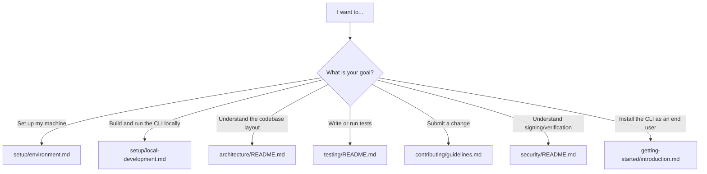

# Development

This section is the entry point for anyone working on the **OpenFrame CLI** source code — the Go-based command-line tool (`openframe`) that provisions Kubernetes clusters and deploys the OpenFrame platform onto them. It covers how the repository is organized, how to set up a local build, how the test suite is structured, how contributions are reviewed, and where to look for architecture and security details.

> **Scope note:** OpenFrame CLI is a standalone binary repository (`flamingo-stack/openframe-cli`). Per the organization's dependency graph, it publishes a single Go module (`github.com/flamingo-stack/openframe-cli`) and has **no recorded upstream dependencies and no downstream consumers** within the organization — it is a self-contained CLI distributed via GitHub Releases and `go install`, not a library consumed by other services. The platform it deploys (ArgoCD app-of-apps and the underlying services) lives in the separate [`flamingo-stack/openframe-oss-tenant`](https://github.com/flamingo-stack/openframe-oss-tenant) repository, which this CLI clones at install time — always treat that repository as external, never as a local subdirectory.

## Overview

OpenFrame CLI is built in Go (module `github.com/flamingo-stack/openframe-cli`, declared in `go.mod` with toolchain `go1.26.5`). It is organized around three core domains:

- **`cmd/`** — Cobra command definitions (`bootstrap`, `cluster`, `app`, `prerequisites`, `update`, plus `cmd/root.go` as the entrypoint builder).
- **`internal/`** — domain services and shared infrastructure: cluster provisioning (`internal/cluster/`), chart/ArgoCD installation (`internal/chart/`), Kubernetes read access (`internal/k8s/`), prerequisite tooling (`internal/prerequisites/`), and cross-cutting concerns under `internal/shared/` (UI, executor, errors, downloads, self-update, WSL launching).
- **`tests/`** — integration test helpers (`tests/integration/common/`) and shared test utilities (`tests/testutil/`).

The repository also ships a single helper shell script, `scripts/sign-binary.sh`, used in the release/signing pipeline.

Development here means working with a Cobra-based CLI that shells out to external tools (Docker, k3d, Helm, Terraform, gcloud, AWS CLI) through a testable `internal/shared/executor` abstraction, and that talks to Kubernetes directly via `client-go` rather than shelling out to `kubectl`. Binaries for pinned tools (k3d, Helm, mkcert, Terraform, infracost) are downloaded and SHA256-verified by the CLI itself (`internal/shared/download/`), and the CLI self-updates using Sigstore/cosign signature verification (`internal/shared/selfupdate/`).

## What's in this section

The development documentation is split into focused topics. Use the table below to jump straight to what you need:

| Doc | What it covers |
|---|---|
| [Environment Setup](./setup/environment.md) | Preparing your machine (Go toolchain, required external tools) to build the CLI |
| [Local Development](./setup/local-development.md) | Running, building, and iterating on the CLI from a local checkout |
| [Architecture](./architecture/README.md) | How `cmd/`, `internal/`, and the provider packages fit together |
| [Testing](./testing/README.md) | The `tests/integration/` and `tests/testutil/` structure and how to run the suite |
| [Contributing Guidelines](./contributing/guidelines.md) | Code conventions and the process for submitting changes |
| [Security](./security/README.md) | How signature verification, checksum pinning, and self-update integrity work |

For the system-level architecture diagrams and the full module breakdown, see [Architecture Overview](../reference/architecture/overview.md) and the [Ecosystem](../reference/architecture/ecosystem.md) document. The repository-wide diagrams (component relationships, bootstrap sequence) are collected in [Architecture Diagrams](../diagrams/architecture/README.md).

## Quick navigation guide

Use this guide to decide where to start, depending on what you're trying to do:



- **New to the repository?** Start with [Environment Setup](./setup/environment.md), then [Local Development](./setup/local-development.md) to get a build running.
- **Need the big picture before changing code?** Read [Architecture](./architecture/README.md) and the [Architecture Overview](../reference/architecture/overview.md) reference doc, which documents the `cmd/` → `internal/` → provider layering and the bootstrap sequence.
- **Adding or changing behavior?** Check [Testing](./testing/README.md) for how `tests/testutil/` and `tests/integration/common/` are used, and [Contributing Guidelines](./contributing/guidelines.md) before opening a change.
- **Touching downloads, releases, or self-update?** Read [Security](./security/README.md) first — these paths are covered by active code-review rules (checksum verification, Sigstore signing) and are easy to break silently.
- **Just want to install and use the CLI, not develop it?** You want [Getting Started](../getting-started/introduction.md), [Prerequisites](../getting-started/prerequisites.md), and [Quick Start](../getting-started/quick-start.md) instead, plus the task-oriented how-to guides: [creating a cluster](../getting-started/how-to/create-a-new-kubernetes-cluster-with-openframe-cli.md), [checking cluster status](../getting-started/how-to/check-the-status-of-your-openframe-cluster-and-apps.md), [installing the platform](../getting-started/how-to/install-the-openframe-platform-onto-a-cluster.md), [upgrading](../getting-started/how-to/upgrade-openframe-cli-and-its-installed-apps.md), and [uninstalling](../getting-started/how-to/uninstall-openframe-and-delete-a-cluster.md).

## Repository layout at a glance

```text
cmd/                    Cobra command tree (bootstrap, cluster, app, prerequisites, update, root)
internal/bootstrap/     Orchestrates "cluster create + app install" as one staged flow
internal/cluster/       Cluster lifecycle: service, providers (k3d, eks, gke, terraform), discovery, UI
internal/chart/         ArgoCD + app-of-apps installation via Helm, git-based chart repo cloning
internal/app/           Platform status aggregation and uninstall orchestration
internal/k8s/           Read-only Kubernetes access: health checks, kubeconfig context handling
internal/prerequisites/ OS-aware tool detection/auto-install framework
internal/shared/        Executor, downloads, errors, self-update, UI, WSL launcher — cross-cutting code
tests/integration/      CLI-level integration test helpers
tests/testutil/         Shared assertions, fixtures, and test patterns
scripts/sign-binary.sh  Release signing helper
main.go                 Process entrypoint; maps errors to exit codes
go.mod                  Module definition, Go 1.26 toolchain, dependency pins
```

> **Note on Windows development:** the native Windows build re-executes itself inside WSL2 (`internal/shared/wsllauncher/`) before any cluster command runs, because the local k3d cluster and the native `client-go` Kubernetes client need to share a network namespace that a native Windows process cannot reach reliably. Keep this in mind when developing or debugging cluster commands on Windows.

## Conventions enforced in this codebase

A few conventions are consistently enforced across `cmd/` and `internal/` and are worth knowing before you start changing code (see [Contributing Guidelines](./contributing/guidelines.md) for the full list):

- Cobra command groups are wired in through `Get<Group>Cmd()` / `get<Sub>Cmd()` factory functions, never constructed inline in `cmd/root.go`.
- Command groups that define their own `PersistentPreRunE` must call `ui.ApplyGlobalOutputFlags(cmd)`, since Cobra only runs the closest parent's hook — otherwise `--verbose`/`--silent` silently stop working for that subtree.
- User-facing terminal output goes through `pterm` printers or the shared `internal/shared/ui` package, never raw `fmt.Print*` to stdout.
- Errors already displayed to the user are returned as (or wrapping) `AlreadyHandledError` so `main` doesn't double-print them.
- External command failures (helm, k3d, terraform, etc.) are preserved as `*executor.CommandError` so the original exit code reaches the OS, instead of collapsing to a generic `1`.
- The root `cobra.Command` sets `SilenceErrors` and `SilenceUsage` to `true`, since error display is handled explicitly.

These rules are detailed further in [Contributing Guidelines](./contributing/guidelines.md) and [Architecture](./architecture/README.md).
