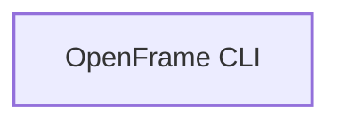
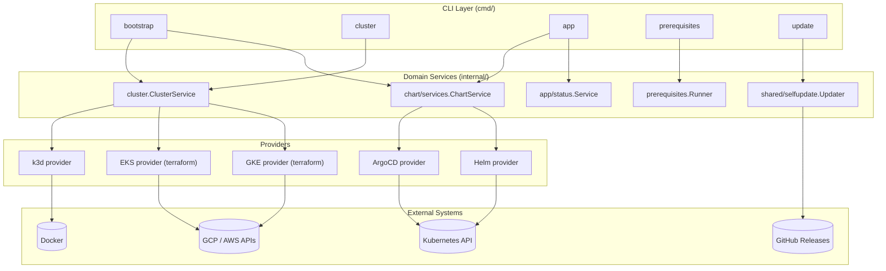
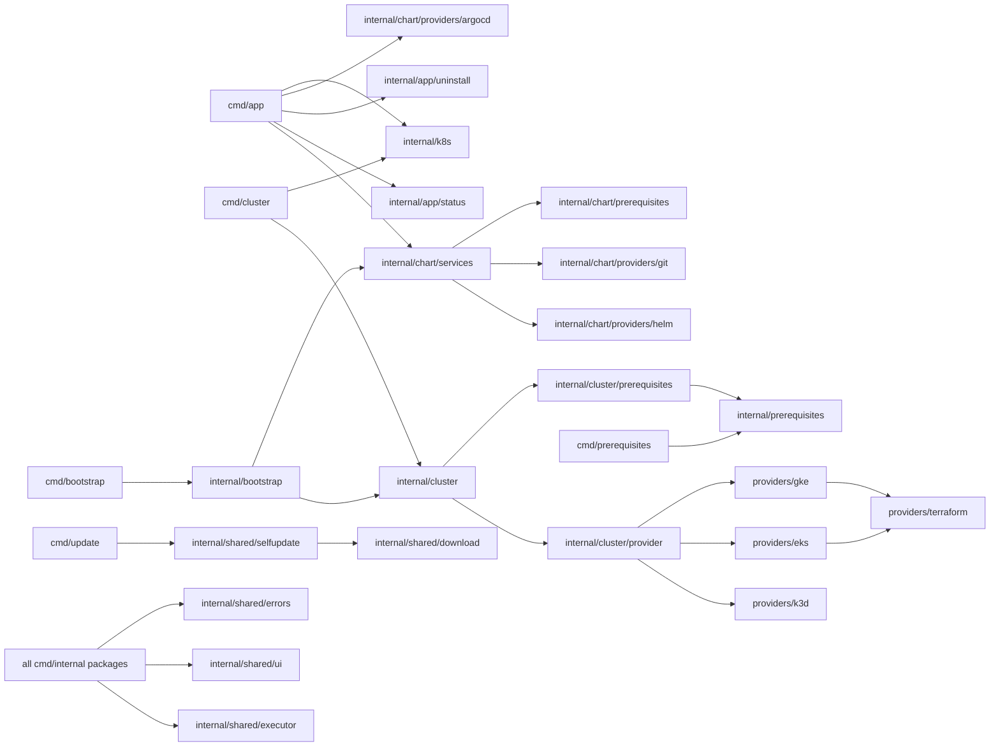
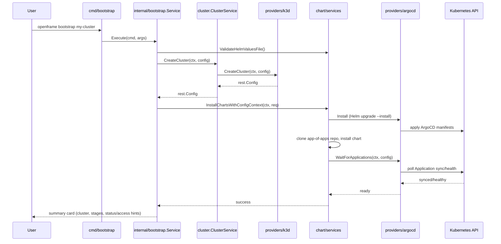
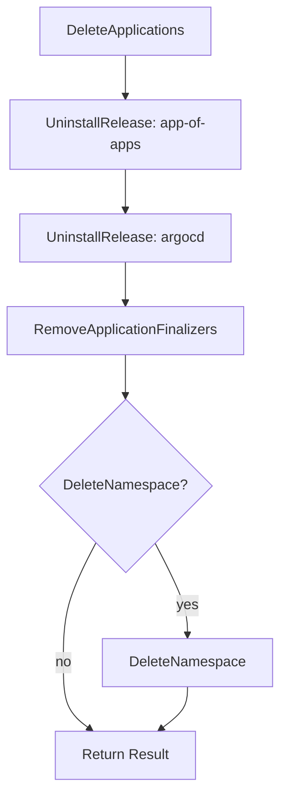

# Architecture Overview

OpenFrame CLI (`openframe`) is the bootstrap and lifecycle-management tool for the [OpenFrame](https://openframe.ai) platform built by [Flamingo](https://flamingo.run). It provisions Kubernetes clusters — locally via k3d, or in the cloud via GKE/EKS through Terraform — and deploys OpenFrame onto them using ArgoCD's app-of-apps pattern, supporting both interactive wizards and non-interactive flags for CI/automation.

> The CLI deploys the platform whose source code lives in the separate [`flamingo-stack/openframe-oss-tenant`](https://github.com/flamingo-stack/openframe-oss-tenant) repository ("OpenFrame Main code Repository"). This repository owns only cluster provisioning, platform install/upgrade/uninstall, prerequisite management, and self-update — it never embeds or vendors that repository's code. When reading this document alongside the oss-tenant repository's own docs (`https://github.com/flamingo-stack/openframe-oss-tenant/tree/main/docs`), keep in mind they describe two separate, independently maintained codebases connected only at install time.

## Where this repository sits in the ecosystem

Per the organization's dependency graph (coverage: **full**, meaning every other managed repository has a fresh graph and an absent consumer is a confirmed fact, not a gap):

- **Publishes** exactly one artifact: the Go module `github.com/flamingo-stack/openframe-cli`.
- **Has no recorded upstream dependencies** on other repositories in the organization — only on third-party Go libraries (Cobra, client-go, pterm, huh, bubbletea, sigstore-go, go-git, terraform-exec) and external CLI binaries it shells out to (Docker, k3d, Helm, Terraform, gcloud, aws).
- **Has no recorded downstream consumers.** No other repository imports this module's Go symbols — expected, since OpenFrame CLI is a standalone, user-facing binary rather than a library. Its only relationship to `openframe-oss-tenant` is operational: at install/upgrade time it clones that repository's app-of-apps Helm chart (via the `RepoOSSTenant` constant in `internal/chart/models/repos.go`), not a code-level import.

## High-level architecture

OpenFrame CLI is organized around three core domain abstractions — **cluster** (provisioning), **app** (platform deployment via ArgoCD), and **prerequisites** (tool verification/installation) — plus shared infrastructure for UI, command execution, and self-update. Commands under `cmd/` are thin Cobra wrappers that delegate into domain services under `internal/`, which in turn drive provider-specific backends (k3d, EKS, GKE, Helm, ArgoCD) through a testable `CommandExecutor` abstraction (`internal/shared/executor/executor.go`).

## Core components

| Component | Path | Responsibility |
|---|---|---|
| CLI entrypoint | `main.go`, `cmd/root.go` | Builds the root Cobra command, resolves build-time version info, exits with the failed child command's exit code |
| Bootstrap command | `cmd/bootstrap/`, `internal/bootstrap/` | One-shot "create cluster + install platform" flow with a staged progress tracker and closing summary |
| Cluster commands | `cmd/cluster/`, `internal/cluster/` | `create`/`delete`/`list`/`status`/`use`/`cleanup`; resolves the k3d/EKS/GKE backend via `internal/cluster/provider` |
| App commands | `cmd/app/`, `internal/app/` | `install`/`upgrade`/`status`/`access`/`uninstall` against ArgoCD + app-of-apps on an existing cluster |
| Chart services | `internal/chart/` | Installs ArgoCD and the app-of-apps Helm chart, clones the chart repo, validates Helm values, orchestrates retries |
| Prerequisites framework | `internal/prerequisites/`, `internal/cluster/prerequisites/`, `internal/chart/prerequisites/` | OS-aware check/install of Docker, k3d, Helm, Terraform, cloud CLIs, certificates |
| Cluster providers | `internal/cluster/providers/{k3d,eks,gke,terraform}` | Backend-specific `Provider` implementations behind a single interface |
| Discovery | `internal/cluster/discovery/` | Finds external GKE/EKS clusters and handles gcloud/AWS auth flows |
| k8s access layer | `internal/k8s/` | Reads kubeconfig contexts, builds `rest.Config`, checks cluster health/capacity — read-only, separate from cluster creation |
| Self-update | `internal/shared/selfupdate/` | Checks GitHub releases, verifies cosign signatures + SHA256, applies/rolls back the binary |
| Verified downloads | `internal/shared/download/` | Pinned-version, checksum-verified installers for k3d, Helm, Terraform, mkcert, infracost (no `curl \| bash`) |
| Shared UI | `internal/shared/ui/` | pterm/huh/bubbletea wrappers: prompts, spinners, glyphs, `--silent`/`--plain`/`--verbose` contract, GitHub Actions annotations |
| Executor abstraction | `internal/shared/executor/` | `CommandExecutor` interface wrapping all external process calls; `MockCommandExecutor` for tests |
| WSL launcher | `internal/shared/wsllauncher/` | Forwards the native Windows build into WSL2, where Docker/k3d/client-go actually work |
| Error handling | `internal/shared/errors/` | Structured error rendering, retry policy, friendly hints, `AlreadyHandledError` sentinel |

### Component relationships

## Data flow: the bootstrap sequence

`openframe bootstrap` is the CLI's flagship one-command flow: it creates a local k3d cluster and installs the OpenFrame platform onto it in a single staged operation, orchestrated by `internal/bootstrap/service.go`'s `Service.Execute` / `bootstrap` function.

Per `internal/bootstrap/.service.md`, the workflow runs a three-stage `steps.Tracker` (validate Helm values → create cluster → install platform), defaults the cluster name to `openframe-dev` when none is given, and emits a desktop notification plus a GitHub Actions Step Summary card on completion. The install request explicitly sets `KubeContext` to `k3d-<clusterName>` (not resolved dynamically from the current context), since bootstrap always creates a k3d cluster and must not risk matching an unrelated pre-existing context.

A second, related sequence worth understanding is `openframe app uninstall` (`internal/app/uninstall/uninstall.go`), which removes the platform in a specific safe order: ArgoCD `Application` CRs are deleted **before** the Helm releases, so ArgoCD can cascade workload cleanup while it is still running; finalizers are stripped only **after** ArgoCD itself is gone, to unblock any CRs stuck in `Terminating`.

## CLI command surface

| Command | Summary |
|---|---|
| `openframe bootstrap [cluster-name]` | Create a local k3d cluster and install the OpenFrame platform in one step (`--non-interactive` for CI) |
| `openframe cluster create [NAME]` | Create a k3d/GKE/EKS cluster (interactive wizard or `--skip-wizard` with flags like `--type`, `--nodes`, `--region`, `--project`, `--profile`, `--ha`, `--spot`) |
| `openframe cluster delete [NAME]` | Delete a cluster; cloud deletes require typed-name confirmation or `--force` |
| `openframe cluster list [--all]` | List managed clusters; `--all` additionally discovers external GKE/EKS clusters |
| `openframe cluster status [NAME]` | Detailed cluster health/resource info, `-o json\|yaml` supported |
| `openframe cluster use [NAME]` | Switch the kubectl context (and gcloud config, for GKE) to a cluster |
| `openframe cluster cleanup [NAME]` | Prune unused container images from cluster nodes (k3d only) |
| `openframe app install [cluster-name]` | Install ArgoCD + app-of-apps onto an existing cluster (`--ref` to pick a branch/tag) |
| `openframe app upgrade` | Change ref (`--ref`) or force a re-sync (`--sync`, optional `--prune`) of an installed platform |
| `openframe app status [--watch\|--interactive]` | Report/monitor ArgoCD application sync/health; `--interactive` opens a k9s-style TUI |
| `openframe app access` | Print ArgoCD admin credentials and how to reach the UI |
| `openframe app uninstall` | Remove ArgoCD + apps from a cluster, keeping the cluster itself |
| `openframe prerequisites check\|install [--type k3d\|eks\|gke]` | Report or install the tools required for a given cluster type |
| `openframe update [version]`, `update check`, `update rollback` | Self-update the CLI binary, with checksum + cosign signature verification and offline rollback |

## Key design decisions

**Provider abstraction behind a single interface.** `internal/cluster/provider/factory.go` resolves one `Provider` implementation by `ClusterType` (k3d, EKS, GKE), so `cmd/cluster` and `internal/bootstrap` never branch on cluster type directly — all the k3d/EKS/GKE-specific logic lives in `internal/cluster/providers/`. EKS and GKE both delegate to a shared `providers/terraform` engine.

**Terraform modules are pinned, not floating ranges.** The generated workspace in `internal/cluster/providers/eks/templates/main.tf` pins the `terraform-aws-modules/eks/aws` module to an exact version (`21.24.1`), with an inline comment recording that a previously floating `~> 21.0` constraint once resolved to a new minor version whose changed defaults broke cluster creation in three independent ways (no bootstrapped addons, IMDS hop limit 1, a gated `kubernetes_version` data source). The same deliberate-pin discipline applies to the GKE template's `terraform-google-modules` sources.

**Every addon a working EKS cluster needs is declared explicitly.** Because the EKS module sets `bootstrap_self_managed_addons = false`, `main.tf` declares `vpc-cni` (with `before_compute = true`), `kube-proxy`, `coredns`, and `aws-ebs-csi-driver` itself — without the EBS CSI addon, every `PersistentVolumeClaim` the OpenFrame platform creates (Kafka, MongoDB, Cassandra, etc.) would stay `Pending` forever.

**Free-Tier-friendly defaults.** The EKS template defaults `instance_type` to `m7i-flex.large` instead of `m6i.large` specifically because new AWS accounts on the Free plan refuse to launch non-eligible instance types — a comment in the template records that the larger type caused the node group to die roughly 30 minutes into a first-run path.

**Verified, pinned downloads instead of `curl | bash`.** `internal/shared/download/` installs k3d, Helm, Terraform, mkcert, and infracost at pinned versions with SHA256 checksum verification, rather than piping an install script from the internet.

**A single `CommandExecutor` abstraction for every external process call.** `internal/shared/executor/executor.go` defines the interface every package shells out through (Docker, k3d, Helm, Terraform, gcloud, aws), with `internal/shared/executor/mock.go` providing a `MockCommandExecutor` for tests — this keeps cluster/chart logic testable without actually invoking external binaries.

**WSL2 forwarding for the Windows build.** `internal/shared/wsllauncher/` forwards the native Windows binary into WSL2, because Docker, k3d, and `client-go` do not work natively on Windows; this is also why the Windows release artifact is distributed as a `.zip` rather than a bare binary.

**Cosign/Sigstore-verified self-update with rollback.** `internal/shared/selfupdate/` checks GitHub Releases, verifies the downloaded binary's cosign keyless signature and SHA256 checksum via `github.com/sigstore/sigstore-go`, and supports an offline rollback (`openframe update rollback`) if an update turns out to be bad.

**Explicit `--context` over positional cluster-name ambiguity for destructive app commands.** `cmd/app/app.go`'s `noPositionalArgs` rejects any positional argument on `app` subcommands, with an error naming `--context` as the correct way to target a cluster — the in-code comment notes that without this guard, Cobra's default `ArbitraryArgs` behavior meant a command like `openframe app status my-eks` would silently run against whatever the current kube-context happened to be, which is especially dangerous for `uninstall`.

**Consistent `--silent`/`--verbose` handling despite Cobra's hook-shadowing.** Because the `app` command group defines its own `PersistentPreRunE` (which shadows the root command's, since Cobra only runs the closest parent's hook), `cmd/app/app.go` explicitly re-applies `ui.ApplyGlobalOutputFlags(cmd)` — a comment there records that an earlier version replicated only the silent half of this contract, leaving `app install --verbose` with no debug output while `bootstrap --verbose` printed everything.

**Mutually exclusive upgrade modes, explicitly rejected rather than silently merged.** `cmd/app/upgrade.go` treats `--ref` (deploy a new git ref) and `--sync` (force re-sync the current ref) as mutually exclusive and returns an error if both are set — an in-code comment explains that silently preferring `--sync` previously force-synced the *current* ref and discarded an explicit `--ref`, leaving the user believing they had deployed a new version when they had not.

**Credentials are never baked into the app-of-apps Git URL.** `internal/chart/models/appofapps.go`'s `GetGitURL()` always strips any embedded username/password (e.g. an `x-access-token:PAT@` prefix) from the repository URL before handing it to the `helm-git` plugin, to prevent token leakage through Helm's logs or process arguments.

**Safe-ordered, two-phase platform uninstall.** As shown in the uninstall sequence above, `internal/app/uninstall/uninstall.go` deletes ArgoCD `Application` resources before removing the Helm releases (`app-of-apps` before `argocd` itself), and only strips stuck finalizers after ArgoCD is gone — ensuring cascading workload cleanup happens while the controller that performs it is still running.

**Exit-code fidelity for automation.** `main.go` preserves a failed external command's real exit code (when it is a valid Unix code in the 1–255 range) rather than collapsing every failure to a generic `1`, and distinguishes already-user-facing errors (the `AlreadyHandledError` sentinel) from errors that still need to be printed — so CI pipelines consuming `openframe`'s exit status get meaningful signal.

## Further reading

For a narrower look at how individual domains are wired, see `../../reference/architecture/overview.md` (module-level breakdown with additional key-files tables) and `../../reference/architecture/ecosystem.md` (the organization's dependency-graph facts for this repository). The source `.mmd` diagram files referenced throughout this document are also available individually under `../../diagrams/architecture/README.md`.
