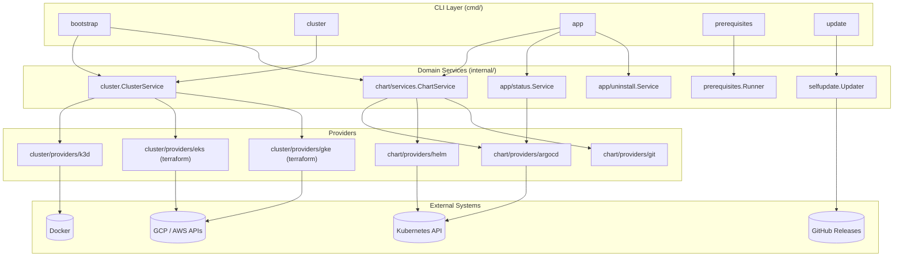
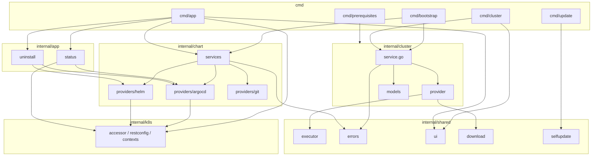
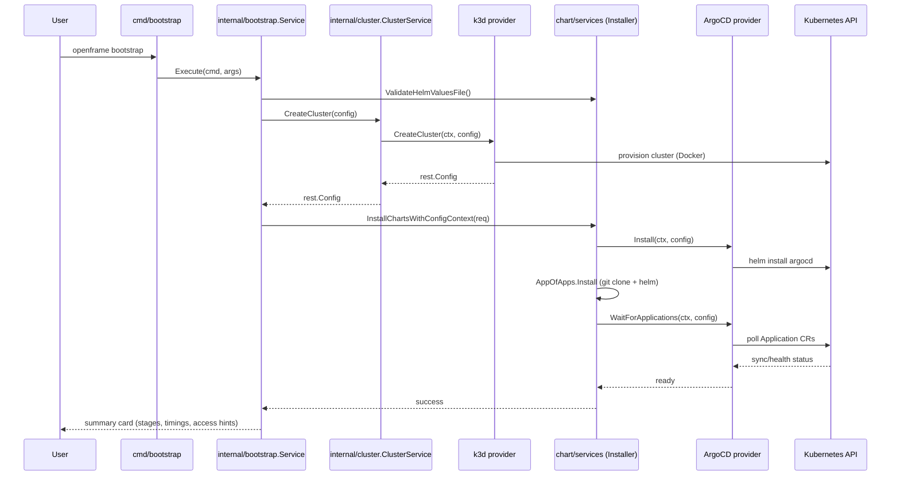
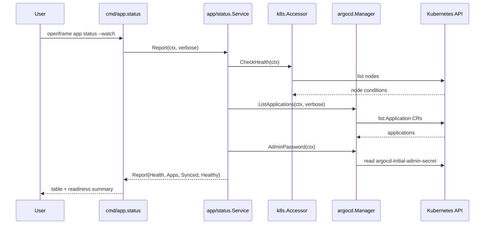

## Architecture Overview

OpenFrame CLI is a Go command-line tool, published to the `go` ecosystem as `github.com/flamingo-stack/openframe-cli`, that provisions Kubernetes clusters (local k3d, or cloud GKE/EKS via Terraform) and deploys the OpenFrame platform onto them through ArgoCD's app-of-apps pattern. It manages the full lifecycle — prerequisites, cluster creation, chart installation, status monitoring, upgrades, and teardown — via Cobra-driven commands, both as fully interactive wizards and as non-interactive flags for CI/automation.

The CLI deploys the OpenFrame application stack from the external **flamingo-stack/openframe-oss-tenant** repository (the app-of-apps chart repo cloned by `internal/chart/providers/git`); that repository is maintained separately and is not part of this codebase.

> According to the organization's repository graph, OpenFrame CLI has no recorded upstream dependencies on other internal repositories and no recorded downstream consumers — it sits as a standalone leaf artifact in the internal dependency graph. Graph coverage is **partial**, so this absence of consumers is informative but not exhaustive proof that nothing in the organization invokes it.

### High-Level Architecture

The codebase is organized around three core abstractions — **cluster** (provisioning), **app** (platform deployment via ArgoCD), and **prerequisites** (tool verification/installation) — plus shared infrastructure for UI, command execution, and self-update.

A design decision worth highlighting at the top level: `internal/k8s` deliberately isolates read/inspect access to an *existing* cluster (contexts, health, resources) from `internal/cluster`, which handles cluster *creation*. This lets `openframe app install` target any reachable cluster — one created by `openframe cluster create`, or one the user made directly — without the app subsystem needing to know how the cluster came to exist.

### Core Components

| Component | Path | Responsibility |
|---|---|---|
| Root command | `cmd/root.go` | Cobra root, version metadata, global flags (`--silent`, `--verbose`, `--plain`), pinned-dependency reporting |
| Bootstrap | `cmd/bootstrap/`, `internal/bootstrap/` | One-shot `cluster create` + `app install` with a staged progress tracker |
| Cluster commands | `cmd/cluster/` | `create`, `delete`, `list`, `status`, `use`, `cleanup` subcommands |
| Cluster service | `internal/cluster/service.go` | Cluster lifecycle orchestration, provider dispatch, existing-cluster reuse logic |
| Cluster providers | `internal/cluster/providers/{k3d,eks,gke}` | Backend-specific cluster create/delete/status via Docker/k3d or Terraform |
| Cluster discovery | `internal/cluster/discovery/` | Finds cloud clusters outside the openframe registry (GKE/EKS), gcloud/AWS auth flows |
| Cluster prerequisites | `internal/cluster/prerequisites/` | Type-aware tool gates (Docker/k3d/helm for k3d; terraform+CLI for EKS/GKE) |
| App commands | `cmd/app/` | `install`, `upgrade`, `status`, `access`, `uninstall` subcommands |
| Chart services | `internal/chart/services/` | Orchestrates ArgoCD + app-of-apps install, validation, retries |
| ArgoCD provider | `internal/chart/providers/argocd/` | ArgoCD Helm install, application listing/sync, admin password, wait logic |
| Helm provider | `internal/chart/providers/helm/` | Helm CLI wrapper for install/upgrade/uninstall |
| Git provider | `internal/chart/providers/git/` | Clones the app-of-apps chart repository at a given ref |
| App status | `internal/app/status/` | Aggregates cluster health + ArgoCD app sync/health into a `Report` |
| App status TUI | `internal/app/status/tui/` | Interactive k9s-style bubbletea view for navigating/syncing apps |
| App uninstall | `internal/app/uninstall/` | Removes ArgoCD applications and Helm releases, keeping the cluster |
| Prerequisites framework | `internal/prerequisites/` | OS-aware `Prerequisite`/`Set`/`Runner` abstraction (auto-install on macOS/Linux, docs-only on Windows) |
| k8s access | `internal/k8s/` | Kubeconfig context resolution, `rest.Config` building, cluster health/resource checks |
| Platform hints | `internal/platform/` | Per-OS install guidance, Windows/WSL cluster-access error messaging |
| Shared executor | `internal/shared/executor/` | `CommandExecutor` abstraction (real + mock) for all shelled-out commands |
| Shared errors | `internal/shared/errors/` | Structured error handling, retry policy, friendly hints |
| Shared UI | `internal/shared/ui/` | Logo, spinners, prompts, glyphs, GitHub Actions annotations, silent/plain modes |
| Shared download | `internal/shared/download/` | Checksum-verified pinned-tool downloads (k3d, helm, mkcert, terraform, infracost) |
| Self-update | `internal/shared/selfupdate/` | Checks/applies CLI updates, cosign signature + checksum verification, rollback |
| WSL launcher | `internal/shared/wsllauncher/` | Forwards the native Windows binary into WSL2 for cluster operations |

### Component Relationships

Note the asymmetry inside `cmd/app`: `getInstallCmd`, `getUpgradeCmd`, and `getUninstallCmd` all route through `internal/chart/services`, while `getStatusCmd` and `getAccessCmd` build an ArgoCD manager (`argocd.NewManagerWithConfig`) and `internal/app/status.Service` directly from a resolved `rest.Config` — read paths bypass the chart-install orchestration entirely.

### Data Flow

#### Bootstrap Sequence

`openframe bootstrap` is the single-command path: it chains cluster creation and platform installation, driven by `internal/bootstrap.Service.Execute`, which resolves `verbose`/`non-interactive` flags and runs a staged `steps.Tracker` (validate helm values → create cluster → install platform).

Because `bootstrap` always creates a k3d cluster, `internal/bootstrap/service.go` sets `KubeContext` to `"k3d-" + clusterName` explicitly rather than resolving it dynamically — avoiding any risk of matching an unrelated pre-existing context.

#### App Status Aggregation

`openframe app status` (and the `--interactive` TUI in `internal/app/status/tui/`) call the same `internal/app/status.Service.Report`, which combines a best-effort cluster health check, a hard-failing ArgoCD application list, and a best-effort admin-password read into one `Report`.

`Report.Summary()` (in `internal/app/status/status.go`) is careful not to contradict itself: if applications were listed successfully but the node-health read failed (commonly namespace-scoped RBAC denying `list nodes`), it reports "node health unavailable" rather than claiming the cluster is unreachable — since the API server clearly did answer.

### Key Design Decisions

- **Shell out to verified, pinned binaries rather than link cloud/cluster tool libraries.** Docker, k3d, Helm, Terraform, gcloud, and aws are all invoked through the `internal/shared/executor.CommandExecutor` abstraction (real executor + mock for tests), not imported as Go libraries. Binaries are downloaded, checksum-verified, and version-pinned via `internal/shared/download` (see `internal/shared/download/pins.go`, `verify.go`).

- **Native Kubernetes access via `client-go`, not `kubectl` shelling.** `internal/k8s` builds `rest.Config` objects directly (`k8s.io/client-go`) for health checks, context resolution, and resource access, while Helm/ArgoCD operations still shell out — a hybrid chosen per operation's needs rather than uniformly.

- **Read access and creation are separate packages.** `internal/k8s` (inspect an existing, reachable cluster) is kept apart from `internal/cluster` (create/delete/list clusters). This lets `app install`/`app status`/`app uninstall` operate against any reachable cluster regardless of how it was made.

- **Exact Terraform module/provider pins, not version ranges.** Both `internal/cluster/providers/eks/templates/main.tf` and `internal/cluster/providers/gke/templates/main.tf` pin exact module versions (e.g. `terraform-aws-modules/eks/aws` at `21.24.1`). The EKS template's comment records that a floating `~> 21.0` constraint once resolved to a new minor whose changed defaults broke cluster creation three separate ways (no bootstrapped addons, an IMDS hop limit of 1, a gated `kubernetes_version` data source).

- **Provider-specific infrastructure decisions are deliberate, not defaults.** The EKS template sets `bootstrap_self_managed_addons = false` and explicitly declares `vpc-cni`, `kube-proxy`, `coredns`, and `aws-ebs-csi-driver` addons (the latter needed because, since Kubernetes 1.23, there is no in-tree EBS provisioner — without it, PersistentVolumeClaims for Kafka/MongoDB/Cassandra would stay `Pending` forever). The GKE template deliberately keeps private nodes with egress via Cloud NAT, and does **not** manage project-level `google_project_service` APIs in Terraform state, since multiple cluster workspaces in a shared project would otherwise fight over ownership of the same project-level toggles.

- **Mutually exclusive upgrade modes, rejected explicitly rather than silently resolved.** `openframe app upgrade` supports changing the deployed git ref (`--ref`, Mode 1) or forcing an ArgoCD re-sync of the current ref (`--sync`, Mode 2, the default). `cmd/app/upgrade.go` explicitly rejects passing both flags together, because silently preferring one used to force-sync the *current* ref while discarding an explicit `--ref` — leaving the user believing a new version had been deployed when it had not.

- **Credentials are stripped from constructed URLs before being handed to external tools.** `internal/chart/models/appofapps.go`'s `GetGitURL()` always strips embedded userinfo (e.g. an `x-access-token:PAT@` prefix) from the Git repository URL before passing it to the `helm-git` plugin, to avoid leaking tokens through Helm's own logging or process arguments.

- **Destructive commands require explicit targeting and confirmation.** `cmd/app/app.go`'s `noPositionalArgs` rejects any positional argument on `app` subcommands (install/upgrade/status/access/uninstall), requiring `--context` instead — without it, a stray positional argument like `openframe app uninstall my-eks` would silently run against whatever the current kube-context happened to be. `openframe app uninstall` additionally prompts for confirmation unless `--yes` is passed, and fails fast rather than blocking when run non-interactively.

- **Uninstall ordering preserves ArgoCD's own cleanup cascade.** `internal/app/uninstall/uninstall.go` deletes ArgoCD Application CRs *before* uninstalling the Helm releases, so ArgoCD can cascade workload cleanup while it is still running; Application finalizers are only stripped *after* ArgoCD itself is removed, to unblock any custom resources stuck in `Terminating`.

- **Self-update is integrity-checked end to end.** `internal/shared/selfupdate` verifies downloaded CLI binaries via both checksum and `sigstore-go` cosign keyless signature verification before replacing the running binary, with rollback support.

- **Machine-readable output modes disable interactive chrome.** `cmd/app/output.go`'s `isMachineOutput` check (used in `PersistentPreRunE`) suppresses the logo and prompts when `--output json` or `--output yaml` is requested, keeping stdout clean for scripting; `--watch` and `--interactive` views explicitly refuse to combine with non-text output or `--plain` mode (`cmd/app/status.go`).

### Dependencies

OpenFrame CLI's functional dependencies are external, third-party Go modules and CLI tools rather than sibling repositories in this organization's ecosystem, per `go.mod`:

- **Cobra** (`spf13/cobra`) — command routing and flag parsing for the entire `cmd/` tree.
- **client-go** (`k8s.io/client-go`) plus `k8s.io/api`, `k8s.io/apimachinery`, `k8s.io/apiextensions-apiserver` — native Kubernetes API access.
- **pterm** — terminal rendering: tables, spinners, boxes, colored status printers.
- **huh** (`charmbracelet/huh`) and **bubbletea** (`charmbracelet/bubbletea`) — interactive prompts/wizards and the `app status --interactive` TUI.
- **sigstore-go** (`sigstore/sigstore-go`) — cosign keyless signature verification for self-update integrity.
- **go-git** (`go-git/go-git/v5`) — Git operations for cloning the app-of-apps chart repository.
- **terraform-exec** / **terraform-json** (`hashicorp/terraform-exec`, `hashicorp/terraform-json`) — driving Terraform for the EKS/GKE providers.
- **golang.org/x/mod** — version comparison for self-update and auto-update logic.

Per the organization's repository graph, OpenFrame CLI is a leaf service: it has no recorded upstream dependencies on, and no recorded downstream consumers from, other repositories in this organization. Because of this, its `internal/` packages are treated as private implementation detail rather than a public Go API surface intended for import elsewhere.

### Where to Go Next

For the full list of CLI commands, usage examples, and file-by-file descriptions, see the ecosystem reference documentation at `docs/reference/architecture/overview.md` and `docs/reference/architecture/ecosystem.md`, and the standalone diagram sources under `docs/diagrams/architecture/`. For environment setup, see `../setup/environment.md` and `../setup/local-development.md`.
