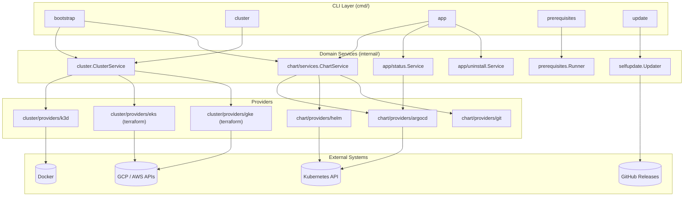
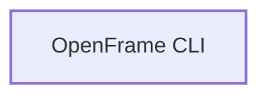
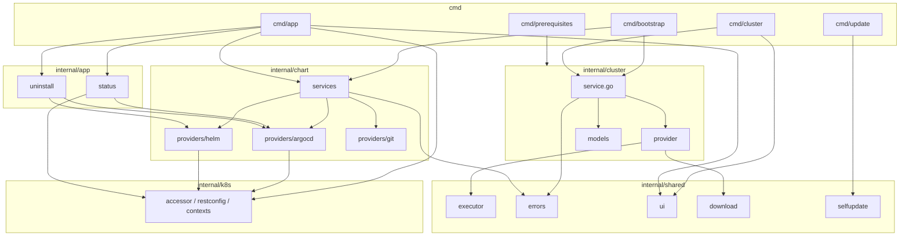
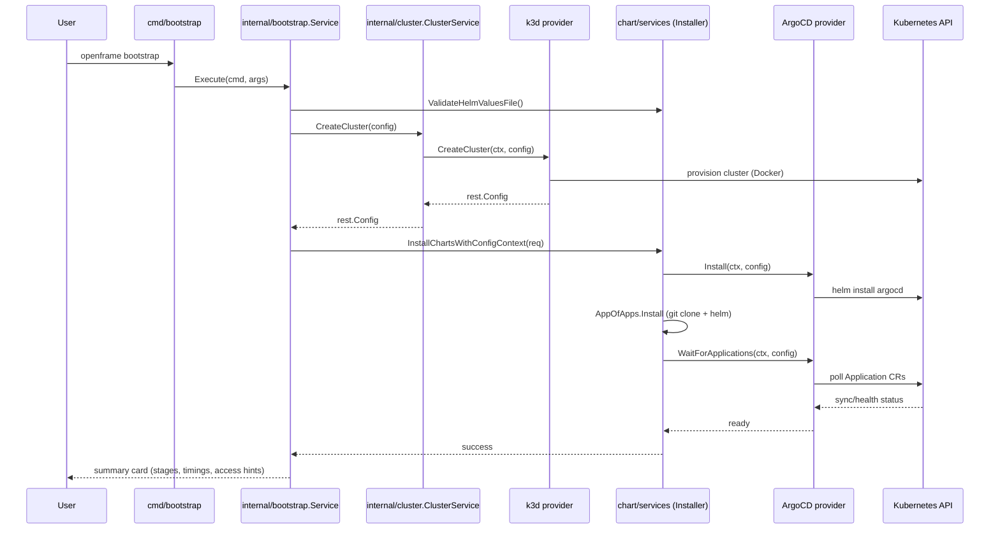
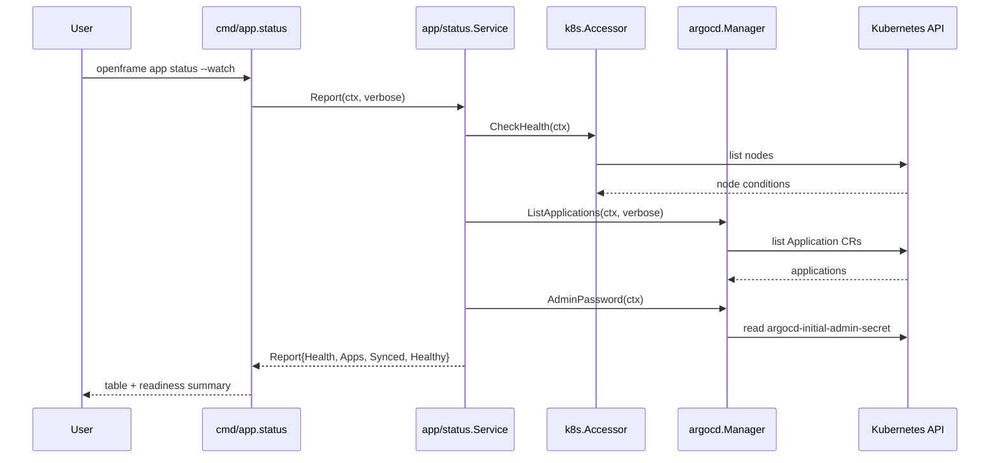

# Architecture Overview

OpenFrame CLI is a Go command-line tool, published as the `go` module `github.com/flamingo-stack/openframe-cli`, that provisions Kubernetes clusters (local k3d, or cloud GKE/EKS via Terraform) and deploys the OpenFrame platform onto them through ArgoCD's app-of-apps pattern. It manages the full lifecycle — prerequisites, cluster creation, chart installation, status monitoring, upgrades, and teardown — with both interactive wizards and non-interactive flags for CI/automation.

The actual OpenFrame platform (the application this CLI installs) lives in a separate repository, **flamingo-stack/openframe-oss-tenant** (https://github.com/flamingo-stack/openframe-oss-tenant). This CLI does not vendor or embed that platform's code; it clones its app-of-apps Helm chart from a configurable Git repository/ref at install time and drives the cluster/ArgoCD side of the deployment.

> Per the repository ecosystem graph, OpenFrame CLI has **no recorded upstream dependencies and no recorded downstream consumers** within the organization's repository graph — it is a leaf/terminal artifact there. Graph coverage is partial (some repositories, including CodeWiki, NATS Rust Client, and Registry, have no fresh snapshot), so this reflects what is currently indexed, not necessarily every integration that exists. Its functional dependencies are third-party Go modules and external CLI tools, detailed below — not sibling repositories in this ecosystem.

## High-Level Architecture

OpenFrame CLI is organized around three core abstractions — **cluster** (provisioning), **app** (platform deployment via ArgoCD), and **prerequisites** (tool verification/installation) — plus shared infrastructure for UI, command execution, and self-update.

The `internal/k8s` package deliberately isolates read/inspect access to an *existing* cluster (contexts, health, resources) from `internal/cluster`, which handles cluster *creation*. This separation lets `app install` target any reachable cluster — one made by `openframe cluster create`, or one the user set up directly.

### Repository role in the wider ecosystem

OpenFrame CLI publishes a single Go module artifact and has no in-graph consumers or dependencies recorded — it is an end-user/operator tool, not a library imported by other services in this organization. Its `internal/` packages are private implementation detail: there is no public Go API surface intended for import by other modules.

## Core Components

| Component | Path | Responsibility |
|---|---|---|
| Root command | `cmd/root.go` | Cobra root, version metadata, global flags (`--silent`, `--verbose`, `--plain`), pinned-dependency reporting |
| Bootstrap | `cmd/bootstrap/`, `internal/bootstrap/` | One-shot `cluster create` + `app install` with a staged progress tracker |
| Cluster commands | `cmd/cluster/` | `create`, `delete`, `list`, `status`, `use`, `cleanup` subcommands |
| Cluster service | `internal/cluster/service.go` | Cluster lifecycle orchestration, provider dispatch, existing-cluster reuse logic |
| Cluster providers | `internal/cluster/providers/k3d`, `internal/cluster/providers/eks`, `internal/cluster/providers/gke` | Backend-specific cluster create/delete/status via Docker/k3d or Terraform |
| Cluster discovery | `internal/cluster/discovery/` | Finds cloud clusters outside the openframe registry (GKE/EKS), gcloud/AWS auth flows |
| Cluster prerequisites | `internal/cluster/prerequisites/` | Type-aware tool gates (Docker/k3d/helm for k3d; terraform+CLI for EKS/GKE) |
| App commands | `cmd/app/` | `install`, `upgrade`, `status`, `access`, `uninstall` subcommands |
| Chart services | `internal/chart/services/` | Orchestrates ArgoCD + app-of-apps install, validation, retries |
| ArgoCD provider | `internal/chart/providers/argocd/` | ArgoCD Helm install, application listing/sync, admin password, wait logic |
| Helm provider | `internal/chart/providers/helm/` | Helm CLI wrapper for install/upgrade/uninstall |
| Git provider | `internal/chart/providers/git/` | Clones the app-of-apps chart repository at a given ref |
| App status | `internal/app/status/` | Aggregates cluster health + ArgoCD app sync/health into a `Report` |
| App status TUI | `internal/app/status/tui/` | Interactive k9s-style bubbletea view for navigating/syncing apps |
| App uninstall | `internal/app/uninstall/` | Removes ArgoCD applications and Helm releases, keeping the cluster |
| Prerequisites framework | `internal/prerequisites/` | OS-aware `Prerequisite`/`Set`/`Runner` abstraction (auto-install on macOS/Linux, docs-only on Windows) |
| k8s access | `internal/k8s/` | Kubeconfig context resolution, `rest.Config` building, cluster health/resource checks |
| Platform hints | `internal/platform/` | Per-OS install guidance, Windows/WSL cluster-access error messaging |
| Shared executor | `internal/shared/executor/` | `CommandExecutor` abstraction (real + mock) for all shelled-out commands |
| Shared errors | `internal/shared/errors/` | Structured error handling, retry policy, friendly hints |
| Shared UI | `internal/shared/ui/` | Logo, spinners, prompts, glyphs, GitHub Actions annotations, silent/plain modes |
| Shared download | `internal/shared/download/` | Checksum-verified pinned-tool downloads (k3d, helm, mkcert, terraform, infracost) |
| Self-update | `internal/shared/selfupdate/` | Checks/applies CLI updates, cosign signature + checksum verification, rollback |
| WSL launcher | `internal/shared/wsllauncher/` | Forwards the native Windows binary into WSL2 for cluster operations |

## Component Relationships

Note the explicit dependency injection in `cmd/app/install.go`: `buildInstallRequest` wires `ClusterAccess: cluster.NewClusterService(...)` into the `InstallationRequest` from the command layer (the composition root), keeping the `app` subsystem isolated from cluster-creation code rather than importing `internal/cluster` logic directly inside chart services.

## Data Flow

### Bootstrap Sequence

The `openframe bootstrap` command chains cluster creation and platform installation into a single staged workflow (`internal/bootstrap/service.go`), defaulting to a k3d cluster named `openframe-dev` when no name is given.

### App Status Aggregation

`openframe app status` (and its `--watch`/`--interactive` modes, plus `app access`) combine cluster health with ArgoCD application state via `internal/app/status.Service.Report`.

`Report.Ready()` only returns true when the cluster is reachable and every application is both `Synced` and `Healthy`; `Report.Summary()` (`internal/app/status/status.go`) is careful not to contradict itself when the node-health read fails (often RBAC-restricted) while applications still list successfully — it reports "node health unavailable" rather than falsely declaring the cluster unreachable.

## Key Design Decisions

- **Separation of cluster creation from cluster access.** `internal/cluster` (creation: k3d/EKS/GKE) is kept distinct from `internal/k8s` (read/inspect access to any already-existing cluster). This lets `app install` target a cluster made by `cluster create`, or any other reachable cluster the operator set up independently.

- **Composition root for dependency injection.** `cmd/app/install.go` injects a `cluster.ClusterService` into the chart layer's `InstallationRequest` from the command layer rather than letting `internal/chart` import `internal/cluster` directly, keeping the app/install subsystem decoupled from cluster-provisioning code.

- **All external tools are shelled out, never linked.** Docker, k3d, Helm, Terraform, gcloud, and aws are invoked through the `internal/shared/executor.CommandExecutor` abstraction (with a mock implementation for tests) instead of being linked as Go libraries. Their binaries are checksum-verified and version-pinned via `internal/shared/download` (see `internal/shared/download/pins.go` and `.verify.md`).

- **Native Kubernetes API access over shelling out to kubectl.** `client-go` (`k8s.io/client-go`) is used directly in `internal/k8s`, the ArgoCD provider, and the Helm provider, rather than invoking the `kubectl` binary.

- **Exact Terraform module/provider pins, not version ranges.** Both `internal/cluster/providers/eks/templates/main.tf` and `internal/cluster/providers/gke/templates/main.tf` pin exact module versions (e.g. `terraform-aws-modules/eks/aws` at `21.24.1`). The EKS template's comments record that a floating `~> 21.0` constraint once resolved to a new minor version whose changed defaults broke cluster creation three independent ways (no bootstrapped addons, an IMDS hop limit of 1, and a gated `kubernetes_version` data source) — pins are bumped deliberately, with a full create/delete pass re-run afterward.

- **Project-level cloud resources are provisioned outside Terraform state.** The GKE template deliberately does *not* manage `google_project_service` (API-enablement) resources in Terraform, because as `google_project_service` resources every cluster workspace sharing a GCP project would claim ownership of the same project-level toggles, and every `destroy` would plan their removal. The CLI enables required project APIs itself before Terraform runs.

- **Credential stripping before Helm invocation.** `internal/chart/models/appofapps.go`'s `GetGitURL()` always strips any embedded username/password (e.g. an `x-access-token:PAT@` prefix) from the Git repository URL before passing it to Helm's `helm-git` plugin, to avoid leaking tokens through process arguments or Helm release metadata.

- **Exit-code fidelity for automation.** `main.go` propagates a failed external command's real exit code (when it is a valid Unix code in the 1–255 range) rather than always exiting 1, so CI pipelines calling the CLI can distinguish failure modes. It also recognizes an `AlreadyHandledError` sentinel to avoid double-printing errors already surfaced through the UI's error handler.

- **Mutually exclusive, explicit upgrade modes.** `openframe app upgrade` deliberately rejects combining `--ref` and `--sync` rather than silently preferring one, because silently preferring `--sync` was found to force-sync the *current* ref while discarding an explicitly requested new ref — leaving the operator believing a new version had been deployed when it had not.

- **Non-interactive upgrades reuse existing values.** Mode 1 of `app upgrade` (`--ref`) runs non-interactively against the existing `openframe-helm-values.yaml` and sets `RequireExistingValues` on the installation request, so a scripted ref bump can never run with an empty values map (which would otherwise cause Helm to reset the release to chart defaults and wipe registry credentials or ingress settings) and never re-triggers certificate regeneration or the configuration wizard.

- **Safe uninstall ordering.** `internal/app/uninstall/uninstall.go` deletes ArgoCD `Application` CRs *before* uninstalling Helm releases, so ArgoCD can cascade workload cleanup while it is still running; it strips any stuck `Terminating` finalizers only *after* ArgoCD itself is gone, and removes the `app-of-apps` Helm release before the `argocd` release since the former owns the child Applications.

- **Go toolchain pinned for a specific Windows bug.** `go.mod` sets `toolchain go1.26.5` with an explanatory comment: Go 1.26.0/1.26.1 could crash at random on `windows-amd64` due to return addresses being corrupted during GC stack scanning, fixed in 1.26.2. CI and releases resolve the toolchain from this file, which is what keeps shipped Windows binaries off the buggy runtimes.

## Repository Structure Reference

For the generated architecture diagrams referenced above as standalone `.mmd` files, see `docs/diagrams/architecture/architecture-diagram.mmd`, `docs/diagrams/architecture/dependency-diagram.mmd`, `docs/diagrams/architecture/bootstrap-sequence.mmd`, and `docs/diagrams/architecture/app-status-aggregation.mmd`, indexed at [Architecture Diagrams](../../diagrams/architecture/README.md).

For the full command reference, module-by-module breakdown, and dependency listing, see [Architecture Reference Overview](../../reference/architecture/overview.md) and [Ecosystem Facts](../../reference/architecture/ecosystem.md). For environment setup before working on the CLI, see [Environment Setup](../setup/environment.md) and [Local Development](../setup/local-development.md).
