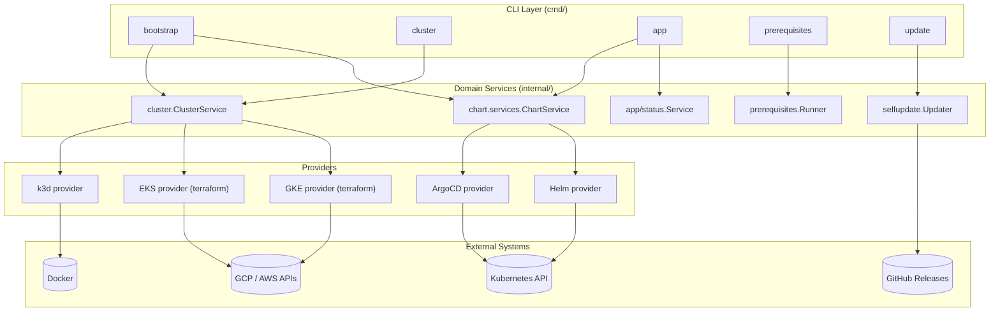
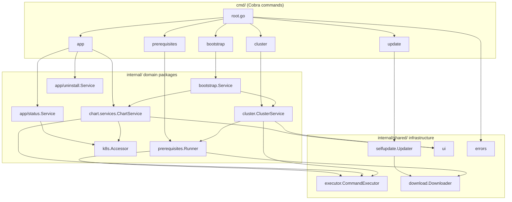
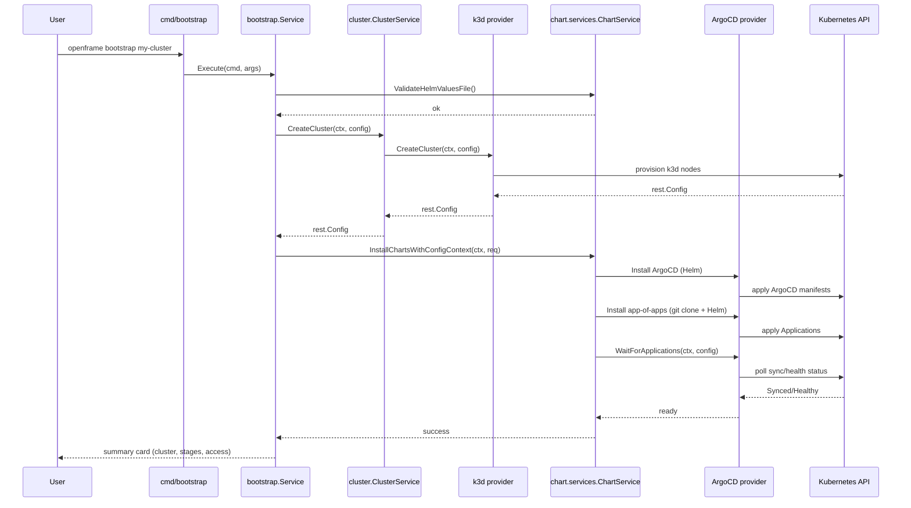

# Architecture Overview

OpenFrame CLI (`openframe`) is the Go-based command-line tool that provisions Kubernetes clusters and deploys the [OpenFrame](https://openframe.ai) platform by [Flamingo](https://flamingo.run) onto them. It provisions clusters locally via k3d or in the cloud via GKE/EKS through Terraform, then installs the platform using ArgoCD's app-of-apps pattern. The CLI also manages prerequisites, status monitoring, upgrades, teardown, and its own self-update, offering both interactive wizards and non-interactive flags for CI/automation.

The application code the CLI deploys lives in a separate, externally-maintained repository, [flamingo-stack/openframe-oss-tenant](https://github.com/flamingo-stack/openframe-oss-tenant) ("OpenFrame Main code Repository"). This CLI repository clones that repository's app-of-apps Helm chart at install/upgrade time and never embeds its source — treat it as an external dependency, not a local subdirectory.

> According to the organization's code graph, `openframe-cli` publishes a single Go module artifact — `github.com/flamingo-stack/openframe-cli` — and has **no recorded upstream dependencies on, nor downstream consumers from, any other repository the organization manages**. Index coverage for this fact is `full`, meaning the absence is confirmed rather than a gap in visibility. This is a standalone, user-facing CLI binary distributed via GitHub Releases and `go install`, not a library consumed by other services.

## High-Level Architecture

The CLI is organized around three core abstractions — **cluster** (provisioning), **app** (platform deployment via ArgoCD), and **prerequisites** (tool verification/installation) — plus shared infrastructure for UI, command execution, verified downloads, and self-update.

> **Windows note:** on Windows, the native build re-executes itself inside WSL2 (`internal/shared/wsllauncher`) before any cluster command runs. The local cluster path (Docker + k3d) and the native Kubernetes client (`client-go`) must share a network namespace that a native Windows process cannot reach reliably, so cluster operations are forwarded into a Linux environment.

A full-ecosystem view (this repository's published artifact and its organization-wide relationships) is available at `../../reference/architecture/ecosystem.md`; more granular, standalone Mermaid source files for the diagrams on this page live under `../../diagrams/architecture/README.md`.

## Core Components

| Component | Path | Responsibility |
|---|---|---|
| CLI entrypoint | `main.go`, `cmd/root.go` | Cobra root command, version metadata, global error/exit-code handling |
| Bootstrap | `cmd/bootstrap/`, `internal/bootstrap/` | One-shot "create cluster + install platform" flow with staged progress tracking |
| Cluster commands | `cmd/cluster/` | `create`, `delete`, `list`, `status`, `use`, `cleanup` subcommands |
| Cluster service | `internal/cluster/` | Cluster lifecycle orchestration, provider selection, registry of managed clusters |
| Cluster providers | `internal/cluster/providers/{k3d,eks,gke,terraform}` | Backend-specific cluster create/delete/status, unified behind the `provider.Provider` interface |
| Cluster discovery | `internal/cluster/discovery/` | Read-only discovery of external GKE/EKS clusters and gcloud/AWS auth flows |
| App commands | `cmd/app/` | `install`, `upgrade`, `status`, `access`, `uninstall` for the OpenFrame platform |
| Chart services | `internal/chart/` | ArgoCD + app-of-apps installation via Helm, git-based chart repo cloning, prerequisites |
| App status | `internal/app/status/`, `internal/app/status/tui/` | Aggregated platform health/sync report; k9s-style interactive TUI |
| App uninstall | `internal/app/uninstall/` | Ordered teardown of ArgoCD Applications, Helm releases, namespace |
| Prerequisites | `cmd/prerequisites/`, `internal/prerequisites/`, `internal/cluster/prerequisites/` | OS-aware tool detection/auto-install framework (Docker, k3d, helm, terraform, gcloud, aws) |
| Kubernetes access | `internal/k8s/` | Kubeconfig context handling, health/resource checks — read-only inspection of an existing cluster |
| Verified downloads | `internal/shared/download/` | SHA256-pinned, checksum-verified binary downloads (k3d, helm, mkcert, terraform, infracost) |
| Self-update | `internal/shared/selfupdate/`, `cmd/update/` | GitHub release check, cosign/Sigstore signature verification, in-place binary replacement, rollback |
| Command executor | `internal/shared/executor/` | Testable abstraction over external command execution (shell-out to docker/k3d/helm/terraform/gcloud/aws) |
| Shared UI | `internal/shared/ui/` | pterm/huh/bubbletea-based prompts, spinners, themed status printers, GitHub Actions annotations |
| Error handling | `internal/shared/errors/` | Structured error types, friendly hints, retry policy for transient failures |
| WSL launcher | `internal/shared/wsllauncher/` | Forwards the native Windows binary into WSL2 and auto-installs the Linux binary there |

### Component Relationships

The command layer (`cmd/`) never touches external tools directly. Every Cobra command delegates to a domain service in `internal/` (`cluster.ClusterService`, `chart.services.ChartService`, `app/status.Service`, `app/uninstall.Service`, `prerequisites.Runner`), and those services share the same `internal/shared/executor.CommandExecutor` abstraction to shell out to Docker, k3d, Helm, Terraform, gcloud, and the AWS CLI. This indirection is what lets the test suite under `tests/` substitute `internal/shared/executor/mock.go` for the real executor.

## Data Flow

The sequence below traces `openframe bootstrap`, the CLI's primary end-to-end flow: it chains cluster creation and platform installation into one command, driven by `internal/bootstrap/service.go`.

A second everyday flow is `openframe app status`, implemented in `cmd/app/status.go`. It resolves a `rest.Config` for the target kube-context (`resolveRestConfig`), builds an ArgoCD manager (`newArgoCDManager`) and a Kubernetes accessor (`k8s.NewAccessorForConfig`), then wires both into `appstatus.NewService`. `Service.Report` (in `internal/app/status/status.go`) aggregates three independent, best-effort sources — cluster health, the ArgoCD application list, and the admin password — into one `Report`, failing hard only if the application list itself cannot be read. The same `Service` backs three presentations: a single text/JSON/YAML report, a `--watch` polling loop (`watchStatus`), and the `--interactive` k9s-style TUI in `internal/app/status/tui/tui.go`.

`openframe app uninstall` (`cmd/app/uninstall.go`, orchestrated by `internal/app/uninstall/uninstall.go`) follows a deliberately ordered teardown: delete the ArgoCD `Application` resources first (so ArgoCD is still running to cascade workload cleanup), then uninstall the `app-of-apps` and `argocd` Helm releases in that order, then clear any finalizers left on stuck `Application` CRs, and only then optionally delete the `argocd` namespace. The cluster itself is never deleted by this path.

## Key Design Decisions

- **Three abstractions, one executor.** Cluster provisioning, platform deployment, and prerequisite management are kept as separate domains (`internal/cluster/`, `internal/chart/`, `internal/prerequisites/`), but all of them shell out through the same `internal/shared/executor.CommandExecutor` interface. This keeps every external-tool interaction testable via `internal/shared/executor/mock.go` without duplicating process-invocation logic per domain.
- **`client-go` over shelled-out `kubectl`.** The CLI uses `k8s.io/client-go` directly (`internal/k8s/`) for health checks, resource queries, and context resolution, rather than shelling out to `kubectl`, giving typed error handling and avoiding a `kubectl` dependency on the operator's machine.
- **Provider interface unifies heterogeneous cluster backends.** `internal/cluster/provider/factory.go` selects among k3d (local, Docker-based), EKS, and GKE (cloud, Terraform-based) behind one `provider.Provider` interface, so `cluster.ClusterService` and the `cmd/cluster/` commands stay backend-agnostic.
- **Pinned, exact Terraform module versions for cloud clusters.** Both `internal/cluster/providers/eks/templates/main.tf` and `internal/cluster/providers/gke/templates/main.tf` pin exact module versions rather than ranges. The EKS template's comments record that a floating `~> 21.0` constraint once resolved to a new minor version whose changed defaults broke cluster creation in three independent ways (no bootstrapped addons, an IMDS hop limit of 1, a gated `kubernetes_version` data source); version bumps are now deliberate, re-tested events.
- **Checksum-verified, pinned downloads — never `curl | bash`.** `internal/shared/download/pins.go` pins exact versions and SHA256 digests for every tool the CLI downloads on the operator's behalf (k3d, helm, mkcert, terraform, infracost), and `internal/shared/download/verify.go` is the shared verification substrate every installer uses.
- **Signed, verifiable self-update.** `openframe update` (`cmd/update/`, `internal/shared/selfupdate/`) checks GitHub Releases and verifies each downloaded binary's signature via Sigstore/cosign (`internal/shared/selfupdate/cosign.go`), anchored through TUF to the public-good Sigstore trust root, before replacing the running binary. `update rollback` reverts to the previously-installed version entirely offline, with no download.
- **Exit-code fidelity for automation.** `main.go` distinguishes errors already shown to the user (the `AlreadyHandledError` sentinel, which suppresses a duplicate stderr print) from unexpected ones, and — via `exitCode()` — propagates a failed external command's real exit code instead of collapsing every failure to a generic `1`, so CI pipelines calling `openframe` can branch on the underlying tool's failure mode.
- **WSL2 re-exec on Windows, not a native code path.** Rather than reimplementing cluster networking natively on Windows, `internal/shared/wsllauncher/launcher.go` forwards the native Windows binary into WSL2 (and auto-installs the Linux binary there) before any cluster command executes, reusing the same Linux-oriented k3d/Docker code path everywhere.
- **Guarded destructive operations.** Commands that can destroy cluster-wide state — `app uninstall`, `cluster delete` — require either an interactive confirmation prompt or an explicit `--yes`/`--force` flag, and `cmd/app/app.go`'s `noPositionalArgs` helper rejects stray positional arguments so a command like `app status` or `app uninstall` cannot silently target the wrong cluster through a typo.
- **Standalone binary, no internal consumers.** Per the organization's code graph (coverage: full), no other repository in the organization imports from or depends on `openframe-cli`, and it imports no other internally-published artifact. It is designed and distributed purely as an end-user binary (GitHub Releases, `go install`), not as a library for other services to embed.

## Runtime and External Dependencies

`go.mod` pins Go `1.26.0` with toolchain `1.26.5` — the module's own comment notes that Go `1.26.0`/`1.26.1` could crash intermittently on `windows-amd64` during GC stack scanning, and `1.26.5` is the toolchain that keeps shipped Windows binaries off that bug. Notable direct dependencies:

| Dependency | Used for |
|---|---|
| `github.com/spf13/cobra` | Command routing and flag parsing across the entire `cmd/` tree |
| `k8s.io/client-go`, `k8s.io/api`, `k8s.io/apimachinery` | Native Kubernetes API access, replacing shelled-out `kubectl` calls |
| `github.com/pterm/pterm` | Terminal rendering: tables, spinners, boxes, themed status printers |
| `github.com/charmbracelet/huh`, `github.com/charmbracelet/bubbletea` | Interactive prompts/wizards and the `app status --interactive` TUI |
| `github.com/sigstore/sigstore-go` | Cosign keyless signature verification for self-update integrity |
| `github.com/hashicorp/terraform-exec`, `github.com/hashicorp/terraform-json` | Driving Terraform for the EKS/GKE cluster providers |
| `github.com/go-git/go-git/v5` | Cloning the app-of-apps chart repository |
| `golang.org/x/mod` | Semantic version comparison for update/downgrade decisions |
| `sigs.k8s.io/yaml` | JSON/YAML round-tripping for `--output json|yaml` command output |

At runtime — not as Go dependencies, but orchestrated through `internal/shared/executor.CommandExecutor` — the CLI also shells out to Docker, k3d, Helm, Terraform, gcloud, and the AWS CLI.

## Hardware Requirements

| Resource | Minimum | Recommended |
|---|---|---|
| RAM | 24 GB | 32 GB |
| CPU Cores | 6 | 12 |
| Disk Space | 50 GB | 100 GB |

## Where to Go Next

For prerequisites and first-run setup, see `../../getting-started/introduction.md`, `../../getting-started/prerequisites.md`, and `../../getting-started/quick-start.md`. Task-specific walkthroughs are available for creating a cluster (`../../getting-started/how-to/create-a-new-kubernetes-cluster-with-openframe-cli.md`), installing the platform (`../../getting-started/how-to/install-the-openframe-platform-onto-a-cluster.md`), checking cluster/app status (`../../getting-started/how-to/check-the-status-of-your-openframe-cluster-and-apps.md`), upgrading (`../../getting-started/how-to/upgrade-openframe-cli-and-its-installed-apps.md`), and uninstalling (`../../getting-started/how-to/uninstall-openframe-and-delete-a-cluster.md`). For contribution workflow and local development, see `../README.md`, `../setup/environment.md`, and `../setup/local-development.md`.
