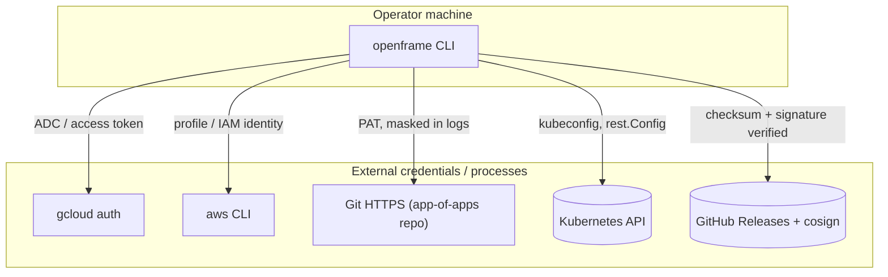

# Security

> OpenFrame CLI (`openframe`) is the bootstrap and lifecycle-management tool for the [OpenFrame](https://openframe.ai) platform built by [Flamingo](https://flamingo.run). It provisions Kubernetes clusters (locally via k3d, or in the cloud via GKE/EKS through Terraform) and installs the OpenFrame platform onto them via ArgoCD's app-of-apps pattern. The platform's own source lives in the separate [`flamingo-stack/openframe-oss-tenant`](https://github.com/flamingo-stack/openframe-oss-tenant) repository — this CLI only provisions infrastructure and drives the install.

This document covers how the CLI handles credentials, what it shells out to, how it validates input, the vulnerability classes most relevant to a CLI that wraps other CLIs, and how to report a real security issue.

## 1. Threat Model for a Provisioning CLI

Unlike a web service, OpenFrame CLI's attack surface is primarily:

- **Credentials it handles on behalf of the user** — cloud provider auth (gcloud, aws), Git tokens for cloning the app-of-apps chart repository, ArgoCD admin credentials, kubeconfig contents.
- **External processes it shells out to** — Docker, k3d, Helm, Terraform, `gcloud`, `aws`. Anything that reaches an `exec.Command` call is a potential command-injection surface if not handled carefully.
- **Artifacts it downloads and executes** — pinned installers for k3d, Helm, Terraform, mkcert, infracost, and the CLI's own self-update binary.
- **Generated infrastructure-as-code** — the Terraform root modules under `internal/cluster/providers/eks/templates/main.tf` and `internal/cluster/providers/gke/templates/main.tf`, which provision real cloud resources with real IAM permissions.

There is no network-facing API surface in this repository: per the organization's dependency graph (`get_repo_ecosystem`, coverage **full**), OpenFrame CLI publishes a single Go module (`github.com/flamingo-stack/openframe-cli`) and has no recorded downstream consumers — it is a standalone binary, not a library imported by other services. That means classic web-app concerns (sessions, CSRF, SQL injection) do not apply here; the concerns below are the ones that do.

## 2. Authentication and Authorization Patterns

OpenFrame CLI does not implement its own authentication system — it **delegates** to the identity provider of whatever backend it is driving, and never stores a long-lived credential itself.

### 2.1 Cloud provider authentication

- **GKE** — `internal/cluster/discovery/auth.go` implements `AuthFlow`, the single gcloud login flow every GKE-touching command goes through. `AuthFlow.Ensure(ctx, requireADC)`:
  - Checks `gcloud` is installed (`CLIMissing`) and authenticated (`NotAuthenticated`) via the `GKEDiscoverer`.
  - In an interactive session, offers to run `gcloud auth login` (and, when Terraform needs Application Default Credentials, `gcloud auth application-default login`) right there, using a terminal-attached subprocess (`runLogin`) so browser-based OAuth flows work.
  - In a **non-interactive** session (CI), it never prompts — it returns an actionable error telling the operator to run the `gcloud` command manually.
  - `hasFreshLogin` deliberately calls `gcloud auth print-access-token --quiet` rather than `gcloud auth list`, because `auth list` reports an **expired** account as still `ACTIVE` — the token-mint check is the only way to catch a stale-but-apparently-active login before it fails deep inside Terraform.
- **EKS/AWS** — authentication flows through the `aws` CLI and the identity it resolves (profile or environment credentials); see `cmd/cluster/aws_identity.go` and `internal/cluster/prerequisites/aws/aws.go`. The CLI does not read or store AWS secret keys itself.
- **Kubernetes** — `internal/k8s/accessor.go`, `internal/k8s/contexts.go`, and `internal/k8s/restconfig.go` build a `rest.Config` from the user's existing kubeconfig context; the CLI is read-only with respect to cluster health checks and relies on whatever RBAC the kubeconfig's identity already has.

### 2.2 Git authentication for the app-of-apps repository

`internal/chart/providers/git/auth.go` isolates all Git HTTP credential handling:

- `extractGitAuth(rawURL)` parses a clone URL and separates any embedded credential from it, returning a `gitAuth{cleanURL, username, token}`. It specifically handles the common GitHub PAT shorthand `https://<token>@host` (a single-field userinfo with no password), promoting that single field to the token role rather than silently dropping it.
- `gitAuth.buildAuth()` returns a go-git `transport.AuthMethod` (HTTP Basic) built **only in memory** — the token is handed to go-git directly, never written back into a URL, into `argv`, or onto disk. This keeps the token off `ps`/`/proc/<pid>/cmdline` and out of any credentials file.
- `GitTokenUser = "x-access-token"` is the conventional username used when none is present in the URL (the token itself is the password).
- `maskToken(s, token)` redacts every occurrence of the token in a string with `***`, used to make clone URLs safe to log.

Because the OSS deployment (`oss-tenant`) clones from a **public** repository, `internal/chart/services/validation.go`'s `ConfigurationValidator.ValidateConfiguration` is intentionally a no-op: no credentials are required for that path, and the comment in the code marks this as the extension point if a credentialed deployment type is added later.

### 2.3 ArgoCD and Helm authorization

- `openframe app access` (`cmd/app/access.go`) is the one command that surfaces ArgoCD admin credentials to the operator, for logging into the ArgoCD UI directly.
- `internal/chart/providers/argocd/` drives ArgoCD purely through its Kubernetes `Application` CRDs (sync/health polling, diagnostics) using the same `rest.Config` as the rest of the CLI — there is no separate ArgoCD API token management.
- `internal/app/uninstall/uninstall.go` removes the platform in a deliberately safe order (Applications → Helm releases → finalizers → namespace) specifically to avoid leaving orphaned, improperly-deprovisioned resources that could linger with stale permissions.

> **Note:** `cmd/app/app.go` enforces `noPositionalArgs` on every `app` subcommand. This is a deliberate authorization-adjacent guard: Cobra's default `ArbitraryArgs` would otherwise let `openframe app status my-eks` **silently** run against whatever kube-context happens to be current instead of the one the operator named — destructively so, in the case of `uninstall`. Use `--context` to target a specific cluster instead of a bare positional argument.

## 3. Data Encryption and Secure Storage

OpenFrame CLI does not operate its own datastore or persist application data; "secure storage" here means **how it avoids persisting secrets it is only supposed to pass through**.

| Concern | Mechanism | Source |
|---|---|---|
| Git PAT for cloning the chart repo | Extracted from the URL, used via an in-memory `transport.AuthMethod`, never written to a URL, file, or argv | `internal/chart/providers/git/auth.go` |
| Download integrity (k3d, Helm, Terraform, mkcert, infracost) | Pinned exact versions with SHA256 checksum verification before any binary is trusted or executed | `internal/shared/download/pins.go`, `internal/shared/download/verify.go` |
| Self-update binary integrity | Checksum verification **and** cosign/Sigstore keyless signature verification before the running binary is replaced | `internal/shared/selfupdate/cosign.go`, `internal/shared/selfupdate/update.go` |
| Self-update failure recovery | Explicit rollback path so a corrupted or malicious replacement cannot be left in place silently | `internal/shared/selfupdate/rollback.go` |
| Terraform state secrets (cluster CA data, endpoint) | Marked `sensitive = true` in Terraform outputs for the GKE module | `internal/cluster/providers/gke/templates/main.tf` |

The EKS and GKE Terraform root modules (`internal/cluster/providers/eks/templates/main.tf`, `internal/cluster/providers/gke/templates/main.tf`) are **generated and owned by the CLI** — the header comment on each file explicitly says "do not edit by hand". Module versions are **exact pins**, not ranges: the EKS template's comment records that a floating `~> 21.0` constraint once resolved to a new minor release whose changed defaults broke cluster creation in three independent ways. Treat any change to these pins as a deliberate, tested action, not a routine bump.

Notable hardening already baked into the generated infrastructure:

- **EKS**: IMDS is required to use IMDSv2 (`http_tokens = "required"`) with a hop limit of 2 — high enough for the EBS CSI controller (which is not on host network) to reach instance metadata, but still IMDSv2-only rather than open.
- **GKE**: nodes are private (`enable_private_nodes = true`, `enable_private_endpoint = false`) with no external IPs, egress routed through a dedicated Cloud NAT — compatible with organizations enforcing `constraints/compute.vmExternalIpAccess`. The API endpoint itself stays public so the operator's machine can reach it without a VPN.
- Both templates tag every cluster-owned cloud resource (`openframe:cluster` / `openframe-cluster`) so the CLI's teardown logic (see `internal/cluster/providers/eks/teardown.go`, `internal/cluster/providers/gke/teardown.go`) can find and remove resources created outside Terraform state, such as CSI-provisioned EBS volumes.

## 4. Secrets Handling and Redaction in Output

Because the CLI's entire job is to shell out to other tools and surface their output to the operator, accidental secret leakage into terminal output or logs is a first-class concern.

- `internal/shared/redact/redact.go` exposes `Redact(s string)`, used to scrub sensitive substrings out of text before it is shown or logged. It is called from:
  - `internal/chart/providers/helm/manager.go`'s `HelmManager.InstallArgoCDWithProgress` — redacting Helm's own progress/error output before it reaches the terminal.
  - `internal/shared/executor/executor.go`'s `RealCommandExecutor.ExecuteWithOptions` — the single choke point through which **every** shelled-out command's output passes, making redaction apply uniformly regardless of which subcommand is running.
- `maskToken` (see §2.2) is the Git-specific counterpart, used specifically for clone URLs that may embed a PAT.
- `internal/shared/executor/lognoise.go` filters routine, non-sensitive noise from subprocess output separately from redaction — keep these concerns distinct when touching either file: filtering for readability is not a substitute for redacting secrets.

If you add a new code path that shells out to a tool capable of echoing a credential (a new cloud CLI, a new Helm plugin, etc.), route its output through the same `CommandExecutor` abstraction (`internal/shared/executor/executor.go`) rather than calling `os/exec` directly, so it inherits redaction automatically. `internal/cluster/discovery/auth.go` is a deliberate, documented exception: its `runLogin` seam calls `os/exec` directly because an OAuth browser flow must attach to the real terminal's stdin/stdout — bypass the capturing executor only for that same reason, never to avoid redaction.

## 5. Input Validation and Sanitization

### 5.1 Command argument validation

- `cmd/app/app.go`'s `noPositionalArgs` (described in §2.3) rejects any stray positional argument on `app` subcommands with an explicit error naming `--context` as the correct way to target a cluster, instead of letting Cobra's default `ArbitraryArgs` silently ignore it.
- Cluster names, cloud regions/projects/profiles, and node counts passed via flags (`--type`, `--nodes`, `--region`, `--project`, `--profile`, `--ha`, `--spot` on `cluster create`) are validated by the relevant provider and config-building code (`internal/cluster/models/flags.go`, `internal/chart/utils/config/builder.go`) before being interpolated into generated Terraform variables (`terraform.tfvars.json`) or passed to subprocess arguments.

### 5.2 Subprocess argument construction

The CLI shells out extensively (Docker, k3d, Helm, Terraform, gcloud, aws). The consistent pattern across the codebase is:

- Build argument lists as **fixed argv slices assembled by the CLI's own code**, not by interpolating untrusted strings into a shell string. `internal/cluster/discovery/auth.go`'s `runLogin` is explicit about this in its `#nosec G204` justification comment: "fixed argv assembled by this package, no user input" — the gocritic/gosec exception is scoped and documented, not blanket-suppressed.
- Route execution through `internal/shared/executor/executor.go`'s `CommandExecutor` interface, which has a real implementation and a `MockCommandExecutor` (`internal/shared/executor/mock.go`) used throughout the test suite — this means every command invocation is unit-testable without actually invoking Docker/Terraform/etc., which in turn means argument-construction logic gets exercised by tests rather than only by manual QA.

When adding a new subprocess call, follow the same pattern: construct the argv as a slice built from already-validated values, go through `CommandExecutor`, and add a `#nosec` justification comment only when the surrounding code genuinely has no untrusted input reaching the command line.

### 5.3 Downloaded artifact verification

`internal/shared/download/` is the CLI's answer to "never `curl | bash`":

- `pins.go` holds exact pinned versions and SHA256 checksums for k3d, Helm, Terraform, mkcert, and infracost.
- `verify.go` checks a downloaded artifact's checksum against the pin before it is treated as trusted.
- `progress.go` handles user-facing download progress separately from verification, so verification is never skipped for the sake of a smoother progress bar.

Any new third-party binary the CLI needs to fetch should be added to `pins.go` with an explicit version and checksum, following the existing pattern, rather than downloaded "latest" and trusted implicitly.

## 6. Common Security Vulnerabilities and Mitigations

| Vulnerability class | Relevance to this CLI | Mitigation in place |
|---|---|---|
| Command injection via subprocess args | High — the CLI shells out to Docker/k3d/Helm/Terraform/gcloud/aws constantly | Fixed argv slices assembled internally, routed through `CommandExecutor`; `#nosec G204` only where justified and documented (`internal/cluster/discovery/auth.go`) |
| Secret leakage in logs/terminal output | High — Helm, Terraform and Git all produce verbose output that can embed tokens | Central `Redact` function (`internal/shared/redact/redact.go`) wired into the single `CommandExecutor` choke point and into Helm's progress reporting |
| Secrets in URLs / argv / disk | Medium — Git clone URLs and cloud CLI calls can embed credentials | `extractGitAuth`/`buildAuth` keep tokens in memory only (`internal/chart/providers/git/auth.go`) |
| Supply-chain tampering of downloaded tools | Medium — k3d/Helm/Terraform/mkcert/infracost binaries are fetched and executed | Pinned versions + SHA256 verification (`internal/shared/download`) |
| Supply-chain tampering of the CLI's own self-update | High — a compromised update would run with the operator's full local and cloud privileges | Checksum **and** cosign/Sigstore signature verification before applying (`internal/shared/selfupdate/cosign.go`), with a rollback path (`internal/shared/selfupdate/rollback.go`) |
| Retrying a destructive or already-applied operation | Medium — naive retry-on-any-error could reinstall an already-installed ArgoCD, or resend a request that already landed | `NonRetryableError` interface explicitly vetoes retry regardless of error text (`internal/shared/errors/retry_policy.go`); structural classification (`classifyTransient`) is checked before any substring-matching fallback |
| Targeting the wrong cluster | Medium (destructive for `uninstall`) | `noPositionalArgs` on `app` subcommands forces explicit `--context` targeting (`cmd/app/app.go`) |
| Insecure generated cloud infrastructure | Medium — Terraform templates provision real IAM roles, network paths, and node metadata access | IMDSv2-only with a minimal hop limit (EKS), private nodes with no external IPs plus Cloud NAT egress (GKE), exact module version pins on both |
| Orphaned cloud resources after teardown | Low/operational — CSI-provisioned volumes exist outside Terraform state | Cluster-name tagging (`openframe:cluster`) lets the CLI's orphan-sweep teardown logic find and remove them |

### Retry-safety as a security property

`internal/shared/errors/retry_policy.go` deserves a specific callout: its `RetryableErrs` substring table only matches strings that the **actual tools in this stack** emit (verified against the Go standard library and Helm/kubectl behavior — the file's comments explicitly note that previously-listed substrings like `"tiller not ready"` and `"network timeout"` could never have matched anything real). An error-classification table that matches on vibes rather than verified tool output risks retrying an operation that already succeeded destructively, or failing to retry one that is genuinely transient — both are security-relevant failure modes for a tool that provisions and destroys infrastructure.

## 7. Security Testing and Code Review Guidelines

### 7.1 Testability as a security control

The `CommandExecutor` abstraction (`internal/shared/executor/executor.go`, with `MockCommandExecutor` in `internal/shared/executor/mock.go`) exists specifically so that command construction — the part of the codebase most exposed to injection risk — can be exercised by unit tests without touching a real shell. When adding or changing any code that shells out:

- Write or extend tests that assert on the **exact argv** passed to the mock executor, not just on the final success/failure outcome.
- Review the test helpers under `tests/testutil/` (`command_assertions.go`, `flag_contract.go`, `assertions.go`) and the integration test helpers under `tests/integration/common/` (`cli_runner.go`, `cluster_management.go`, `dependencies.go`) for existing patterns before writing new assertions from scratch.

### 7.2 Code review checklist for security-relevant changes

When reviewing a change that touches credentials, subprocess execution, or generated infrastructure, check for:

- **No credential ever reaches `argv` or a file.** Any new auth flow should follow `internal/chart/providers/git/auth.go`'s pattern: parse, hold in memory, build an in-memory auth method, mask for logging.
- **Any `#nosec` suppression carries a specific justification comment**, as in `internal/cluster/discovery/auth.go` ("fixed argv assembled by this package, no user input") — not a blanket suppression.
- **New subprocess output flows through `CommandExecutor`**, so it inherits redaction, rather than calling `os/exec` directly (the one documented exception being an interactive OAuth login that must attach to the real terminal).
- **New retryable-error substrings are verified against the tool's actual output**, not assumed, and anything that must never be retried (e.g., a result that may have already partially applied) implements `NonRetryableError` rather than relying on the substring table to simply not match.
- **Changes to the generated Terraform templates are tested with a full create/delete pass**, per the EKS template's own comment about module version bumps — a change that "looks fine" in a plan can still alter defaults in ways that only surface at apply or destroy time.
- **Non-interactive (CI) code paths never prompt.** Follow `AuthFlow.Ensure`'s pattern: check `interactive()` first, and return an actionable error with the manual command to run when it is false.

### 7.3 Reporting a vulnerability

This repository follows the organization-wide Flamingo AI Security Policy. Report a suspected vulnerability to **security@flamingo.run** — do not open a public GitHub issue, pull request, or discussion for a security problem, and do not post it in a community channel, since a public report puts every user at risk before a fix exists. Include the affected command or file, the version/commit, what an attacker could do with it, and reproduction steps.

The policy commits to acknowledging a report within 3 business days, an initial severity assessment within 10 business days, and progress updates at least every 30 days until the issue is closed, with a target of 90 days to fix confirmed vulnerabilities. Security research under the policy's guidelines (test only against resources you own or have permission to use, stop immediately on encountering real credentials or another user's data, no denial-of-service testing) is treated as authorized.

In scope for that policy: the source code in the public repositories of the flamingo-stack GitHub organization, including this CLI. Out of scope: vulnerabilities in third-party tools this CLI shells out to (Docker, k3d, Helm, Terraform, gcloud, aws) that are not caused by how this CLI invokes them — report those upstream, but tell Flamingo too if OpenFrame users are affected.

## 8. Environment Variables and Secrets Management

OpenFrame CLI's own configuration surface is deliberately small and does not define application secrets of its own — it is a provisioning tool that passes through credentials owned by other systems (cloud providers, Git hosts, Kubernetes clusters).

- `internal/shared/config/envbool.go` centralizes how the CLI parses boolean environment-variable overrides, giving a single, tested definition of "truthy" across every flag that can also be set via environment variable rather than each call site inventing its own parsing.
- `internal/shared/config/system.go` and `internal/shared/config/transport.go` hold other environment-derived system and transport configuration.
- **Never pass a credential as a literal command-line flag value** if an environment variable or an interactively-prompted, in-memory value is available instead — flag values are visible in shell history and in `ps` output on multi-user systems, which is exactly the exposure that `internal/chart/providers/git/auth.go` goes out of its way to avoid for Git tokens.
- The CLI relies on each underlying tool's own credential convention rather than reinventing one: `gcloud`'s own credential store for GKE, the `aws` CLI's profile/credential chain for EKS, and the operator's existing kubeconfig for cluster access. Do not add a new, CLI-specific credential file format without a clear reason — it adds another place secrets can be forgotten on disk.
- When documenting or scripting against this CLI, prefer environment variables or the interactive prompts (`internal/shared/ui/prompts.go`) for anything secret, and never hardcode a credential, token, or password in an example — this document deliberately does not include any example credential values; refer to your environment configuration for the actual values used in your setup.

## Related Reading

For how the CLI's commands and providers fit together architecturally (useful context when assessing the blast radius of a given change), see the architecture overview. For environment and local development setup, including which tools must be installed before running the CLI against a real cluster, see the environment setup guide. For the test suite and how to extend it with new executor-mock assertions, see the testing guide. For the PR and commit conventions expected for any change, including security-relevant ones, see the contributing guidelines.
