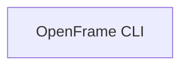

## Development Environment Setup

This guide covers setting up a local development environment for the **OpenFrame CLI** (`openframe`), the Go-based command-line tool that bootstraps and manages the [OpenFrame](https://openframe.ai) platform by [Flamingo](https://flamingo.run). It provisions Kubernetes clusters (k3d locally, GKE/EKS in the cloud via Terraform) and deploys the OpenFrame platform onto them through ArgoCD's app-of-apps pattern.

> **Note on scope:** This repository (`flamingo-stack/openframe-cli`) contains only the CLI binary's source. The platform application code it deploys lives in the separate [`flamingo-stack/openframe-oss-tenant`](https://github.com/flamingo-stack/openframe-oss-tenant) repository, which the CLI clones at install/upgrade time. Per the organization's repository graph, `openframe-cli` publishes a single Go module (`github.com/flamingo-stack/openframe-cli`) and has no recorded upstream dependencies or downstream consumers within the organization — it is a standalone, user-facing binary distributed via GitHub Releases and `go install`, not a library other repositories import.

Before proceeding, make sure you have reviewed the general prerequisites in `../../getting-started/prerequisites.md` and the quick-start flow in `../../getting-started/quick-start.md`.

### Hardware requirements

Because the CLI's primary job is to provision a Kubernetes cluster (local or cloud) and run the full OpenFrame platform on it, your development machine needs headroom beyond what building the Go binary itself requires:

| Resource | Minimum | Recommended |
|---|---|---|
| RAM | 24 GB | 32 GB |
| CPU Cores | 6 | 12 |
| Disk Space | 50 GB | 100 GB |

---

## 1. Required development tools

The module declaration in `go.mod` pins the toolchain explicitly:

```text
module github.com/flamingo-stack/openframe-cli

go 1.26.0
toolchain go1.26.5
```

> The `go.mod` comment notes that Go 1.26.0/1.26.1 crash intermittently on Windows-amd64 during GC stack scanning (a known upstream Go issue); the pinned `toolchain go1.26.5` line is what keeps CI and release builds off the affected runtimes. Match this toolchain locally rather than whatever `go` version happens to be on `$PATH`.

### Core toolchain

| Tool | Why it's needed |
|---|---|
| Go 1.26.x (toolchain `go1.26.5`) | Builds and tests the CLI; `go install github.com/flamingo-stack/openframe-cli@latest` is one of the documented installation paths |
| Git | Source control, and the CLI itself shells out to git-style operations via `go-git/go-git/v5` (vendored, no system git required for runtime, but useful for development) |
| Docker | Required to run the local k3d cluster that `openframe cluster create` / `openframe bootstrap` provision |
| `golangci-lint` v2 | Static analysis gate — see `.golangci.yml` at the repository root |

### Runtime dependencies shelled out to by the CLI

The CLI does not vendor these as Go dependencies; instead it orchestrates them at runtime through the `internal/shared/executor` abstraction (`internal/shared/executor/executor.go`). Having them installed locally lets you exercise the full `cluster create` / `app install` flows during development:

- **Docker** — backs local k3d clusters
- **k3d** — local Kubernetes cluster provider (`internal/cluster/providers/k3d/manager.go`)
- **Helm** — installs ArgoCD and the app-of-apps chart (`internal/chart/providers/helm/manager.go`)
- **Terraform** — provisions EKS/GKE clusters (`internal/cluster/providers/terraform/engine.go`)
- **gcloud** — GKE cluster auth and discovery (`internal/cluster/prerequisites/gcloud/gcloud.go`)
- **AWS CLI** — EKS cluster auth and discovery (`internal/cluster/prerequisites/aws/aws.go`)

Several of these (k3d, Helm, mkcert, Terraform, infracost) are instead **downloaded and version-pinned by the CLI itself** through `internal/shared/download/`, with every download checksum-verified against the pins recorded in `internal/shared/download/pins.go` before use — never fetched via an unverified `curl | bash`. You generally do not need to pre-install these yourself; running `openframe prerequisites check` (see `cmd/prerequisites/prerequisites.go`) reports what is missing, and `openframe prerequisites install` auto-installs on macOS/Linux (Windows prints manual install links instead, handled in `internal/prerequisites/runner.go`).

### Key third-party Go libraries (from `go.mod`)

These shape how you'll read and extend the codebase:

| Library | Role |
|---|---|
| `github.com/spf13/cobra` | Command routing and flag parsing for the entire `cmd/` tree |
| `k8s.io/client-go` | Native Kubernetes API access (health checks, resource queries, context resolution) |
| `github.com/pterm/pterm` | Terminal rendering — tables, spinners, boxes, themed status printers |
| `github.com/charmbracelet/huh`, `github.com/charmbracelet/bubbletea` | Interactive prompts/wizards and the `app status --interactive` TUI |
| `github.com/sigstore/sigstore-go` | Cosign keyless signature verification for self-update integrity |
| `github.com/hashicorp/terraform-exec`, `github.com/hashicorp/terraform-json` | Drives Terraform plans/applies for EKS/GKE and parses their JSON output |
| `github.com/go-git/go-git/v5` | Git operations for cloning the app-of-apps chart repository |
| `golang.org/x/mod` (`semver`) | Semantic version comparison for update/downgrade decisions |
| `sigs.k8s.io/yaml` | JSON/YAML round-tripping for `--output json|yaml` command output |

---

## 2. IDE recommendations and setup

The repository is a plain Go module (no `package.json` or Maven/Gradle build, confirmed by the absence of a frontend or backend manifest in this repository) — any Go-aware editor works, but the two most common choices in the team are:

### GoLand / IntelliJ (with the Go plugin)

1. Open the repository root (where `go.mod` lives) as the project root.
2. Point the Go SDK setting at a Go 1.26.x installation matching the `toolchain` line in `go.mod`.
3. Enable "Go Modules" integration (it is auto-detected from `go.mod`).
4. Configure the bundled `golangci-lint` integration to read `.golangci.yml` from the repository root so inline lint warnings match what CI enforces.

### VS Code

1. Open the repository root.
2. Install the official Go extension (`golang.go`). It will prompt to install supporting tools (`gopls`, `dlv`, `goimports`) on first open — accept these, they back code navigation, debugging, and formatting.
3. Set `"go.lintTool": "golangci-lint"` and `"go.lintFlags": ["--config=.golangci.yml"]` in your workspace settings so inline diagnostics match the configuration in `.golangci.yml`.
4. Enable "format on save" with `goimports` as the formatter to keep import grouping consistent with the codebase's alias conventions (see below).

### Editor extensions/plugins

| Editor | Extension | Purpose |
|---|---|---|
| VS Code | `golang.go` | Core Go language support: `gopls`, debugging, test run/debug lenses |
| VS Code | A YAML extension | Editing Helm values files and Terraform-adjacent YAML (the chart configuration wizard reads/writes `openframe-helm-values.yaml`) |
| VS Code / GoLand | HashiCorp Terraform extension | Syntax/validation support for the embedded Terraform templates under `internal/cluster/providers/eks/templates/main.tf` and `internal/cluster/providers/gke/templates/main.tf` |
| GoLand | Built-in Go plugin | SDK management, test runner, debugger, refactoring |

> There is no frontend package manifest in this repository (`packageJsonPath` is not set), so no JavaScript/TypeScript tooling (ESLint, Prettier, etc.) applies here.

---

## 3. Static analysis and linting

The repository root `.golangci.yml` configures **golangci-lint v2**, added specifically as "the primary drift detector across the codebase" per its own comments. Run it locally before pushing:

```bash
golangci-lint run ./...
```

Key points from the configuration:

- `linters.default: standard` — the v2 standard set (`errcheck`, `govet`, `ineffassign`, `staticcheck`, `unused`) is the baseline.
- Additionally enabled: `gosec` (security — subprocess execution, file paths, file permissions, unverified downloads), `bodyclose`, `errorlint`, `misspell`.
- `gosec.excludes: []` — the full default rule set is kept; security rules are never silently excluded.
- `govet.enable-all: true`, with `fieldalignment` and `shadow` explicitly disabled as noise exclusions.
- Test files (`_test\.go`) are exempted from `errcheck` and `gosec` — tests intentionally ignore some errors and use weak fixtures.
- `issues.max-issues-per-linter: 0` and `max-same-issues: 0` — every finding is shown, nothing is capped, so the backlog stays visible.

This repository also enforces a set of organization- and repository-specific code review rules beyond what `golangci-lint` checks mechanically — for example, that every Cobra command group is returned by a `Get<Group>Cmd()` factory (not constructed inline), that service types are unexported structs instantiated only via a `New<Name>Service` constructor, that errors already shown to the user are wrapped in `AlreadyHandledError` before returning to `main`, and that cross-package imports which would collide on their last path segment (e.g. two packages both named `config` or `ui`) carry a disambiguating camelCase alias such as `sharedErrors` or `chartServices`. Review these conventions against the actual source in `internal/` and `cmd/` as you work — they are enforced on every pull request.

---

## 4. Environment variables for development

The CLI reads configuration primarily from flags and from the Helm values file it manages (`openframe-helm-values.yaml`, resolved via `internal/chart/utils/config/paths.go`'s `DefaultHelmValuesFile` constant), rather than from a `.env` file. The environment variables that matter during development are the ones the underlying tools (Docker, gcloud, AWS CLI, Terraform, Kubernetes) already expect:

| Variable | Purpose |
|---|---|
| `$PATH` | Must include the directory holding the `openframe` binary if built locally (e.g. via `go build`), plus `docker`, `helm`, `k3d`, `terraform`, `gcloud`, and `aws` if you pre-install them instead of letting the CLI auto-install them |
| `$KUBECONFIG` | Standard kubeconfig path used by `k8s.io/client-go` when the CLI reads cluster context/health (`internal/k8s/accessor.go`, `internal/k8s/contexts.go`, `internal/k8s/restconfig.go`) |
| `$HOME` | Used to resolve the certificate directory at `$HOME/.config/openframe/certs`, created automatically by `GetCertificateDirectory()` in `internal/chart/utils/config/paths.go` if it does not already exist |
| `$GOPATH` / `$GOBIN` | Standard Go toolchain locations; relevant if you install the CLI with `go install github.com/flamingo-stack/openframe-cli@latest` |

> Docker registry credentials, Ngrok API keys/auth tokens, and similar secrets are **not** environment variables — they are collected interactively by the chart configuration wizard (`internal/chart/ui/configuration/docker.go`, `internal/chart/ui/configuration/ingress.go`) and immediately registered with the redaction helper (`redact.RegisterSecret`) so they never leak into verbose logs or error output. Refer to your environment configuration for any registry or tunnel credentials you need to supply interactively; do not hardcode them.

### Cloud provider authentication

For EKS/GKE development flows, authenticate through the respective CLI tools before running `openframe cluster create --type eks` or `--type gke`:

- **AWS**: standard AWS CLI credential resolution (`~/.aws/credentials`, `$AWS_PROFILE`, or environment-based credentials) — consumed by `internal/cluster/prerequisites/aws/aws.go` and the generated Terraform workspace's `profile` variable (see `internal/cluster/providers/eks/templates/main.tf`).
- **GCP**: `gcloud auth login` / `gcloud auth application-default login` — consumed by `internal/cluster/prerequisites/gcloud/gcloud.go` and the generated Terraform workspace's `project`/`region` variables (see `internal/cluster/providers/gke/templates/main.tf`).

Both generated Terraform root modules pin exact module/provider versions deliberately (the EKS template's comments explain that a floating `~> 21.0` constraint once broke cluster creation three separate ways after a minor version bump) — do not loosen these pins locally without re-running a full create/delete pass.

---

## 5. Building and running locally

```bash
# Build the binary
go build -o openframe .

# Run unit tests (the Makefile's test-unit target excludes tests/integration/...)
go test ./...

# Run static analysis
golangci-lint run ./...
```

Integration tests under `tests/integration/` require Docker/k3d and real external binaries; they are gated behind the `integration` build tag and are intentionally excluded from a plain `go test ./...` run. See `tests/integration/common/cli_runner.go`, `tests/integration/common/cluster_management.go`, and `tests/integration/common/dependencies.go` for how they drive the CLI end-to-end, and `../testing/README.md` for the project's testing conventions in more depth.

For a day-to-day local development loop — building, running against a local k3d cluster, and iterating — see `./local-development.md`. For the broader architecture this CLI implements (command layer, domain services, providers), see `../architecture/README.md` and the reference architecture document at `../../reference/architecture/overview.md`, which includes the full component diagram and bootstrap sequence. Security-sensitive conventions (checksum-verified downloads, cosign/Sigstore verification for self-update, secret redaction) are covered in `../security/README.md`. Contribution conventions, including commit and PR expectations, are in `../contributing/guidelines.md`.

### Trying the CLI against a real cluster

Once built, the fastest way to validate a local change end-to-end is the one-shot bootstrap flow:

```bash
./openframe bootstrap my-dev-cluster --verbose
```

This chains `cluster create` (k3d by default) and `app install` (ArgoCD + app-of-apps) in one step, per `internal/bootstrap/service.go`. For more granular control while developing a specific area, use the subcommands directly — `openframe cluster create`, `openframe app install`, `openframe app status --interactive` (the k9s-style TUI backed by `internal/app/status/tui/tui.go`), and `openframe app uninstall`. See the task-focused how-to guides for creating a cluster (`../../getting-started/how-to/create-a-new-kubernetes-cluster-with-openframe-cli.md`), installing the platform (`../../getting-started/how-to/install-the-openframe-platform-onto-a-cluster.md`), checking status (`../../getting-started/how-to/check-the-status-of-your-openframe-cluster-and-apps.md`), and tearing everything down (`../../getting-started/how-to/uninstall-openframe-and-delete-a-cluster.md`).

> On Windows, the native build automatically re-executes itself inside WSL2 (`internal/shared/wsllauncher/launcher.go`) before any cluster command runs, because the local cluster (Docker + k3d) and the native Kubernetes client must share a network namespace a native Windows process cannot reach reliably. Keep this in mind when debugging platform-specific behavior — Windows development effectively happens inside WSL2 even when you invoke the `.exe` directly.

---

## 6. Architecture reference while you develop



Per the organization's repository graph (index coverage: full), `openframe-cli` has no recorded upstream dependencies on other internally-published artifacts, and no other repository in the organization is recorded as consuming it — it is a standalone binary. The one exception worth knowing as you develop: it **clones** (does not import) the separate `flamingo-stack/openframe-oss-tenant` repository at install/upgrade time, using the `GitHubRepo`/`GitHubBranch` configuration modeled in `internal/chart/models/appofapps.go`. If you are testing changes to the app-of-apps install flow, you will likely need a checkout or fork reference of that external repository's branch, configured through the branch wizard in `internal/chart/ui/configuration/branch.go`.

For the full component-relationship and bootstrap-sequence diagrams referenced throughout this document, see `../../reference/architecture/ecosystem.md` and the diagrams indexed under `../../diagrams/architecture/README.md`.
