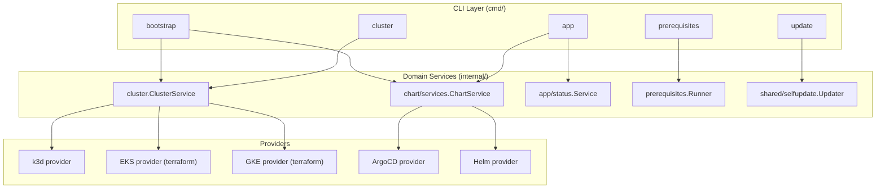

# Development Environment Setup

This guide covers how to set up a local development environment for **OpenFrame CLI** — the Go-based command-line tool that provisions Kubernetes clusters (k3d, EKS, GKE) and installs the OpenFrame platform onto them via ArgoCD. It is a standalone binary: per the organization's dependency graph (coverage: full), it has no recorded upstream dependencies on other internal repositories and no recorded downstream consumers. Its only relationship to the rest of the OpenFrame platform is operational — it clones and installs the app-of-apps chart from the separate [`flamingo-stack/openframe-oss-tenant`](https://github.com/flamingo-stack/openframe-oss-tenant) repository at install time; it is not a code dependency of or on that repository.

> If you are looking for how to install and run the CLI as an end user, see [Prerequisites](../../getting-started/prerequisites.md) and [Quick Start](../../getting-started/quick-start.md) instead. This document is for people building or modifying the CLI itself.

## Required Development Tools

The project is a pure Go module (`go.mod` at the repository root declares `module github.com/flamingo-stack/openframe-cli`). The toolchain is pinned explicitly:

```text
go 1.26.0
toolchain go1.26.5
```

> **Note:** `go.mod` pins the toolchain to `go1.26.5` deliberately. A comment in the file explains that Go `1.26.0`/`1.26.1` crash intermittently on `windows-amd64` during GC stack scanning (a known upstream Go issue), fixed in `1.26.2`. CI and releases resolve the toolchain from this file, so installing a plain Go `1.26.0` toolchain and letting `go build` auto-select the pinned toolchain (Go's toolchain-selection mechanism) is what keeps local builds consistent with what ships.

| Tool | Why it's needed |
|---|---|
| Go (toolchain resolves to `1.26.5` via `go.mod`) | Builds and tests the CLI; Go's automatic toolchain switching will fetch `1.26.5` the first time you build if your installed `go` binary is older |
| `git` | Required by `go-git/go-git/v5` style workflows and for cloning the repository itself; the CLI also shells out to git-related logic in `internal/chart/providers/git` |
| `golangci-lint` (v2) | Runs the linter configuration declared in `.golangci.yml` |
| Docker | Needed to exercise the `k3d` cluster-provider code paths locally (k3d itself runs cluster nodes as Docker containers) |
| `kubectl` or equivalent kubeconfig tooling | Useful for inspecting clusters the CLI creates during manual testing, though the CLI's own `internal/k8s` package talks to the Kubernetes API directly via `client-go` rather than shelling out to `kubectl` |
| Terraform (for EKS/GKE provider work) | `internal/cluster/providers/terraform` drives Terraform through `github.com/hashicorp/terraform-exec`; required only if you're touching the EKS (`internal/cluster/providers/eks`) or GKE (`internal/cluster/providers/gke`) provider code |

### Installing Go dependencies

Because this is a standard Go module, dependency resolution is handled by the toolchain itself — there is no separate package manager step:

```bash
go mod download
```

Key third-party libraries declared in `go.mod` that shape the development experience:

| Library | Purpose |
|---|---|
| `github.com/spf13/cobra` | Command routing/flag parsing for the entire `cmd/` tree |
| `k8s.io/client-go`, `k8s.io/api`, `k8s.io/apimachinery` | Native Kubernetes API access |
| `github.com/pterm/pterm` | Terminal rendering (tables, spinners, status output) |
| `github.com/charmbracelet/huh`, `github.com/charmbracelet/bubbletea` | Interactive prompts/wizards and the `app status --interactive` TUI |
| `github.com/sigstore/sigstore-go` | Cosign keyless signature verification used by the self-update path |
| `github.com/hashicorp/terraform-exec`, `github.com/hashicorp/terraform-json` | Drives Terraform for the EKS/GKE cluster providers |
| `github.com/go-git/go-git/v5` | Git operations used by the chart/git provider |
| `github.com/stretchr/testify` | Assertions used throughout `tests/testutil` |

### Linting

The repository ships a `.golangci.yml` (golangci-lint v2 config) at the root. It extends the `standard` default set (which already includes `errcheck`, `govet`, `ineffassign`, `staticcheck`, `unused`) and additionally enables:

- `gosec` — security-focused checks (subprocess construction, file path handling, file permissions, unverified downloads). The config explicitly keeps the full default rule set (`excludes: []`) rather than silently turning off findings.
- `bodyclose`
- `errorlint`
- `misspell`

`govet` is configured with `enable-all: true` but disables `fieldalignment` (considered noise) and `shadow` (too noisy for this codebase currently). Test files (`_test.go`) are exempted from `errcheck` and `gosec`, since they legitimately ignore errors and use weak fixtures. Run the linter locally before pushing:

```bash
golangci-lint run
```

### Running tests

Tests live alongside the code under `tests/integration/common` and `tests/testutil`, with per-package `_test.go` files throughout `internal/` and `cmd/`. Use the standard Go test runner:

```bash
go test ./...
```

`tests/testutil` provides shared helpers (`assertions.go`, `cluster.go`, `command_assertions.go`, `flag_contract.go`, `patterns.go`, `setup.go`, `utilities.go`) used across the suite, and `tests/integration/common` provides a CLI runner (`cli_runner.go`), cluster-management helpers (`cluster_management.go`), and dependency helpers (`dependencies.go`) for integration-style tests that actually invoke the built binary.

## IDE Recommendations and Setup

No editor configuration files (for example a `.vscode/` directory) are present in the repository, so the following are general recommendations rather than settings checked into the repo.

### Recommended IDE: a Go-aware editor

Any editor with solid `gopls` (the Go language server) support works well here. Two common choices:

- **VS Code** with the official Go extension (`golang.go`), which bundles `gopls`, `go vet`, debugging via `delve`, and test-lens integration.
- **GoLand** (JetBrains), which has first-class Go module support, built-in test runners, and Terraform plugin support useful for the `internal/cluster/providers/terraform` and `internal/cluster/providers/eks|gke` code.

### Editor extensions/plugins

Because the codebase spans Go, Terraform templates (`internal/cluster/providers/eks/templates/main.tf`, `internal/cluster/providers/gke/templates/main.tf`), YAML, and shell (`scripts/sign-binary.sh`), the following extensions are useful regardless of which editor you choose:

| Extension/Plugin | Purpose |
|---|---|
| Go language support (`golang.go` for VS Code, or GoLand's built-in support) | Syntax highlighting, `gopls`-powered completion/navigation, inline `go vet` diagnostics |
| golangci-lint integration | Surfaces the same findings `golangci-lint run` produces (per `.golangci.yml`) directly in the editor |
| HashiCorp Terraform extension | Syntax highlighting and validation for the `.tf` templates under `internal/cluster/providers/eks/templates` and `internal/cluster/providers/gke/templates` |
| YAML extension | Useful when editing Helm-values-shaped files the CLI generates/reads (see `internal/chart/utils/config/paths.go`'s `DefaultHelmValuesFile` constant, `openframe-helm-values.yaml`) |
| ShellCheck extension | Lints `scripts/sign-binary.sh` |

### Suggested editor settings

- Enable "format on save" using `gofmt`/`goimports` — the codebase follows standard Go formatting throughout.
- Enable `go vet` on save; it is part of the standard golangci-lint set this project already enforces in CI-equivalent form.
- If your editor supports running a single test under cursor, use it against the `_test.go` files next to the code you're editing rather than always running the full `go test ./...` suite, since the module touches cloud-provider code (EKS/GKE/Terraform) that some tests may skip or mock via `internal/shared/executor`'s `MockCommandExecutor`.

## Environment Variables for Development

The CLI itself is designed to shell out to external tools (Docker, k3d, Helm, Terraform, gcloud, aws) via the `CommandExecutor` abstraction in `internal/shared/executor`, rather than reading a large custom set of environment variables. The environment variables relevant to day-to-day development are mostly the ones those underlying tools already respect:

| Variable | Relevance |
|---|---|
| `$KUBECONFIG` | Honored when the CLI merges a newly created cluster's context into your default kubeconfig. The EKS kubeconfig logic (`internal/cluster/providers/eks/kubeconfig.go`) explicitly merges into "the user's default kubeconfig (honoring `$KUBECONFIG`)" and refuses to silently overwrite an existing context that points at a different server. |
| `$HOME` | Used to resolve the certificate directory. `internal/chart/utils/config/paths.go`'s `GetCertificateDirectory()` resolves to `~/.config/openframe/certs` via `os.UserHomeDir()`, creating it with `0750` permissions if missing, and falls back to a path under the working directory only if the home directory cannot be determined. |
| AWS/GCP credentials (`$AWS_PROFILE`, `$AWS_ACCESS_KEY_ID`/`$AWS_SECRET_ACCESS_KEY`, Google Application Default Credentials, etc.) | Consumed indirectly by the `aws`/`gcloud` CLIs and by the Terraform providers (`internal/cluster/providers/eks`, `internal/cluster/providers/gke`) when you test against real EKS/GKE clusters. These are standard AWS CLI / gcloud environment conventions, not custom to this repo. |

> This repository does not define a bundled `.env` file or a documented custom environment-variable contract of its own beyond the kubeconfig/home-directory behaviors above — most configuration instead flows through CLI flags (see `internal/shared/flags/flags.go`) and on-disk files such as `openframe-helm-values.yaml` (see `internal/chart/utils/config/paths.go`).

### Secrets handling during development

When working on interactive configuration code (`internal/chart/ui/configuration/docker.go`, `internal/chart/ui/configuration/ingress.go`), note the project's redaction convention: any secret collected from a prompt (Docker registry password, Ngrok API key, Ngrok auth token) is immediately registered with `redact.RegisterSecret` from `internal/shared/redact` right after being trimmed of whitespace. This ensures the value never leaks into verbose logs or error output. If you add a new prompt that collects a credential, follow the same pattern — register the **trimmed** value, since that is what flows downstream and what the redactor matches against.

## Repository Layout for Development

Understanding the directory layout up front makes it much faster to find where to make a change:



Entry points worth knowing while developing:

- `main.go` — process entrypoint. It checks whether the returned error is (or wraps) `sharederrors.AlreadyHandledError` before deciding whether to print it again, and it derives the process exit code from `executor.CommandError.ExitCode` when present (falling back to `1` otherwise). Any new top-level error path should respect this contract.
- `cmd/root.go` — the root Cobra command.
- `cmd/bootstrap/bootstrap.go`, `cmd/cluster/*.go`, `cmd/app/*.go`, `cmd/prerequisites/prerequisites.go`, `cmd/update/update.go` — thin Cobra command wrappers; `cmd/app/app.go` is a good example of the pattern (it applies the global `--silent`/`--verbose` output contract in its own `PersistentPreRunE`, since Cobra only runs the closest parent's hook).
- `internal/` — all domain logic, organized by subsystem (`bootstrap`, `chart`, `cluster`, `k8s`, `prerequisites`, `shared`).

### Error-handling conventions enforced in this repository

Several active review rules shape how you should write Go code here, particularly around `main.go` and error propagation:

- **Wrap errors with context at call boundaries.** Every error returned from a called function should be wrapped with a short, lowercase context string using `fmt.Errorf("<context>: %w", err)` rather than returned bare — this preserves where in the call chain a failure happened.
- **Already-displayed errors must carry the `AlreadyHandledError` sentinel.** When a command has already printed its error to the user (via `sharedErrors.HandleGlobalError` or equivalent), the error it returns up to `main` must be — or wrap — `*sharederrors.AlreadyHandledError` from `internal/shared/errors`. `main.go` checks for this sentinel with `errors.As` specifically to avoid printing the same error twice.
- **Preserve external-command exit codes.** When an external binary (`helm`, `k3d`, `terraform`, etc.) fails, the error must be returned as, or be unwrappable to, `*executor.CommandError` carrying the original exit code, so `main.go`'s `exitCode()` function can propagate the real exit code to the OS instead of collapsing everything to a generic `1`.
- **Alias same-named packages when importing within the module.** Because many subsystems each have their own `config`, `ui`, or `errors` package (for example `internal/chart/utils/config` vs `internal/shared/config`), any file importing two such packages must use a disambiguating camelCase alias that encodes the owning subsystem (for example `sharedErrors`, `chartServices`), as already done in `main.go` (`sharederrors "github.com/flamingo-stack/openframe-cli/internal/shared/errors"`). Bare last-segment import names are only acceptable when a file imports just one package with that name.

These rules are enforced by the organization's automated code review; keep them in mind for any PR that touches error paths or adds cross-package imports.

## Working on Cluster Providers

If your work touches cluster provisioning, note the provider split:

- `internal/cluster/providers/k3d` — local clusters via Docker; the fastest inner loop for day-to-day development since it needs no cloud account.
- `internal/cluster/providers/eks` — drives Terraform against the template in `internal/cluster/providers/eks/templates/main.tf`. That template pins exact module versions deliberately (a comment in the file notes that a floating version constraint once broke cluster creation in three independent ways after a minor version bump), uses the Free-Tier-eligible `m7i-flex.large` instance type by default, and sets `http_put_response_hop_limit = 2` so the EBS CSI controller's IMDS calls succeed.
- `internal/cluster/providers/gke` — similarly drives Terraform against `internal/cluster/providers/gke/templates/main.tf`, which provisions a dedicated VPC with secondary ranges, a Cloud NAT for private-node egress, and a regional or zonal GKE cluster depending on the `regional` variable.

Both Terraform templates are explicitly marked as CLI-owned ("do not edit by hand") — editing them directly and then running the CLI against a live workspace can produce drift, so when developing against these providers, treat the `.tf` files as the source of truth that the CLI's `internal/cluster/providers/terraform` package (via `terraform-exec`) applies.

## Working on the Chart/Install Pipeline

Most of the interactive configuration logic lives under `internal/chart/ui/configuration`:

- `wizard.go` wires together `BranchConfigurator`, `DockerConfigurator`, and `IngressConfigurator`, all sharing one `*templates.HelmValuesModifier`.
- `modes.go` implements the top-level choice between "Default configuration" (reuse the existing `openframe-helm-values.yaml` as-is) and "Interactive configuration" (walk through branch, Docker, then ingress).
- `branch.go`, `docker.go`, `ingress.go` each follow the same shape: read current values via the modifier, prompt via `pterm`/`sharedUI`, and only mark the relevant section as modified in `config.ModifiedSections` if the value actually changed.
- `helpers.go` provides `loadBaseValues()` and `createTemporaryValuesFile()`, the two private methods the wizard uses to go from "nothing loaded" to "temp Helm values file ready to pass to `helm install`".

The configuration shapes themselves (`ChartConfiguration`, `DockerRegistryConfig`, `IngressConfig`, `NgrokConfig`, `DeploymentMode`) live in `internal/chart/utils/types/configuration.go`, and the install-time config assembly (`ChartInstallConfig`, `Builder.BuildInstallConfigWithCustomHelmPath`) lives in `internal/chart/utils/config/builder.go` and `internal/chart/utils/config/models.go`. If you're adding a new configurable section, mirror this split: a type in `utils/types`, a configurator in `ui/configuration`, and wiring into `builder.go` or `service.go` as needed.

## Next Steps

Once your environment is set up, see [Local Development](./local-development.md) for day-to-day workflows, and [Architecture](../architecture/README.md) for a deeper look at how the CLI's domain services and providers fit together. For contribution conventions, see [Contributing Guidelines](../contributing/guidelines.md), and for the testing strategy in more depth, see [Testing](../testing/README.md).
