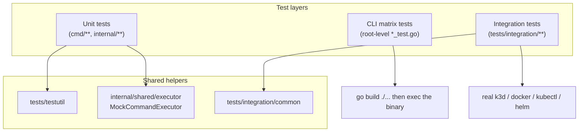

# Testing

OpenFrame CLI (`github.com/flamingo-stack/openframe-cli`) is a Go service with no downstream consumers and no upstream internal dependencies recorded in the organization's code graph (coverage is `full`, so this is confirmed, not a gap). Its test suite is entirely self-contained: unit tests against the command tree and internal packages, a CLI invocation matrix against the real built binary, and a separate integration suite gated behind a build tag for scenarios that need Docker/k3d.

This repository is the CLI that provisions Kubernetes clusters and installs the OpenFrame platform. The platform's application code itself lives in the separate [`flamingo-stack/openframe-oss-tenant`](https://github.com/flamingo-stack/openframe-oss-tenant) repository — its tests are out of scope here.

> This document covers Go testing for the `openframe-cli` module. For the broader development workflow, see [Development](../README.md); for local environment setup, see [Local Development](../setup/local-development.md).

## Test structure and organization

Tests live in three places, each with a distinct purpose:

| Location | Scope | Build tag | Runs with |
|---|---|---|---|
| `*_test.go` next to the code it tests (`cmd/**`, `internal/**`, root) | Unit tests of commands, services, and internal packages | none | `go test` / `make test-unit` |
| Root-level `cli_matrix_test.go`, `main_test.go` | Builds the real binary and exercises it as a black box (exit codes, stdout/stderr, flag parsing) | none | `go test` (builds the binary itself) |
| `tests/integration/**/*_test.go` | End-to-end scenarios that create real k3d clusters and shell out to real external binaries | `integration` | `make test-integration` |
| `tests/testutil/` | Shared test helpers (assertions, flag-contract checks, mock executor wiring) — not tests themselves | none | imported by other tests |

### Unit tests co-located with source

Unit tests sit beside the code they exercise, following Go convention. Examples from the material:

- `cmd/root_test.go` — root command structure, version string composition (`TestGetRootCmd`), VCS metadata backfill (`TestBackfillFromVCS`), and the `--verbose`/`--silent` debug-output wiring (`TestVerboseEnablesDebugOutput`).
- `cmd/contract_test.go` — freezes the root command's persistent-flag and top-level subcommand surface (`TestRootContract_PersistentFlags`, `TestRootContract_TopLevelSubcommands`).
- `cmd/help_matrix_test.go` — walks the **entire** command tree (`collectCommandPaths`) and asserts every command's `--help` prints a `Usage:` section, has a non-empty `Short` description, and every local flag has non-empty usage text. New commands are covered automatically with no per-command test to write.
- `cmd/app/app_test.go` — structure of the `app` command group and a regression test (`TestAppGroup_PersistentPreRunEHonorsVerbose`) proving that group's own `PersistentPreRunE` (which shadows the root's, per cobra's "closest parent" rule) still applies the global `--verbose`/`--silent` contract.

### Root-level CLI matrix tests

`cli_matrix_test.go` and `main_test.go` at the module root build the actual `openframe` binary (via `go build`) and run it as a subprocess with a spread of argument combinations — version/help output, unknown commands and flags, parse-time flag validation, and command-level guards (e.g. mutually exclusive flags, uninstall confirmation). Everything in this file is deliberately **machine-independent**: no Docker, no k3d, no Helm, no network, no cluster, and no interactive prompts (stdin is closed, forcing the CLI into non-interactive mode). The harness sets a hermetic environment per run (`runMatrix` in `cli_matrix_test.go`):

- isolated `HOME`/`USERPROFILE` (no real `~/.openframe` state leaks in)
- `KUBECONFIG` pointed at a path that does not exist
- `OPENFRAME_NO_UPDATE_CHECK=1` to disable the self-update check
- `OPENFRAME_NO_WSL_FORWARD=1` to keep the binary running natively even on Windows test runners

`TestCLIMatrix_MachineOutputsOnStdout` specifically guards that script-facing output (`--version`, `completion bash`) lands on stdout, not stderr — breaking that would break any pipeline piping those outputs. `TestCLIMatrix_SilentVersion` guards that `--silent` never leaks the logo banner.

Anything that needs real external tools (actual cluster creation, Helm installs, ArgoCD sync) belongs in the e2e workflow, not in this root-level matrix.

### Integration tests (`tests/integration/`)

Integration tests are reserved for scenarios that create real k3d clusters or run real external binaries. Code rule **OPENFRAM-006** (active, severity `error`) requires every file under `tests/integration/**/*_test.go` to carry `//go:build integration` as its first line — this is what keeps `go test ./...` / `make test-unit` from accidentally triggering them.

Shared helpers for this suite live in `tests/integration/common/`:

- `cli_runner.go` — `InitializeCLI()` builds (and caches) the CLI binary into a `build/` directory under the project root, `RunCLI(args...)` executes it and returns a `CLIResult` (stdout, stderr, exit code, error) with helpers like `Success()`, `Failed()`, `ErrorMessage()`.
- `cluster_management.go` — `GenerateTestClusterName()`, `CreateTestCluster`/`DeleteTestCluster`/`StopTestCluster` (shelling out to the real `k3d` binary), plus `CleanupAllTestClusters()` and Docker network/container cleanup helpers for clusters whose names match test-ish patterns (`test`, `integration`, `collision`, `stress`, etc.).
- `dependencies.go` — a `Dependency` type (`Docker`, `K3d`, `Kubectl`, `Helm` are predefined) whose `RequireOrSkip(t, msg)` **skips** (never silently passes) a test when the tool isn't available, logging what to install. `RequireClusterDependencies`/`RequireK8sDependencies`/`RequireAllDependencies` bundle the common combinations.

### Shared test utilities (`tests/testutil/`)

`tests/testutil/` is imported by unit tests across the module (not itself a test package):

- `setup.go` — `InitializeTestMode()` sets `ui.TestMode = true` to suppress logo/banner output during tests; `CreateStandardTestFlags()` builds a `cluster.FlagContainer` wired to a `MockCommandExecutor` with canned responses for common `k3d` commands (e.g. `k3d cluster list` → empty JSON array) and a mock k3d manager; `CreateIntegrationTestFlags()` builds a flag container with no mock injection, for real dependencies.
- `cluster.go` — `TestCommandStructure`, `TestCLICommand` (executes a cobra command, captures output, asserts `contains` substrings), `TestFlags()`/`IntegrationFlags()`.
- `patterns.go` — `TestClusterCommand(t, name, cmdFunc, setupFunc, teardownFunc)` runs a standard four-part suite (`Structure`, `Flags`, `CLI`, `Execution`) against a cluster subcommand, so adding a new cluster command means wiring it into this pattern rather than writing four bespoke tests.
- `flag_contract.go` — `FlagSpec` + `AssertFlag`/`AssertFlags` freeze a flag's name, shorthand, type, and default value so a silent rename or dropped shorthand fails loudly; `AssertSubcommands` verifies a parent command exposes exactly the named subcommands.
- `assertions.go` — a fluent `AssertCommandOutput` builder (`NoError()`, `HasError()`, `StdoutContains()`, `StderrContainsAny()`, `OutputContains()`, etc.) plus `AssertCommandSuccess`/`AssertCommandFailure` convenience wrappers.
- `command_assertions.go` — security-focused assertions over a `*executor.MockCommandExecutor`'s **structured** command log (`executor.RecordedCommand`, which keeps argv as discrete elements rather than one flattened string): `AssertNoArgContains` (a secret never appears in any argv element), `AssertNoBashCConcatenation` and `AssertNoCurlPipeShell` (regression guards against building shell strings instead of passing discrete arguments), `AssertArgIsDiscrete`, `AssertNoDeleteOf` (a destructive command never targets a protected resource like `kube-system`).

### The mock command executor

`internal/shared/executor/mock.go` provides `MockCommandExecutor`, the seam that lets command and service tests run without any real `docker`/`k3d`/`helm`/`terraform`/`gcloud`/`aws` process. It records every invocation both as a flattened string (`GetExecutedCommands()`, `WasCommandExecuted(pattern)`) and as a structured `RecordedCommand{Name, Args, Env, Stdin}` (`Commands()`), is safe under `go test -race` (all state behind a `sync.Mutex`), and supports `SetResponse(pattern, result)` / `SetShouldFail(fail, message)` to script specific command outcomes.



## Running tests

All commands below are run from the module root (where `go.mod` lives).

### Unit tests only

```bash
make test-unit
```

This is the gate the release workflow runs before any tag is cut (the release's "Gate: unit tests" step). It targets the root package plus `cmd`, `internal`, and `tests/testutil` while explicitly **excluding** `./tests/integration/...` — that exclusion, together with the `integration` build tag (OPENFRAM-006), is what keeps `go test ./...` from ever creating a real k3d cluster.

Without the Makefile target, the equivalent plain `go test` invocation covers the same packages:

```bash
go test ./... -short
```

(The root-level `cli_matrix_test.go` and `main_test.go` are part of this run — they build the binary themselves via `go build`/`exec.Command("go", "build", ...)` and need no extra setup, no Docker, and no network.)

### Integration tests

```bash
make test-integration
```

This adds `-tags integration` so the files under `tests/integration/` compile and run. These tests expect Docker to be running and `k3d` (plus `kubectl`/`helm` for some suites) to be installed — `tests/integration/common/dependencies.go`'s `RequireOrSkip` will **skip** (not fail) any test whose dependency is missing, logging what's absent. Run this leg only when you have Docker and k3d available locally; it provisions and tears down real clusters.

### Running a single test or package

Standard `go test` filtering works throughout:

```bash
go test ./cmd/... -run TestRootContract_PersistentFlags -v
go test ./internal/shared/executor/... -v
go test ./tests/testutil/... -v
```

For a single integration test, remember the build tag:

```bash
go test -tags integration ./tests/integration/... -run TestSomeIntegrationScenario -v
```

### Race detector

Several shared pieces (`MockCommandExecutor`) are explicitly built to be race-safe. Run with `-race` when touching concurrency-sensitive code:

```bash
go test ./... -race
```

### Lint gate

The release pipeline also runs `golangci-lint` before any unit-test gate. Keep code lint-clean alongside green tests; a release will not proceed past a failing lint or test gate (see the "Gate: lint" and "Gate: unit tests" steps the release workflow runs on every dispatch).

## Writing new tests

### Prefer the shared helpers over ad hoc assertions

- Use `testutil.CreateStandardTestFlags()` (from `tests/testutil/setup.go`) to get a `cluster.FlagContainer` with a `MockCommandExecutor` already wired and pre-seeded with sane `k3d` responses, instead of constructing executor mocks by hand in every test.
- Use `testutil.TestClusterCommand(t, name, cmdFunc, setupFunc, teardownFunc)` for a new cluster subcommand to automatically get structure, flag, CLI-arg, and execution checks, rather than writing four separate test functions.
- Use `testutil.AssertFlags(t, cmd, []testutil.FlagSpec{...})` whenever a command's flags should be frozen as a contract — this is what prevents a flag rename or dropped default from slipping through unnoticed (see `cmd/contract_test.go` for the pattern against the root command).
- For anything touching command construction (argv, env, stdin) — especially code that shells out to `docker`/`k3d`/`helm`/`terraform`/`gcloud`/`aws` — assert against the **structured** log (`executor.RecordedCommand` via `MockCommandExecutor.Commands()`), using `testutil.AssertNoArgContains`, `AssertNoBashCConcatenation`, `AssertNoCurlPipeShell`, `AssertArgIsDiscrete`, or `AssertNoDeleteOf` as appropriate. These exist specifically because a flattened command string cannot distinguish "passed as one literal argument" from "concatenated into a shell string," and that distinction is where injection bugs live.

### New commands get help-matrix coverage for free

Because `cmd/help_matrix_test.go` walks the live command tree (`collectCommandPaths` against `GetRootCmd`), any new `cobra.Command` you add is automatically checked for: a working `--help` that prints `Usage:`, a non-empty `Short` description, and non-empty usage text on every locally declared flag. There is nothing extra to wire up for this coverage — just make sure the command has a `Short` description and real flag `Usage` strings when you write it.

### Respect the pterm/ui output rule in testable code

Code rule **OPENFRAM-007** (active, severity `warn`, applies to `internal/**/*.go` and `cmd/**/*.go`) requires all user-facing terminal output to go through `pterm` printers or the `internal/shared/ui` package rather than raw `fmt.Print*` to stdout. This matters for testing because `ui.TestMode = true` (set via `testutil.InitializeTestMode()` or in a package's own `init()`, as in `cmd/root_test.go` and `cmd/app/app_test.go`) and pterm's writer redirection rely on that discipline to suppress logo/banner noise and capture output deterministically in tests. Code that writes straight to stdout bypasses both `--silent`/`--plain` and this test capture — write new user-facing output through `pterm.Info`/`pterm.Success`/`pterm.Warning` or the `ui` helpers so it stays testable the same way.

### Keep unit tests hermetic

Follow the pattern in `cli_matrix_test.go`'s `runMatrix`: isolate `HOME`, point `KUBECONFIG` at a nonexistent path, and set `OPENFRAME_NO_UPDATE_CHECK=1` / `OPENFRAME_NO_WSL_FORWARD=1` for any new root-level matrix case so it can't pick up a developer's real `~/.openframe` state, real kube context, or trigger a real self-update check or WSL re-exec.

### New integration scenarios

Place new end-to-end scenarios under `tests/integration/`, start the file with `//go:build integration` (OPENFRAM-006), and build on `tests/integration/common`:

- `common.InitializeCLI()` once per suite to build the real binary, `common.RunCLI(args...)` to invoke it and get a `*CLIResult`.
- `common.RequireClusterDependencies(t)` / `RequireK8sDependencies(t)` / `RequireAllDependencies(t)` at the top of any test needing Docker/k3d/kubectl/helm, so the test **skips** cleanly in an environment without them instead of failing.
- `common.GenerateTestClusterName()` for a unique, collision-resistant cluster name, and `common.CleanupTestCluster(name)` / `common.CleanupAllTestClusters()` in a `defer` or test cleanup to avoid leaking k3d clusters, Docker networks, and containers between runs.

### Mocking external tools

When a new package shells out to an external tool, accept a `executor.CommandExecutor` interface (as the existing cluster/chart/prerequisite packages do) so tests can inject `executor.NewMockCommandExecutor()` (or `testutil.NewTestMockExecutor()`) and script responses with `SetResponse`/`SetDefaultResult`/`SetShouldFail`, rather than requiring the real binary to be present.

## Coverage requirements

The material available for this repository does not define a numeric coverage threshold or a coverage-reporting command (no `go test -cover` invocation, badge, or CI coverage gate appears in the inlined workflow or Makefile targets referenced here). What **is** enforced mechanically:

- **OPENFRAM-006** (error severity): every file under `tests/integration/**/*_test.go` must declare `//go:build integration`, keeping integration tests out of the default `go test ./...` / `make test-unit` run.
- **OPENFRAM-007** (warn severity): user-facing output in `internal/**/*.go` and `cmd/**/*.go` must go through `pterm` or `internal/shared/ui`, which keeps that code capturable and assertable in tests (`ui.TestMode`, pterm writer redirection).
- The release workflow's **"Gate: unit tests"** step (`make test-unit`) and **"Gate: lint"** step (`golangci-lint`) must both pass before any release is tagged — these are the closest thing to an enforced quality bar in the material shown, and they gate release, not every pull request merge.
- `cmd/help_matrix_test.go` functions as a structural coverage floor for the command tree: it asserts there are at least 15 commands discovered (`len(paths) < 15` fails the test) and that every one of them has a working `--help`, a `Short` description, and documented flags — so the command surface cannot silently grow undocumented or broken.

If your environment configuration or CI setup defines an additional coverage percentage gate beyond what's shown here, follow that configuration; it is not present in the material reviewed for this document.
