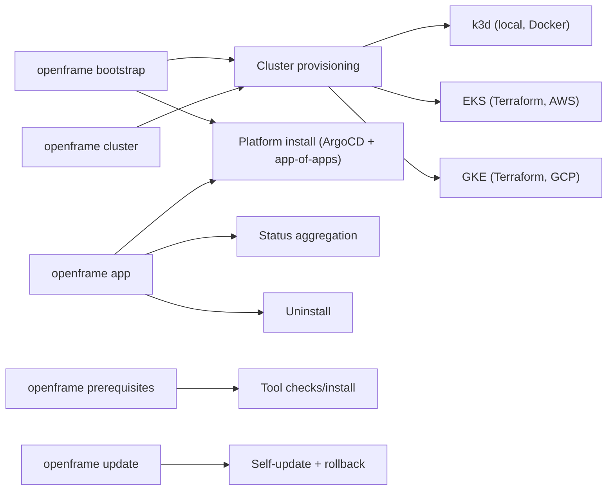

## First Steps

This page walks you through the first things to do right after installing the OpenFrame CLI, the common initial configuration you'll run into, and where to go next to explore the platform it deploys.

The CLI itself (`openframe-cli`, repository [flamingo-stack/openframe-cli](https://github.com/flamingo-stack/openframe-cli)) is a Go service built with Cobra. It provisions Kubernetes clusters (local k3d, or cloud GKE/EKS via Terraform) and deploys the OpenFrame platform onto them through ArgoCD's app-of-apps pattern. The platform it installs lives in a separate repository, **flamingo-stack/openframe-oss-tenant** (docs: https://github.com/flamingo-stack/openframe-oss-tenant/tree/main/docs) — the CLI is the provisioning/deployment tool, not the application itself.

> If you haven't installed the CLI yet, see the [Introduction](./introduction.md), [Prerequisites](./prerequisites.md), and [Quick Start](./quick-start.md) pages first.

---

### 1. First 5 things to do after installation

#### Step 1 — Confirm the CLI is on your `$PATH` and check its version

Run the root command with no arguments, or check the version flag, to confirm the binary resolved correctly:

```bash
openframe --help
```

The root command (`cmd/root.go`) reports version metadata and exposes global flags you'll use constantly: `--silent`, `--verbose`, and `--plain`.

#### Step 2 — Verify prerequisites for the cluster type you plan to use

Before creating anything, let the CLI check your local toolchain. Prerequisites are OS-aware: on macOS/Linux, missing tools can be auto-installed; on Windows, the CLI prints docs-only guidance.

```bash
openframe prerequisites check --type k3d
```

Use `--type eks` or `--type gke` instead if you're targeting a cloud cluster. For k3d, this verifies Docker, k3d, and Helm; for EKS/GKE it verifies Terraform plus the relevant cloud CLI (`aws` or `gcloud`). You can also run `openframe prerequisites install` to have the CLI install what's missing where supported.

#### Step 3 — Create your first cluster (or bootstrap everything in one step)

For local development, the fastest path is the single `bootstrap` command, which creates a k3d cluster and installs the OpenFrame platform in one step:

```bash
openframe bootstrap
```

If you'd rather control cluster creation and platform installation separately (for example, to target a cloud provider), use `openframe cluster create` instead — see the dedicated how-to guide for the full walkthrough: [Create a Kubernetes Cluster with OpenFrame CLI](./how-to/create-a-kubernetes-cluster-with-openframe-cli.md).

#### Step 4 — Install the OpenFrame platform onto the cluster

If you created a cluster without bootstrapping the platform, install ArgoCD and the app-of-apps next:

```bash
openframe app install
```

This requires an existing, online cluster — one made with `openframe cluster create`, one you made yourself, or any other reachable cluster. The full procedure, including the interactive configuration wizard, is covered in [Install the OpenFrame Platform onto a Cluster](./how-to/install-the-openframe-platform-onto-a-cluster.md).

#### Step 5 — Check that everything came up healthy

Once bootstrap or install finishes, confirm the platform is actually ready before you start using it:

```bash
openframe app status
```

This aggregates cluster node health with ArgoCD application sync/health status into a single readiness report. For the full set of status options (`--watch`, `--interactive`, `-o json|yaml`), see [Check the Status of Your OpenFrame Cluster and App](./how-to/check-the-status-of-your-openframe-cluster-and-app.md).

---

### 2. Common initial configuration

#### Global flags

Every command supports three global flags defined on the root command:

| Flag | Effect |
|---|---|
| `--silent` | Suppresses interactive UI elements and most output — useful for CI/automation |
| `--verbose` | Prints additional debug detail, including pinned-dependency and diagnostic information |
| `--plain` | Disables colored/animated terminal output (spinners, logos) for plain-text terminals or log capture |

#### Helm values configuration

When you install the platform (`openframe app install`), the CLI builds its Helm configuration from `openframe-helm-values.yaml` in your working directory. You have two configuration paths:

- **Default configuration** — uses the existing `openframe-helm-values.yaml` as-is (or a generated default if none exists).
- **Interactive configuration** — a guided wizard that walks through three sections in order:
  1. **Branch** — which Git branch of the OSS repository to deploy (`repository.branch` in the Helm values; this is also what pins the app-of-apps clone and each child Application's `targetRevision` to the same ref).
  2. **Docker registry** — optional custom registry credentials (username, password, email); passwords are masked on input and registered with the CLI's secret redactor so they never leak into verbose logs.
  3. **Ingress** — choose between `localhost` (local-only visibility) or `ngrok` (external visibility via an Ngrok tunnel, with optional CIDR-based IP allowlisting).

You select the mode when `openframe app install` runs interactively; non-interactive/CI installs can point at a prepared values file instead. Deployment mode itself is always OSS — there is no other deployment mode to choose.

#### Certificates

The CLI manages local TLS certificates for `localhost` ingress under `~/.config/openframe/certs` (created automatically on first use, with a fallback to a path under the CLI's own prerequisites directory if the home directory can't be resolved).

#### Kube context targeting

Commands that operate on an existing cluster resolve the kube-context either from a cluster name you pass as an argument, or explicitly via a context flag — the explicit context always wins over a name-derived one, so a single install or status check never silently targets the wrong cluster. If you manage multiple clusters, switch your active context explicitly:

```bash
openframe cluster use my-cluster
```

#### Self-update

Keep the CLI itself current with the `update` command group, which checks GitHub Releases, verifies the new binary (checksum and cosign signature) before replacing it, and supports rolling back:

```bash
openframe update check
openframe update rollback
```

See [Update the OpenFrame CLI to the Latest Version](./how-to/update-the-openframe-cli-to-the-latest-version.md) for the complete procedure.

---

### 3. Exploring key features

The CLI is organized around three core command groups — `cluster`, `app`, and `prerequisites` — plus `bootstrap` and `update`.



**Cluster management (`openframe cluster`)** — create, list, inspect, switch between, clean up, and delete clusters across three backends: local k3d (Docker-based), and cloud GKE or EKS provisioned via Terraform. `cluster create` offers an interactive wizard as well as a `--skip-wizard` non-interactive path for CI. Continue with [Create a Kubernetes Cluster with OpenFrame CLI](./how-to/create-a-kubernetes-cluster-with-openframe-cli.md).

**Platform deployment (`openframe app`)** — installs ArgoCD and the app-of-apps onto any reachable cluster, reports live readiness, prints ArgoCD access credentials, upgrades the deployed Git ref or forces a re-sync, and uninstalls the platform while leaving the cluster intact. Continue with [Install the OpenFrame Platform onto a Cluster](./how-to/install-the-openframe-platform-onto-a-cluster.md).

**Status and observability** — `openframe app status` supports a `--watch` mode for continuous polling, an `--interactive` k9s-style TUI for navigating and syncing individual ArgoCD applications, and machine-readable `-o json|yaml` output for scripting. Continue with [Check the Status of Your OpenFrame Cluster and App](./how-to/check-the-status-of-your-openframe-cluster-and-app.md).

**Prerequisites framework (`openframe prerequisites`)** — an OS-aware tool-gating layer. On macOS/Linux it can auto-install missing tools; on Windows it shows documentation-only guidance instead. It understands distinct tool sets per cluster type (`k3d`, `eks`, `gke`).

**Teardown** — when you're done with a cluster, `openframe app uninstall` removes ArgoCD and the deployed apps while keeping the cluster running, and `openframe cluster delete` removes the cluster itself (cloud clusters require typed-name confirmation before deletion). Continue with [Uninstall OpenFrame and Delete a Cluster](./how-to/uninstall-openframe-and-delete-a-cluster.md).

<details>
<summary>Usage examples (from the CLI's own documentation)</summary>

```bash
# Local development
openframe bootstrap
openframe cluster status

# Cloud cluster (billed resources)
openframe cluster create my-gke --type gke --project my-project --region us-central1 --skip-wizard

# Platform lifecycle
openframe app install -c k3d-dev
openframe app status -c k3d-dev --watch
openframe app upgrade -c k3d-dev --ref v1.4.0
openframe app uninstall -c k3d-dev --yes

# Keeping the CLI current
openframe update check
openframe update rollback
```

</details>

> **Note:** `openframe-cli` has no recorded downstream consumers in the organization's dependency graph and no recorded upstream dependencies on other internal repositories — its functional dependencies (Cobra, `client-go`, pterm, `huh`/`bubbletea`, `sigstore-go`) are all external Go modules, and its `internal/` packages are private implementation detail rather than a published API for other repositories to import.

For the full command-to-component mapping and data-flow diagrams (bootstrap sequence, app status aggregation), see the [Architecture Overview](../reference/architecture/overview.md), the [Ecosystem page](../reference/architecture/ecosystem.md), and the rendered diagrams under [Architecture Diagrams](../diagrams/architecture/README.md).

---

### 4. Where to get help

- **Architecture and design** — [Architecture Overview](../reference/architecture/overview.md) documents the core abstractions (cluster, app, prerequisites), component relationships, and data flow; [Architecture Diagrams](../diagrams/architecture/README.md) collects the Mermaid sources for the bootstrap sequence and app-status aggregation flows.
- **Development setup** — if you want to build or modify the CLI itself, start at [Development](../development/README.md), then [Environment Setup](../development/setup/environment.md) and [Local Development](../development/setup/local-development.md).
- **Security practices** — see [Security](../development/security/README.md) for how secrets (Docker passwords, Ngrok tokens) are redacted from logs and how self-update verifies binaries.
- **Testing** — see [Testing](../development/testing/README.md) for how the project's integration and unit tests are organized (`tests/integration`, `tests/testutil`).
- **Contributing** — see [Contributing Guidelines](../development/contributing/guidelines.md) before opening a pull request.
- **Community support** — this project does not use GitHub Issues or GitHub Discussions. All community support, questions, and discussion happen on the OpenMSP Slack community: https://www.openmsp.ai/ (invite: https://join.slack.com/t/openmsp/shared_invite/zt-36bl7mx0h-3~U2nFH6nqHqoTPXMaHEHA).
- **Releases** — binaries and release notes are published at https://github.com/flamingo-stack/openframe-cli/releases.
- **The platform itself** — OpenFrame CLI only provisions infrastructure and deploys the platform; the platform's own application code and documentation live in the separate **flamingo-stack/openframe-oss-tenant** repository (https://github.com/flamingo-stack/openframe-oss-tenant/tree/main/docs).

### Next: common tasks

Once you've completed the steps above, the how-to guides continue each task in more depth:

1. [Create a Kubernetes Cluster with OpenFrame CLI](./how-to/create-a-kubernetes-cluster-with-openframe-cli.md)
2. [Install the OpenFrame Platform onto a Cluster](./how-to/install-the-openframe-platform-onto-a-cluster.md)
3. [Check the Status of Your OpenFrame Cluster and App](./how-to/check-the-status-of-your-openframe-cluster-and-app.md)
4. [Update the OpenFrame CLI to the Latest Version](./how-to/update-the-openframe-cli-to-the-latest-version.md)
5. [Uninstall OpenFrame and Delete a Cluster](./how-to/uninstall-openframe-and-delete-a-cluster.md)
