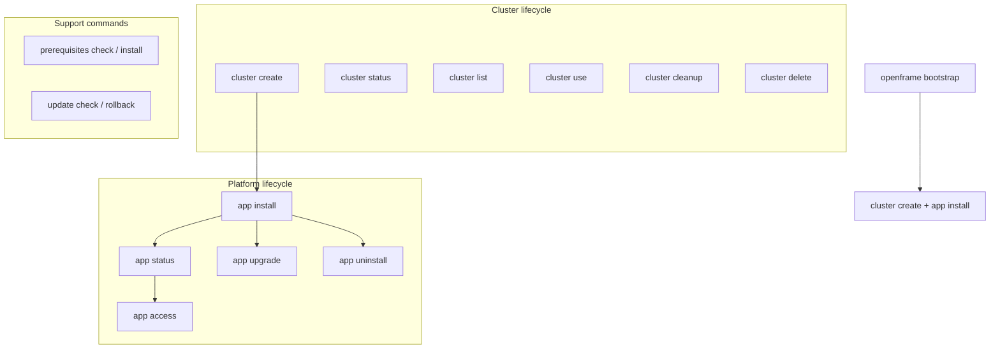

## First Steps

This page walks through the first things to do right after installing the OpenFrame CLI: a quick sanity check, the initial configuration choices you'll face, a tour of the main command groups, and where to ask for help when something doesn't go as expected.

If you haven't installed the CLI yet, see `./introduction.md` and `./prerequisites.md` first. If you just want the fastest path to a running platform, `./quick-start.md` covers the one-command bootstrap flow in more depth than this page does.

> OpenFrame CLI is the provisioning and lifecycle tool for the [OpenFrame platform](https://openframe.ai), part of the [Flamingo](https://flamingo.run) stack. The platform itself (the application code this CLI deploys) lives in the separate **flamingo-stack/openframe-oss-tenant** repository — this repository only ships the Go binary that drives cluster creation and app installation.

### Hardware you'll need

Before doing anything cluster-related, confirm the machine (or cloud account) you're targeting meets the baseline:

| | Minimum | Recommended |
|---|---|---|
| RAM | 24 GB | 32 GB |
| CPU cores | 6 | 12 |
| Disk | 50 GB | 100 GB |

These apply whether you're running a local k3d cluster or pointing the CLI at a cloud cluster — the OpenFrame platform's own workloads are what drive the requirement, not the CLI binary itself.

---

## The first 5 things to do after installation

### 1. Confirm the binary runs and check its version

Run the root command with no arguments to confirm the install worked and see the top-level command groups:

```bash
openframe
```

The root command (`cmd/root.go`) is the Cobra entry point for every subcommand and also exposes global flags that affect all output:

```bash
openframe --help
openframe --version
```

Three flags apply everywhere: `--silent` (suppress non-essential output), `--verbose` (print debug detail), and `--plain` (disable interactive/colored UI, useful in CI). These are documented at the root level because, per `cmd/root.go`, they're meant to be set once and respected by every subcommand.

### 2. Check prerequisites for the cluster type you plan to use

OpenFrame CLI supports three cluster backends — local **k3d**, and cloud **GKE** or **EKS** via Terraform. Each backend has its own tool gate (Docker/k3d/helm for k3d; Terraform plus the relevant cloud CLI for GKE/EKS), implemented under `internal/cluster/prerequisites/`.

Check (and optionally auto-install, on macOS/Linux) what's missing before creating a cluster:

```bash
openframe prerequisites check
openframe prerequisites install
```

Pass `--type` to scope the check to one backend:

```bash
openframe prerequisites check --type k3d
openframe prerequisites check --type eks
openframe prerequisites check --type gke
```

On Windows, the prerequisites framework is documentation-only (it points you to install instructions rather than installing automatically) — see `internal/prerequisites/runner.go` for the OS-aware check/install logic.

### 3. Create your first cluster — or bootstrap everything at once

You have two paths here:

- **Step by step**: `openframe cluster create` to provision a cluster, then `openframe app install` to deploy the platform onto it.
- **One shot**: `openframe bootstrap [cluster-name]`, which runs cluster creation and app installation together with a staged progress tracker (`internal/bootstrap/service.go`).

For local development, the one-shot path is usually the fastest way to get something running:

```bash
openframe bootstrap
```

The step-by-step create-a-cluster flow, including the interactive wizard and non-interactive flags for cloud providers, is covered in detail in the how-to guide: `./how-to/create-a-kubernetes-cluster-with-openframe-cli.md`.

### 4. Install the OpenFrame platform onto the cluster

If you created a cluster without using `bootstrap`, the platform (ArgoCD plus the app-of-apps) still needs to be installed separately:

```bash
openframe app install
openframe app install my-cluster
```

`app install` resolves the target cluster context and builds an `InstallationRequest` (see `cmd/app/install.go`), then installs ArgoCD and the app-of-apps chart via `internal/chart/services/installer.go`. This requires an existing, reachable cluster — one made by `openframe cluster create`, or any other cluster you can already reach with `kubectl`.

This step is walked through fully in `./how-to/install-the-openframe-platform-onto-a-cluster.md`.

### 5. Verify the platform came up healthy

Once installation finishes, check that everything is actually running before you start exploring the platform itself:

```bash
openframe app status
```

`app status` aggregates cluster node health and ArgoCD application sync/health into a single readiness report (`internal/app/status/status.go`). Add `--watch` to keep it refreshing, or `--interactive` to drop into the TUI dashboard (`internal/app/status/tui/tui.go`) for a k9s-style view of individual applications.

The dedicated how-to guide — `./how-to/check-the-status-of-your-openframe-cluster-and-app.md` — covers the output formats (`-o json|yaml`), the interactive TUI, and what a healthy vs. degraded report looks like.

---

## Common initial configuration

Most of what you'll configure up front lives in the Helm values file the CLI reads when installing the platform.

### The Helm values file

By default, the CLI reads and writes `openframe-helm-values.yaml` in the current working directory (`internal/chart/utils/config/paths.go`, `DefaultHelmValuesFile`). If you installed without specifying a custom path, this file controls:

- **Branch** — which ref of the app-of-apps chart repository to deploy. The flattened schema key is `repository.branch`. If this is set in the file, it takes priority over an explicit `--ref` flag passed to the CLI, per `internal/chart/utils/config/builder.go` — the file and the flag should agree.
- **Docker registry credentials** — username, password, and email, if your deployment needs to pull from a private registry. Passwords and tokens are masked on input and immediately registered with the secret redactor so they never leak into verbose logs.
- **Ingress type** — `localhost` (local-only visibility) or `ngrok` (external visibility via an Ngrok tunnel, including an optional CIDR IP allowlist). A third type, `gcp`, exists in the configuration schema but the interactive wizard currently only offers localhost or ngrok.

### Interactive vs. default configuration mode

When you run the configuration wizard (triggered as part of `app install` unless you pass flags for a fully non-interactive run), you're first asked to choose a mode:

- **Default configuration** — uses the existing `openframe-helm-values.yaml` as-is, with no prompts. Good for repeat installs or CI.
- **Interactive configuration** — walks through branch, Docker registry, and ingress configuration in sequence (`internal/chart/ui/configuration/wizard.go`), writing the result to a temporary values file before install.

```text
Configuration Mode
> Default configuration
  Interactive configuration
```

If you want to skip the wizard entirely (for scripted/CI installs), pass the appropriate non-interactive flags to `app install` — the wizard only runs when the CLI needs values it doesn't already have.

### Certificates directory

If your ingress configuration needs local TLS certificates, the CLI resolves a certificate directory automatically — `~/.config/openframe/certs` by default, created on first use if it doesn't exist, with a fallback to a path under the CLI's own working tree if the home directory can't be determined (`internal/chart/utils/config/paths.go`, `GetCertificateDirectory`). You generally don't need to set this yourself.

### Cluster context

Every `app` subcommand other than the bare `app` command prints a one-line header naming the current kube-context before it runs — the cheapest guard against accidentally installing onto, or tearing down, the wrong cluster (`cmd/app/app.go`). Pay attention to this line, especially if you manage more than one cluster. Use `openframe cluster use [NAME]` to switch kubectl (and, for GKE, your gcloud config) to a specific cluster before running `app` commands against it.

---

## Exploring key features

Once the platform is up, here's a tour of what the CLI gives you day-to-day, grouped by command family.



### Cluster management

The `cluster` command group (`cmd/cluster/`) handles provisioning:

```bash
openframe cluster create [NAME]      # k3d, GKE, or EKS — wizard or --skip-wizard
openframe cluster list               # managed clusters; --all includes discovered cloud clusters
openframe cluster status [NAME]      # health, nodes, status; -o json|yaml
openframe cluster use [NAME]         # switch kube-context (and gcloud config for GKE)
openframe cluster cleanup [NAME]     # prune unused container images from nodes
openframe cluster delete [NAME]      # typed-name confirmation required for cloud clusters
```

For GKE and EKS, cluster creation runs through Terraform modules maintained inside this CLI (`internal/cluster/providers/gke/templates/main.tf`, `internal/cluster/providers/eks/templates/main.tf`) — these provision a dedicated VPC, the managed Kubernetes control plane, and a node pool with sensible defaults (for example, EKS defaults to a Free-Tier-eligible instance type and both templates pin module versions exactly rather than using floating version ranges, to avoid defaults changing under you).

Creating your first cluster — including the interactive wizard, cloud provider flags, and what "non-interactive" looks like for CI — is covered step by step in `./how-to/create-a-kubernetes-cluster-with-openframe-cli.md`.

### Platform (app) management

The `app` command group (`cmd/app/`) deploys and manages the OpenFrame platform itself on top of an existing cluster:

```bash
openframe app install [cluster-name]   # install ArgoCD + app-of-apps
openframe app upgrade [cluster-name]   # change git ref (--ref) or force re-sync (--sync)
openframe app status                   # readiness report; --watch, --interactive, -o json|yaml
openframe app access                   # print ArgoCD admin credentials + UI access instructions
openframe app uninstall                # remove ArgoCD + apps, keep the cluster
```

Note that every `app` subcommand explicitly rejects stray positional arguments other than an optional cluster name — if you need to target a non-default cluster, use `--context` (see `cmd/app/app.go`, `noPositionalArgs`). This is deliberate: earlier behavior silently ran commands like `app status` or `app uninstall` against whatever kube-context happened to be active, which is especially risky for a destructive command like uninstall.

Installing the platform for the first time is covered in `./how-to/install-the-openframe-platform-onto-a-cluster.md`, and monitoring it afterwards in `./how-to/check-the-status-of-your-openframe-cluster-and-app.md`.

### Accessing the platform UI

Once `app status` reports the platform healthy, get ArgoCD's admin credentials and UI access instructions:

```bash
openframe app access
```

This reads the ArgoCD initial-admin-secret from the cluster and prints connection details — useful immediately after install, before you've set up your own ingress/DNS.

### Self-update

The CLI can check for and apply its own updates, with cosign signature and checksum verification plus rollback support (`internal/shared/selfupdate/`):

```bash
openframe update check
openframe update [version]
openframe update rollback
```

Keeping current is covered in `./how-to/update-the-openframe-cli-to-the-latest-version.md`.

### Tearing down

When you're done with a cluster, or want to start over cleanly:

```bash
openframe app uninstall          # remove the platform, keep the cluster
openframe cluster delete [NAME]  # remove the cluster entirely
```

The full teardown flow — uninstalling the platform and optionally deleting the underlying cluster — is covered in `./how-to/uninstall-openframe-and-delete-a-cluster.md`.

---

## Where to get help

- **Command help** — every command and subcommand supports `--help`, e.g. `openframe cluster create --help` or `openframe app install --help`, and reflects the same flags and behavior documented here.
- **Architecture reference** — for a deeper look at how the CLI's internal packages fit together (cluster providers, chart services, the ArgoCD and Helm providers, the shared executor abstraction), see `../reference/architecture/overview.md` and the dependency/ecosystem view in `../reference/architecture/ecosystem.md`. Diagrams referenced from those pages live under `../diagrams/architecture/README.md`.
- **OpenMSP Slack community** — this project does not use GitHub Issues or GitHub Discussions. All community support, questions, and discussion happen on the OpenMSP Slack: [openmsp.ai](https://www.openmsp.ai/) ([join link](https://join.slack.com/t/openmsp/shared_invite/zt-36bl7mx0h-3~U2nFH6nqHqoTPXMaHEHA)).
- **Releases** — binaries and release notes are published at [github.com/flamingo-stack/openframe-cli/releases](https://github.com/flamingo-stack/openframe-cli/releases).
- **The OpenFrame platform itself** — remember that the application the CLI deploys (ArgoCD apps, the OSS tenant stack) is maintained in the separate **flamingo-stack/openframe-oss-tenant** repository, not here. Platform-level documentation lives at [github.com/flamingo-stack/openframe-oss-tenant/tree/main/docs](https://github.com/flamingo-stack/openframe-oss-tenant/tree/main/docs).
- **Contributing to the CLI** — if you want to dig into the codebase, set up a development environment, or submit changes, start with `../development/README.md`, then `../development/setup/environment.md` and `../development/setup/local-development.md`. Review the testing and contribution expectations in `../development/testing/README.md` and `../development/contributing/guidelines.md` before opening a change, and `../development/security/README.md` for security-relevant conventions (such as how secrets are redacted, as seen in the Docker and ingress configurators).

> As a reminder: this CLI is a standalone Go module (`github.com/flamingo-stack/openframe-cli`) with no recorded upstream dependencies on other repositories in this organization, and no other repository in the graph currently consumes it — its `internal/` packages are private implementation detail, not a public API meant for import elsewhere.
