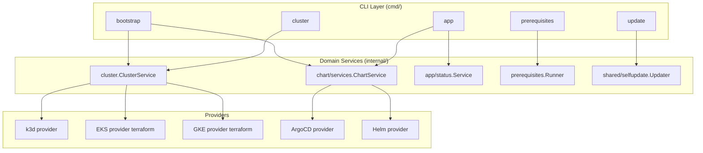

# First Steps

This page walks you through the first things to do right after installing the OpenFrame CLI (`openframe`) — from verifying the install, through common initial configuration, to exploring the CLI's key features. It assumes you have already installed the binary as described in [Prerequisites](./prerequisites.md) and [Quick Start](./quick-start.md).

OpenFrame CLI is the bootstrap and lifecycle-management tool for the OpenFrame platform built by [Flamingo](https://flamingo.run). It provisions Kubernetes clusters — locally via k3d, or in the cloud via GKE/EKS through Terraform — and installs the OpenFrame platform onto them using ArgoCD's app-of-apps pattern. The platform's own application code lives in the separate [`flamingo-stack/openframe-oss-tenant`](https://github.com/flamingo-stack/openframe-oss-tenant) repository; this CLI only owns cluster provisioning, platform install/upgrade/uninstall, prerequisite management, and self-update.

> **Scope note:** Per the organization's dependency graph (coverage: full), OpenFrame CLI has no recorded upstream dependencies on other internal repositories, and no other repository consumes it as a library — it is a standalone, user-facing binary. Its only relationship to `openframe-oss-tenant` is operational: it clones that repository's app-of-apps Helm chart at install/upgrade time.

## The first 5 things to do after installation

### 1. Confirm the binary is on your `$PATH` and check its version

After installing (see [Prerequisites](./prerequisites.md) for OS-specific steps), confirm the CLI resolves and inspect its version and pinned dependency info:

```bash
openframe --version
```

`cmd/root.go` resolves version information at build time (via ldflags, with VCS backfill) and also reports pinned third-party dependency versions the CLI relies on — useful when filing a question in the community or comparing behavior across machines.

### 2. Read the root help and the command tree

Run the root command with no arguments, or `--help`, to see the full command tree before doing anything else:

```bash
openframe --help
```

The CLI is organized around three core command groups — `cluster` (provisioning), `app` (platform deployment), and `prerequisites` (tool verification/installation) — plus a `bootstrap` command that chains cluster creation and platform install into one step, and an `update` command for self-updating the binary. Every subcommand also supports `--help`.

### 3. Check (and install) prerequisites for your target cluster type

Before creating a cluster, verify the tools the CLI shells out to (Docker, k3d, Helm, Terraform, and cloud CLIs for GKE/EKS) are present:

```bash
openframe prerequisites check
```

To check (or install) prerequisites for a specific cluster type only:

```bash
openframe prerequisites check --type k3d
openframe prerequisites install --type k3d
```

Use `--type eks` or `--type gke` instead of `k3d` when you plan to provision in AWS or GCP. The prerequisites framework (`internal/prerequisites/`, `internal/cluster/prerequisites/`, `internal/chart/prerequisites/`) is OS-aware and covers Docker, k3d, Helm, Terraform, cloud CLIs, and local certificates. Tools that the CLI installs itself (k3d, Helm, Terraform, mkcert, infracost) are pinned to specific versions and checksum-verified — never installed via an unverified `curl | bash`.

> **Hardware check:** before provisioning a local cluster, confirm your machine meets the minimum footprint: 24GB RAM, 6 CPU cores, and 50GB disk (32GB RAM / 12 cores / 100GB disk recommended) — the OpenFrame platform itself is a multi-service stack once installed.

### 4. Create your first cluster — or bootstrap the whole stack in one command

You have two paths here:

- **Step by step:** `openframe cluster create [NAME]` to provision a cluster first, then `openframe app install [cluster-name]` to deploy the platform onto it. This two-step path is detailed in [Create a Kubernetes cluster with OpenFrame CLI](./how-to/create-a-kubernetes-cluster-with-openframe-cli.md) and [Install the OpenFrame platform onto a cluster](./how-to/install-the-openframe-platform-onto-a-cluster.md).
- **One shot:** `openframe bootstrap [cluster-name]` creates a local k3d cluster and installs the platform in a single staged flow, with `--non-interactive` available for CI/automation. `internal/bootstrap/service.go` orchestrates this as "create cluster, then install charts" with a step tracker and a closing summary card.

For a first run, `openframe bootstrap` is the fastest way to see the whole system come up.

### 5. Check status, then see how to reach the UI

Once a cluster and platform install are underway (or finished), check health:

```bash
openframe cluster status [NAME]
openframe app status
```

`internal/app/status/status.go` aggregates cluster health with ArgoCD application sync/health into a single report; add `--watch` to poll continuously or `--interactive` to open a TUI (`internal/app/status/tui/tui.go`). To get ArgoCD admin credentials and instructions for reaching the UI, run `openframe app access`. The full status/access workflow is covered in [Check the status of your OpenFrame cluster and app](./how-to/check-the-status-of-your-openframe-cluster-and-app.md).

## Common initial configuration

### Global output flags

Every command respects a shared `--silent` / `--verbose` / `--plain` output contract, applied via `internal/shared/ui`. Use `--verbose` the first few times you run a command to see what the CLI is doing under the hood (which external tools it shells out to, what it waits on), and `--silent` once you're scripting around it.

### Non-interactive mode for CI/automation

Most flows default to an interactive wizard (prompts via `pterm`/`huh`), but `--non-interactive` (combined with `--skip-wizard` and explicit flags on `cluster create`, e.g. `--type`, `--nodes`, `--region`, `--project`, `--profile`, `--ha`, `--spot`) lets you drive the same flows from a script or CI pipeline without any prompts.

### Helm values and the configuration wizard

When installing or upgrading the platform, the CLI reads/writes a `openframe-helm-values.yaml` file in your working directory (the constant `DefaultHelmValuesFile` in `internal/chart/utils/config/paths.go`). You have two configuration modes, offered interactively at install/upgrade time:

- **Default configuration** — uses the existing `openframe-helm-values.yaml` as-is (or creates sensible defaults if absent).
- **Interactive configuration** — walks you through three sections in order:
  1. **Branch** — which ref of the app-of-apps / OSS repository to deploy (keep current, or specify a custom branch).
  2. **Docker registry** — optional custom Docker registry credentials (username, password, email); skip if you don't need a private registry.
  3. **Ingress** — choose between `localhost` (local-only access) or `ngrok` (external access via a registered Ngrok domain, API key, and auth token, with an optional CIDR IP allowlist).

Any credentials or tokens you enter during this wizard (Docker password, Ngrok API key/auth token) are immediately registered with the CLI's redactor (`internal/shared/redact`) so they never leak into verbose logs or error output.

### Certificate directory

Local TLS certificates used for `localhost` ingress are stored under `~/.config/openframe/certs` (created automatically on first use, with a fallback to a path under the working directory if the home directory can't be resolved). You generally don't need to manage this directly — the CLI's certificate prerequisite checker handles it.

### Switching between clusters

If you manage more than one cluster, use:

```bash
openframe cluster use [NAME]
```

This switches your kubectl context (and, for GKE, your gcloud config) to the named cluster, so subsequent `app` and `cluster` commands target the right place without needing an explicit `--context` flag.

## Exploring key features

### Cluster lifecycle (`cluster`)

The `cluster` command group creates, lists, inspects, and tears down clusters across three backends — k3d (local, via Docker), EKS (AWS, via Terraform), and GKE (GCP, via Terraform) — resolved through a single provider factory (`internal/cluster/provider/factory.go`). Key subcommands:

| Command | Purpose |
|---|---|
| `cluster create [NAME]` | Interactive wizard or flag-driven, non-interactive cluster creation |
| `cluster delete [NAME]` | Delete a cluster; cloud deletes require typed-name confirmation or `--force` |
| `cluster list [--all]` | List managed clusters; `--all` also discovers external GKE/EKS clusters not created by this CLI |
| `cluster status [NAME]` | Detailed health/resource info, with `-o json` or `-o yaml` output |
| `cluster use [NAME]` | Switch kubectl (and gcloud) context to a cluster |
| `cluster cleanup [NAME]` | Prune unused container images from cluster nodes (k3d only) |

For cloud clusters, the CLI generates a dedicated Terraform workspace per cluster (see `internal/cluster/providers/eks/templates/main.tf` and `internal/cluster/providers/gke/templates/main.tf`) — a self-contained VPC plus a managed cluster with the add-ons needed for OpenFrame's storage and networking requirements (e.g., the AWS EBS CSI driver, so PersistentVolumeClaims can bind). This path is covered step by step in [Create a Kubernetes cluster with OpenFrame CLI](./how-to/create-a-kubernetes-cluster-with-openframe-cli.md).

### Platform deployment (`app`)

The `app` command group deploys the OpenFrame platform (ArgoCD plus the app-of-apps chart) onto an existing, reachable cluster — one you created with `cluster create`, or any other cluster your kubeconfig can reach:

| Command | Purpose |
|---|---|
| `app install [cluster-name]` | Install ArgoCD + app-of-apps; `--ref` selects a branch/tag of the chart repo |
| `app upgrade` | Change the ref (`--ref`) or force a re-sync (`--sync`, optionally with `--prune`) |
| `app status [--watch\|--interactive]` | Report or monitor ArgoCD application sync/health |
| `app access` | Print ArgoCD admin credentials and how to reach the UI |
| `app uninstall` | Remove ArgoCD and the apps, keeping the cluster itself |

Installation follows a safe, dependency-aware order under the hood: ArgoCD is installed first via Helm, then the app-of-apps chart is cloned from the configured repository and installed, and finally the CLI waits for ArgoCD Applications to sync and become healthy (`internal/chart/services/installer.go`, `internal/chart/providers/argocd`). Uninstall reverses this carefully — Applications, then Helm releases, then finalizers, then the namespace (`internal/app/uninstall/uninstall.go`) — to avoid leaving orphaned resources. See [Install the OpenFrame platform onto a cluster](./how-to/install-the-openframe-platform-onto-a-cluster.md) and [Uninstall OpenFrame and delete a cluster](./how-to/uninstall-openframe-and-delete-a-cluster.md).

### The `bootstrap` command

`openframe bootstrap [cluster-name]` is the flagship one-command flow: it validates the cluster name, then delegates to `internal/bootstrap/service.go`, which creates the cluster and installs the platform as one staged operation with a progress tracker and a closing summary (cluster details, stage results, and access hints). It's the fastest way to go from "nothing" to a running platform, and internally reuses the same cluster and chart services that the standalone `cluster create` / `app install` commands use.

### Self-update (`update`)

Keep the CLI itself current:

```bash
openframe update check
openframe update [version]
openframe update rollback
```

`internal/shared/selfupdate` checks GitHub Releases, verifies the downloaded binary's SHA256 checksum and its cosign/Sigstore signature before applying it, and can roll back to the previous binary if something goes wrong. This is covered in [Update the OpenFrame CLI to the latest version](./how-to/update-the-openframe-cli-to-the-latest-version.md).

### Architecture, if you want to go deeper



For the full component breakdown and data-flow sequence (including the `bootstrap` sequence diagram), see [Architecture Overview](../reference/architecture/overview.md), [Ecosystem](../reference/architecture/ecosystem.md), and the diagrams in [Architecture Diagrams](../diagrams/architecture/README.md).

## Where to get help

OpenFrame doesn't use GitHub Issues or GitHub Discussions for support — everything is handled through the community:

- **OpenMSP Slack community:** [join via this invite link](https://join.slack.com/t/openmsp/shared_invite/zt-36bl7mx0h-3~U2nFH6nqHqoTPXMaHEHA) — this is the primary place to ask questions, report problems, and discuss OpenFrame CLI and the wider OpenFrame/Flamingo platform.
- **OpenMSP website:** [openmsp.ai](https://www.openmsp.ai/)
- **Releases:** check [github.com/flamingo-stack/openframe-cli/releases](https://github.com/flamingo-stack/openframe-cli/releases) for the latest binaries and release notes before reporting something as a bug — `openframe update check` can tell you if you're behind.
- **Source for deeper debugging:** the CLI's domain logic lives under `internal/`, organized by `cluster`, `chart` (platform install), `app` (status/uninstall), `k8s` (read-only cluster access), and `shared` (UI, executor, errors, self-update). Error handling is centralized in `internal/shared/errors`, which renders structured, friendly error messages — a good place to look if a failure message points you there.
- **For the platform itself** (not the CLI): the application code OpenFrame CLI deploys lives in the separate [`flamingo-stack/openframe-oss-tenant`](https://github.com/flamingo-stack/openframe-oss-tenant) repository, with its own documentation under [`docs/`](https://github.com/flamingo-stack/openframe-oss-tenant/tree/main/docs) in that repository.

If you're setting up a development environment for this CLI itself (building from source, running tests, contributing a change), see [Development Overview](../development/README.md), [Environment Setup](../development/setup/environment.md), [Local Development](../development/setup/local-development.md), [Testing](../development/testing/README.md), and [Contributing Guidelines](../development/contributing/guidelines.md). Security-related topics (such as the signature/checksum verification used by self-update) are covered in [Security](../development/security/README.md).

## What's next

Once you've completed these first steps, the how-to guides pick up each task in more depth:

- [Create a Kubernetes cluster with OpenFrame CLI](./how-to/create-a-kubernetes-cluster-with-openframe-cli.md) — provisioning details for k3d, EKS, and GKE.
- [Install the OpenFrame platform onto a cluster](./how-to/install-the-openframe-platform-onto-a-cluster.md) — the full `app install` flow and configuration wizard.
- [Check the status of your OpenFrame cluster and app](./how-to/check-the-status-of-your-openframe-cluster-and-app.md) — `cluster status`, `app status`, and `app access` in detail.
- [Uninstall OpenFrame and delete a cluster](./how-to/uninstall-openframe-and-delete-a-cluster.md) — safe teardown order for both the platform and the underlying cluster.
- [Update the OpenFrame CLI to the latest version](./how-to/update-the-openframe-cli-to-the-latest-version.md) — self-update, verification, and rollback.
