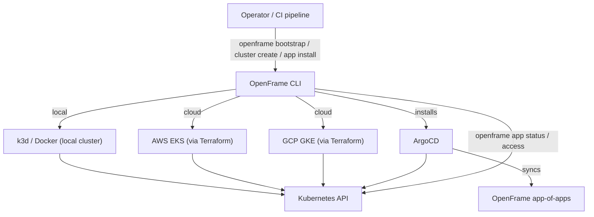

## What is OpenFrame CLI?

OpenFrame CLI is the command-line tool for provisioning Kubernetes clusters and deploying the [OpenFrame](https://openframe.ai) platform onto them. In a single command it can stand up a local k3d cluster (or a cloud GKE/EKS cluster via Terraform) and then install OpenFrame — ArgoCD plus the app-of-apps bundle — using ArgoCD's app-of-apps pattern. It manages the full lifecycle: checking prerequisites, creating clusters, installing charts, reporting status, upgrading deployments, and tearing everything down again.

OpenFrame itself is the unified, AI-driven platform from [Flamingo](https://flamingo.run) that brings together multiple MSP (Managed Service Provider) tools into a single interface, automating IT support operations across the stack. This CLI is how you get OpenFrame running on your own infrastructure.

The CLI is written in Go, built around [Cobra](https://github.com/spf13/cobra) for command routing, and talks to Kubernetes natively via `client-go` — shelling out to Helm, k3d, Terraform, and cloud provider CLIs (`gcloud`, `aws`) only where a real external tool is required.

> The application platform that this CLI installs (OpenFrame itself) lives in a separate, external repository: [flamingo-stack/openframe-oss-tenant](https://github.com/flamingo-stack/openframe-oss-tenant). This `openframe-cli` repository contains only the CLI tool — it is not a subdirectory of that platform repository.

## Key features and benefits

| Feature | What it gives you |
|---|---|
| **One-command bootstrap** | `openframe bootstrap` creates a local k3d cluster and installs the full OpenFrame platform in a single staged, progress-tracked flow |
| **Multiple cluster backends** | Local clusters via k3d (Docker-based), or cloud clusters on GKE and EKS, provisioned through pinned Terraform modules |
| **Interactive and scriptable** | Full interactive wizards for cluster creation and chart configuration, or `--non-interactive` / explicit flags for CI and automation |
| **App-of-apps deployment** | Installs ArgoCD and the OpenFrame app-of-apps bundle, then waits for every child Application to become synced and healthy |
| **Status visibility** | `openframe app status` reports cluster reachability and ArgoCD application health in one-shot, `--watch`, or an interactive k9s-style `--interactive` TUI |
| **Safe lifecycle operations** | `openframe app uninstall` removes ArgoCD and the apps while leaving the cluster intact; `openframe cluster delete` removes the cluster itself, with typed-name confirmation for cloud clusters |
| **Self-updating** | `openframe update` checks for and applies CLI updates, verifying cosign signatures and checksums, with rollback support |
| **Machine-readable output** | `--output json` / `--output yaml` on status, access, and other commands for scripting and CI pipelines |

## Who is this for?

OpenFrame CLI is intended for:

- **MSP technicians and administrators** who need to stand up and operate the OpenFrame platform without hand-rolling Kubernetes manifests or Helm charts.
- **Platform/DevOps engineers** provisioning OpenFrame on cloud infrastructure (GKE or EKS) with repeatable, pinned Terraform configurations.
- **Developers** working locally against a disposable k3d cluster to test OpenFrame changes.
- **CI/CD pipelines** that need non-interactive, scriptable cluster and app lifecycle commands with predictable exit codes and JSON/YAML output.

## How it fits together

As a repository, OpenFrame CLI is published to the Go ecosystem as `github.com/flamingo-stack/openframe-cli`. It has no recorded upstream dependencies on other repositories in the organization's graph and no recorded downstream consumers — its `internal/` packages are private implementation detail with no public Go API intended for import elsewhere. Its functional dependencies are third-party Go modules and external CLI tools (Cobra, `client-go`, pterm, huh/bubbletea, sigstore-go) and external binaries it shells out to (Docker, k3d, Helm, Terraform, `gcloud`, `aws`).

## Hardware requirements

OpenFrame is a multi-service platform, so the cluster it runs on needs real resources:

| | CPU cores | RAM | Disk |
|---|---|---|---|
| Minimum | 6 | 24GB | 50GB |
| Recommended | 12 | 32GB | 100GB |

The `openframe app install` interactive flow checks the target cluster against these recommendations and warns (without blocking) if it falls short.

## Where to go next

- [Prerequisites](./prerequisites.md) — what needs to be installed and verified before running the CLI
- [Quick Start](./quick-start.md) — get a cluster and OpenFrame running quickly
- [First Steps](./first-steps.md) — what to do right after your first install
- [Create a Kubernetes cluster with OpenFrame CLI](./how-to/create-a-kubernetes-cluster-with-openframe-cli.md)
- [Install the OpenFrame platform onto a cluster](./how-to/install-the-openframe-platform-onto-a-cluster.md)
- [Check the status of your OpenFrame cluster and app](./how-to/check-the-status-of-your-openframe-cluster-and-app.md)
- [Update the OpenFrame CLI to the latest version](./how-to/update-the-openframe-cli-to-the-latest-version.md)
- [Uninstall OpenFrame and delete a cluster](./how-to/uninstall-openframe-and-delete-a-cluster.md)

For deeper technical material, see the [development overview](../development/README.md), the [architecture overview](../reference/architecture/overview.md) and [ecosystem graph](../reference/architecture/ecosystem.md), and the [architecture diagrams](../diagrams/architecture/README.md).

## Community

This project does not use GitHub Issues or GitHub Discussions. Community support and discussion happen on the [OpenMSP Slack community](https://www.openmsp.ai/).

## License

This repository is licensed under **The Flamingo AI Unified License v1.0** (© 2025 Flamingo AI, Inc.), as stated in its `LICENSE.md`. Upstream components incorporated elsewhere in the OpenFrame platform (such as Fleet, Osquery, and the MeshCentral Agent) remain under their own original licenses as listed in that file's appendix; this CLI repository's own code is governed by the Flamingo AI Unified License v1.0.
