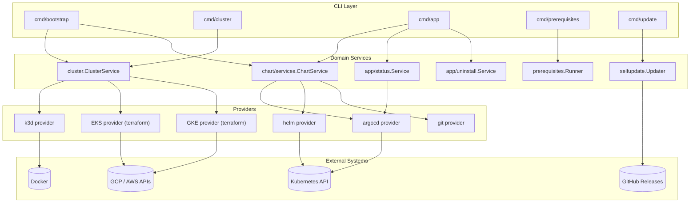

## Introduction

**OpenFrame CLI** is the command-line tool that provisions Kubernetes clusters and deploys the [OpenFrame](https://openframe.ai) platform onto them. It is a single Go binary — no separate installer — that takes you from "nothing" to a running OpenFrame control plane in one command, and then gives you the day-to-day tools (`status`, `upgrade`, `uninstall`, `access`) to operate that platform going forward.

OpenFrame itself is the unified, AI-driven platform from [Flamingo](https://flamingo.run) that brings multiple MSP (Managed Service Provider) tools together behind a single interface, automating IT support operations across the stack. This CLI is how you stand up and manage the Kubernetes environment that OpenFrame runs on — whether that's a local development cluster or a cloud-hosted one.

> The CLI's source lives in this repository, **flamingo-stack/openframe-cli**. The platform it deploys (ArgoCD applications, Helm charts, the app-of-apps manifests) is published from the separate **flamingo-stack/openframe-oss-tenant** repository — see [its documentation](https://github.com/flamingo-stack/openframe-oss-tenant/tree/main/docs) for platform-side details. Do not expect that repository's code to live in a subdirectory here; the CLI only *consumes* it (by git ref) at install time.

### What it does

Under the hood, OpenFrame CLI is organized around three core jobs:

- **Cluster provisioning** — create, inspect, and tear down Kubernetes clusters: a local `k3d` cluster backed by Docker, or cloud clusters on GKE/EKS provisioned through Terraform.
- **Platform deployment** — install ArgoCD and the OpenFrame app-of-apps onto any reachable cluster, following ArgoCD's app-of-apps pattern, then monitor and upgrade that deployment over time.
- **Prerequisites management** — verify (and, on macOS/Linux, auto-install) the tools each operation needs: Docker, k3d, Helm, Terraform, cloud CLIs (`gcloud`, `aws`), and certificate tooling.

Both fully interactive wizards (with sensible prompts and defaults) and non-interactive flags (for CI/automation) are supported throughout.

## Key Features and Benefits

| Feature | Benefit |
|---|---|
| One-command bootstrap (`openframe bootstrap`) | Creates a local k3d cluster **and** installs the OpenFrame platform in a single step — the fastest path to a running environment |
| Multi-provider clusters | Same CLI and commands for local (`k3d`) and cloud (`GKE`, `EKS`) clusters, provisioned via pinned Terraform modules |
| App lifecycle commands | `app install`, `app upgrade`, `app status`, `app access`, and `app uninstall` manage the OpenFrame deployment independently of cluster creation |
| Two upgrade modes | `app upgrade --ref <ref>` deploys a new git ref; `app upgrade --sync` force-resyncs the currently deployed ref via ArgoCD |
| Interactive status TUI | `app status --interactive` gives a k9s-style view for navigating ArgoCD applications, inspecting details, and triggering syncs |
| Machine-readable output | `--output json`/`yaml` on read commands (`status`, `access`, `cluster status`) for scripting and CI |
| Prerequisite checks | `openframe prerequisites check|install --type k3d|eks|gke` verifies/installs required tooling before you hit a failure mid-operation |
| Self-update with signature verification | `openframe update` checks and applies CLI updates, verified via cosign and checksums, with rollback support |
| Safe-by-default destructive commands | `app uninstall` and `cluster delete` require confirmation (or an explicit `--yes`/typed-name flag) before removing anything |
| Exit-code fidelity | Failed external commands (Helm, Terraform, etc.) propagate their real exit code, so CI pipelines can react correctly |

## Target Audience

OpenFrame CLI is built for:

- **Platform operators and MSP technicians** standing up or maintaining an OpenFrame deployment, locally or in the cloud.
- **DevOps / infrastructure engineers** who need repeatable, scriptable cluster provisioning (k3d for local dev, GKE/EKS for cloud) with Terraform underneath.
- **Contributors to the OpenFrame platform** who need a disposable local cluster to develop and test against.
- **CI/automation authors** who need non-interactive flags, JSON/YAML output, and faithful exit codes to drive OpenFrame deployments from pipelines.

## Quick Overview

The CLI's `cmd/` layer routes to domain services in `internal/`, which in turn drive providers (k3d, EKS/GKE via Terraform, ArgoCD, Helm, Git) against external systems:



A typical first run looks like this:

```bash
# Create a local k3d cluster and install OpenFrame in one step
openframe bootstrap

# Check that the platform came up healthy
openframe app status

# Get ArgoCD admin credentials and UI access instructions
openframe app access
```

OpenFrame CLI is published to the Go ecosystem as `github.com/flamingo-stack/openframe-cli`. According to the organization's dependency graph, it has no recorded upstream dependencies on other repositories in this ecosystem and no recorded downstream consumers — its functional dependencies are third-party Go modules (Cobra for commands, `client-go` for native Kubernetes access, `pterm`/`huh`/`bubbletea` for terminal UI, `sigstore-go` for update-signature verification) and external CLI tools it shells out to (Docker, k3d, Helm, Terraform, `gcloud`, `aws`).

## Hardware Requirements

Running a cluster and installing the full OpenFrame platform on it needs real local resources:

| | Minimum | Recommended |
|---|---|---|
| RAM | 24GB | 32GB |
| CPU cores | 6 | 12 |
| Disk | 50GB | 100GB |

The interactive `app install` wizard warns (but does not block) if the target cluster is smaller than the recommended capacity.

## Where to Go Next

This introduction is the starting point for the OpenFrame CLI documentation set. From here:

- [Prerequisites](./prerequisites.md) — tools and accounts you need before installing
- [Quick Start](./quick-start.md) — the fastest path to a running cluster and platform
- [First Steps](./first-steps.md) — what to do right after your first install
- [Create a Kubernetes Cluster with OpenFrame CLI](./how-to/create-a-kubernetes-cluster-with-openframe-cli.md)
- [Install the OpenFrame Platform onto a Cluster](./how-to/install-the-openframe-platform-onto-a-cluster.md)
- [Check the Status of Your OpenFrame Cluster and App](./how-to/check-the-status-of-your-openframe-cluster-and-app.md)
- [Update the OpenFrame CLI to the Latest Version](./how-to/update-the-openframe-cli-to-the-latest-version.md)
- [Uninstall OpenFrame and Delete a Cluster](./how-to/uninstall-openframe-and-delete-a-cluster.md)

For contributors and deeper technical reference:

- [Development Overview](../development/README.md), [Environment Setup](../development/setup/environment.md), [Local Development](../development/setup/local-development.md)
- [Architecture Overview](../development/architecture/README.md) and the [reference architecture document](../reference/architecture/overview.md)
- [Testing](../development/testing/README.md), [Security](../development/security/README.md), [Contributing Guidelines](../development/contributing/guidelines.md)
- [Ecosystem graph](../reference/architecture/ecosystem.md) and [architecture diagrams](../diagrams/architecture/README.md)

## Community

This project does not use GitHub Issues or GitHub Discussions. All support, questions, and community discussion happen on the [OpenMSP](https://www.openmsp.ai/) Slack community — join via the [OpenMSP Slack invite](https://join.slack.com/t/openmsp/shared_invite/zt-36bl7mx0h-3~U2nFH6nqHqoTPXMaHEHA).

## License

This project is licensed under **The Flamingo AI Unified License v1.0** (© 2025 Flamingo AI, Inc.), as stated in the repository's `LICENSE.md`. The license covers Flamingo AI's own contributions; upstream components incorporated into Flamingo Software (such as Fleet, Osquery, and the MeshCentral Agent, per the license's appendix) remain under their own original licenses. See `LICENSE.md` in the repository root for the full terms, including copyleft, contribution-back, and acceptable-use provisions.
