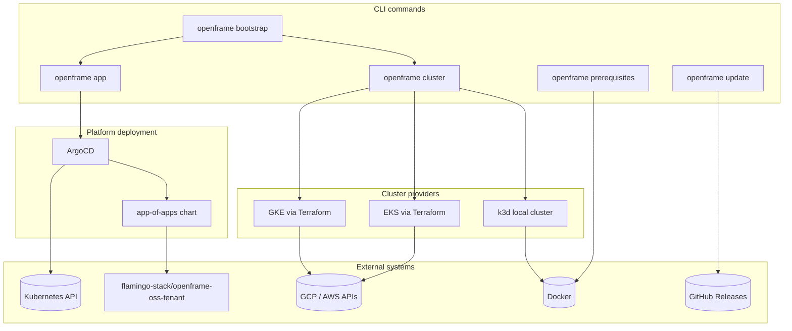

# Introduction

## What is OpenFrame CLI?

OpenFrame CLI (`openframe`) is the Go-based command-line tool that bootstraps and manages the lifecycle of the [OpenFrame](https://openframe.ai) platform by [Flamingo](https://flamingo.run). It provisions Kubernetes clusters — locally via k3d, or in the cloud via GKE/EKS through Terraform — and then deploys the OpenFrame platform onto those clusters using ArgoCD's app-of-apps pattern.

In a single command, `openframe bootstrap` takes you from nothing to a running OpenFrame platform: it creates a local k3d cluster and installs ArgoCD plus the app-of-apps in one staged flow. Beyond that one-shot path, the CLI also exposes granular commands for cluster lifecycle management, platform installation/upgrade, prerequisite checking, status monitoring, and self-update — with both interactive wizards for humans and non-interactive flags for CI/automation.

The OpenFrame platform's application code itself — the services the CLI deploys — lives in a separate repository, [`flamingo-stack/openframe-oss-tenant`](https://github.com/flamingo-stack/openframe-oss-tenant), which this CLI clones at install/upgrade time and deploys via its app-of-apps Helm chart. This repository (`flamingo-stack/openframe-cli`) contains only the CLI itself.

## Key features and benefits

- **One-command bootstrap.** `openframe bootstrap` chains cluster creation and platform installation into a single staged flow with progress tracking, so a local OpenFrame environment is one command away.
- **Multiple cluster backends.** Clusters can be created locally with k3d (Docker-based), or in the cloud on GKE or EKS via Terraform, all behind the same `openframe cluster` command surface.
- **ArgoCD-driven platform deployment.** The platform is installed and kept in sync through ArgoCD and an app-of-apps Helm chart, with support for deploying a specific branch or release tag via `--ref`.
- **Prerequisite automation.** `openframe prerequisites check` and `install` detect and (on macOS/Linux) auto-install the tools each cluster backend needs — Docker, k3d, Helm, Terraform, gcloud, the AWS CLI — with documentation links printed instead on Windows.
- **Status visibility.** `openframe app status` reports cluster reachability and ArgoCD application sync/health, with `--watch` for a live-refreshing view and `--interactive` for a k9s-style terminal UI (navigate applications, inspect details, trigger syncs).
- **Safe, ordered teardown.** `openframe app uninstall` and `openframe cluster delete` remove the platform or the cluster in a deliberate order (Applications, then Helm releases, then finalizers, then optional namespace), asking for confirmation unless `--yes`/`--force` is given.
- **Verified binaries everywhere.** Tool binaries the CLI downloads (k3d, Helm, mkcert, Terraform, infracost) are pinned to exact versions and checksum-verified before use, never fetched via an unverified pipe-to-shell. The CLI's own self-update path additionally verifies releases with Sigstore/cosign signatures.
- **Automation-friendly output.** Most read commands support `--output json|yaml` for scripting, and `--non-interactive` skips every prompt for CI pipelines.
- **Windows support via WSL2.** On Windows, the native build re-executes itself inside WSL2 before any cluster command runs, since the local cluster (Docker + k3d) and the Kubernetes client need to share a network namespace a native Windows process cannot reach reliably.

## Who this is for

OpenFrame CLI is built for:

- **MSP technicians and platform operators** who need to stand up or manage an OpenFrame environment — locally for evaluation/development, or in the cloud for a production footprint.
- **Platform engineers and DevOps teams** integrating OpenFrame cluster provisioning and application deployment into CI/CD pipelines, using the CLI's non-interactive flags and machine-readable output.
- **Contributors to the OpenFrame ecosystem** who want to understand or extend how clusters are provisioned and how the platform is installed, upgraded, and torn down.

## Quick overview



This repository publishes a single Go module, `github.com/flamingo-stack/openframe-cli`, distributed as pre-built binaries via GitHub Releases and installable with `go install`. According to the organization's dependency graph, it has no recorded upstream dependencies on other internally-published artifacts and no internal repository depends on it — it is a standalone, user-facing CLI binary, not a library consumed by other services.

## Hardware requirements

| Resource | Minimum | Recommended |
|---|---|---|
| RAM | 24 GB | 32 GB |
| CPU Cores | 6 | 12 |
| Disk Space | 50 GB | 100 GB |

## Installing on Windows

Windows users download the AMD64 build directly from the releases page:

```text
https://github.com/flamingo-stack/openframe-cli/releases/latest/download/openframe-cli_windows_amd64.zip
```

Run the installer the same way as on other operating systems. As noted above, the native Windows build re-executes itself inside WSL2 before any cluster command runs.

## Where to go next

- [Prerequisites](./prerequisites.md) — what needs to be installed before running the CLI.
- [Quick Start](./quick-start.md) — get an OpenFrame environment running.
- [First Steps](./first-steps.md) — a first walkthrough after installation.
- [Create a new Kubernetes cluster with OpenFrame CLI](./how-to/create-a-new-kubernetes-cluster-with-openframe-cli.md)
- [Install the OpenFrame platform onto a cluster](./how-to/install-the-openframe-platform-onto-a-cluster.md)
- [Check the status of your OpenFrame cluster and apps](./how-to/check-the-status-of-your-openframe-cluster-and-apps.md)
- [Upgrade OpenFrame CLI and its installed apps](./how-to/upgrade-openframe-cli-and-its-installed-apps.md)
- [Uninstall OpenFrame and delete a cluster](./how-to/uninstall-openframe-and-delete-a-cluster.md)

For architecture details, see the [Architecture overview](../reference/architecture/overview.md), the [Ecosystem graph](../reference/architecture/ecosystem.md), and the [architecture diagrams](../diagrams/architecture/README.md). For contributing to this CLI, see the [Development docs](../development/README.md), including [environment setup](../development/setup/environment.md), [local development](../development/setup/local-development.md), [architecture](../development/architecture/README.md), [testing](../development/testing/README.md), [contributing guidelines](../development/contributing/guidelines.md), and [security](../development/security/README.md).

> This project does not use GitHub Issues or GitHub Discussions. Community support and discussion happen on the [OpenMSP Slack community](https://www.openmsp.ai/).

## License

This repository is licensed under **The Flamingo AI Unified License v1.1** (see `LICENSE.md`), copyright Flamingo AI, Inc. The license governs the Flamingo-authored source code in this repository; upstream components bundled elsewhere in the OpenFrame platform remain under their own original licenses as noted in that file's appendix. The Flamingo AI Unified License v1.1 does not govern the hosted OpenFrame service, OpenMSP, or the Flamingo website, which are covered separately by Flamingo AI's Terms of Service.
