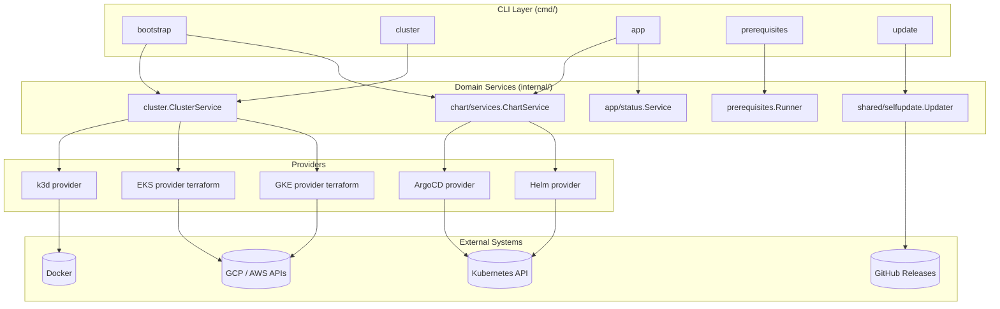

# OpenFrame CLI

## What is OpenFrame CLI?

**OpenFrame CLI** (`openframe`) is the bootstrap and lifecycle-management tool for [OpenFrame](https://openframe.ai), the unified, AI-driven MSP platform built by [Flamingo](https://flamingo.run). OpenFrame integrates multiple MSP tools into a single interface, automating IT support operations across the stack.

This repository, `flamingo-stack/openframe-cli`, does **not** contain the OpenFrame platform itself. It owns one job: getting a Kubernetes cluster ready and putting OpenFrame onto it. The platform's application code — the services the CLI deploys — lives in the separate [`flamingo-stack/openframe-oss-tenant`](https://github.com/flamingo-stack/openframe-oss-tenant) repository, which this CLI clones at install/upgrade time via its app-of-apps Helm chart (see `internal/chart/models/repos.go`'s `RepoOSSTenant` constant). Always treat that repository as external — do not expect the OpenFrame application source to be anywhere under this one.

In short: `openframe` provisions a cluster (locally via k3d, or in the cloud via GKE/EKS through Terraform) and deploys OpenFrame onto it using ArgoCD's app-of-apps pattern, with both interactive wizards and non-interactive flags for CI/automation.

## Key features and benefits

- **One-command bootstrap.** `openframe bootstrap [cluster-name]` creates a local k3d cluster and installs the full OpenFrame platform in a single staged flow, with a progress tracker and a closing summary.
- **Multiple cluster backends, one CLI.** The same commands create and manage clusters on k3d (local, Docker-based), AWS EKS, and Google GKE — all through Terraform-backed providers under `internal/cluster/providers/`.
- **ArgoCD-driven platform install.** `openframe app install`/`upgrade`/`uninstall` drive ArgoCD and the app-of-apps Helm chart, so platform state stays declarative and git-synced.
- **Built-in status visibility.** `openframe app status` reports cluster reachability and ArgoCD application sync/health, with one-shot, `--watch` (auto-refreshing), and `--interactive` (k9s-style TUI, via `internal/app/status/tui`) modes, plus `--output json|yaml` for scripting.
- **Prerequisite management.** `openframe prerequisites check|install` verifies and installs the tools a given cluster type needs (Docker, k3d, Helm, Terraform, cloud CLIs), with pinned versions and checksum verification (no `curl | bash`) handled by `internal/shared/download`.
- **Safe, scriptable operations.** Destructive commands (like `app uninstall` and cloud `cluster delete`) require confirmation or an explicit `--yes`/`--force` flag; machine-readable output and `--non-interactive` modes make the CLI CI-friendly.
- **Self-updating binary.** `openframe update` checks GitHub releases and verifies cosign/Sigstore signatures plus SHA256 checksums before applying an update, with rollback support.
- **WSL-aware on Windows.** The native Windows build forwards into WSL2 (`internal/shared/wsllauncher`) where Docker/k3d/client-go actually work.

## Target audience

OpenFrame CLI is built for:

- **MSP technicians and operators** who need to stand up or manage an OpenFrame deployment, whether a local evaluation cluster or a production cloud cluster.
- **Platform/DevOps engineers** provisioning and maintaining Kubernetes clusters (k3d, EKS, GKE) dedicated to OpenFrame.
- **CI/CD and automation engineers** who need non-interactive, scriptable cluster and platform lifecycle commands with predictable exit codes and JSON/YAML output.
- **Contributors to the OpenFrame ecosystem** who want to understand how the platform in `openframe-oss-tenant` gets deployed end to end.

## Quick overview

The CLI's command tree (`cmd/`) is thin: each command delegates into domain services under `internal/` (cluster provisioning, chart/ArgoCD install, app status, prerequisites, self-update), which in turn drive provider-specific backends through a testable `CommandExecutor` abstraction (`internal/shared/executor`). This is what makes the real work mockable in tests without ever calling Docker, Terraform, or `kubectl` for real.

Per the organization's dependency graph (coverage: full), OpenFrame CLI publishes one artifact — the Go module `github.com/flamingo-stack/openframe-cli` — and has no recorded upstream or downstream dependencies on other repositories in the organization. It is a standalone, user-facing binary: its only relationship to `flamingo-stack/openframe-oss-tenant` is operational (cloning its app-of-apps chart at install time), not a code dependency.

## Hardware requirements

Before installing OpenFrame with this CLI, make sure the target cluster (local or cloud) meets:

| | Minimum | Recommended |
|---|---|---|
| RAM | 24GB | 32GB |
| CPU cores | 6 | 12 |
| Disk | 50GB | 100GB |

> These are advisory thresholds checked during interactive cluster selection (`recommendedRequirements()` in `cmd/app/install.go`); falling short only warns, it does not block installation.

## Where to go next

- [Prerequisites](./prerequisites.md) — tools and accounts the CLI needs before you provision a cluster.
- [Quick Start](./quick-start.md) — get a cluster and the OpenFrame platform running fast.
- [First Steps](./first-steps.md) — what to do right after your first successful install.
- [Create a Kubernetes cluster with OpenFrame CLI](./how-to/create-a-kubernetes-cluster-with-openframe-cli.md)
- [Install the OpenFrame platform onto a cluster](./how-to/install-the-openframe-platform-onto-a-cluster.md)
- [Check the status of your OpenFrame cluster and app](./how-to/check-the-status-of-your-openframe-cluster-and-app.md)
- [Update the OpenFrame CLI to the latest version](./how-to/update-the-openframe-cli-to-the-latest-version.md)
- [Uninstall OpenFrame and delete a cluster](./how-to/uninstall-openframe-and-delete-a-cluster.md)
- [Development overview](../development/README.md), [environment setup](../development/setup/environment.md), and [local development](../development/setup/local-development.md) for contributors.
- [Architecture overview](../development/architecture/README.md), the [reference architecture](../reference/architecture/overview.md), the [ecosystem graph](../reference/architecture/ecosystem.md), and the [architecture diagrams index](../diagrams/architecture/README.md) for a deeper look at how the CLI is organized internally.
- [Testing](../development/testing/README.md), [contributing guidelines](../development/contributing/guidelines.md), and [security](../development/security/README.md) for anyone submitting changes.

## Community

This project does not use GitHub Issues or GitHub Discussions. Everything is managed on the OpenMSP Slack community: [openmsp.ai](https://www.openmsp.ai/) (invite link available there).

## License

This repository is licensed under **The Flamingo AI Unified License v1.1** (see `LICENSE.md`). The license covers the Flamingo-authored code in this repository; it does not cover upstream components bundled elsewhere in the OpenFrame platform, which remain under their own original licenses as listed in the license's appendix.
