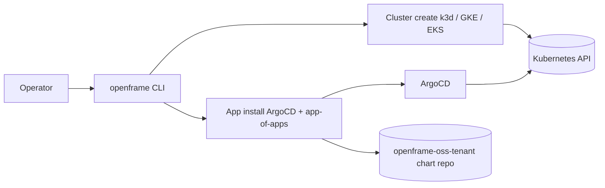

## Quick Start

OpenFrame CLI (`github.com/flamingo-stack/openframe-cli`) is the command-line tool that provisions a Kubernetes cluster — local (k3d) or cloud (GKE/EKS via Terraform) — and deploys the OpenFrame platform onto it using ArgoCD's app-of-apps pattern. This page gets you from zero to a running OpenFrame platform in about 5 minutes on a local machine.

> The OpenFrame platform itself (the services this CLI deploys) lives in the separate **flamingo-stack/openframe-oss-tenant** repository. This CLI only orchestrates cluster creation and deployment — it does not contain the platform's application code.

### Hardware requirements

| | Minimum | Recommended |
|---|---|---|
| RAM | 24 GB | 32 GB |
| CPU cores | 6 | 12 |
| Disk | 50 GB | 100 GB |

The install command advises (but does not block) on undersized clusters — see `recommendedRequirements()` in `cmd/app/install.go`, which checks against these same figures.

---

## TL;DR: 5-minute setup

### 1. Install the CLI

**Windows (AMD64):**

Download the latest release archive directly:

```text
https://github.com/flamingo-stack/openframe-cli/releases/latest/download/openframe-cli_windows_amd64.zip
```

Extract the archive and run the `openframe` executable the same way you would on macOS or Linux — see [Prerequisites](./prerequisites.md) for OS-specific tool requirements (Docker, k3d, Helm) and [First Steps](./first-steps.md) for a guided walkthrough.

**macOS / Linux:**

Grab the matching archive from the [Releases page](https://github.com/flamingo-stack/openframe-cli/releases) for your platform and extract the `openframe` binary onto your `$PATH`.

**Build from source (any platform with Go 1.26+):**

```bash
git clone https://github.com/flamingo-stack/openframe-cli.git
cd openframe-cli
make build
```

This builds a binary for your current OS/architecture into `build/openframe-<os>-<arch>`, using the `build` target in the repository's `Makefile` (`CGO_ENABLED=0 go build -trimpath`).

> The toolchain is pinned to Go 1.26.5 in `go.mod` — versions 1.26.0/1.26.1 have a known crash on windows-amd64 during GC stack scanning, which is why the shipped Windows binaries require the pinned toolchain.

### 2. Verify prerequisites

A local cluster (k3d) needs **Docker**, **k3d**, and **Helm** on your `$PATH`. The CLI checks and reports on these automatically at the start of most `cluster` and `app` subcommands (see `internal/cluster/prerequisites/`). You can also check explicitly:

```bash
openframe prerequisites check
```

Cloud clusters (GKE/EKS) instead require **Terraform** plus the relevant cloud CLI (`gcloud` or `aws`) — pass `--type gke` or `--type eks` to target the right check:

```bash
openframe prerequisites check --type eks
openframe prerequisites check --type gke
```

### 3. Bootstrap OpenFrame

The fastest path to a running platform is the `bootstrap` command, which runs cluster creation and app installation as one streamlined step:

```bash
openframe bootstrap
```

Interactively, this prompts you through cluster configuration (an RFC1123-valid name can be supplied as an argument instead), then:
1. Creates a k3d cluster (local Docker-based Kubernetes)
2. Installs ArgoCD and the app-of-apps chart set from the OpenFrame platform repository

For CI/automation, reuse an existing `openframe-helm-values.yaml` and skip all prompts:

```bash
openframe bootstrap --non-interactive
```

To see detailed logs, including ArgoCD sync progress, add `--verbose`:

```bash
openframe bootstrap --verbose
```

That's it — `bootstrap` is equivalent to running `openframe cluster create` followed by `openframe app install`, documented in more depth in [Create a Kubernetes Cluster with OpenFrame CLI](./how-to/create-a-kubernetes-cluster-with-openframe-cli.md) and [Install the OpenFrame Platform onto a Cluster](./how-to/install-the-openframe-platform-onto-a-cluster.md).

---

## Basic "Hello World" example

A minimal, fully explicit walk-through — equivalent to `bootstrap`, but as two separate steps so you can see each stage:

```bash
# 1. Create a local k3d cluster (interactive wizard by default)
openframe cluster create my-first-cluster --skip-wizard

# 2. Install ArgoCD + the OpenFrame app-of-apps onto it
openframe app install my-first-cluster
```

`cluster create` provisions the cluster via Docker/k3d (see `internal/cluster/providers/k3d`); `app install` then connects to that cluster's kube-context, installs ArgoCD via Helm, clones the app-of-apps chart repository at the default git branch, and waits for every ArgoCD `Application` to report `Synced`/`Healthy`.

Once installed, check that everything came up correctly:

```bash
openframe app status my-first-cluster
```

And retrieve the ArgoCD admin credentials to sign in to the control-plane UI:

```bash
openframe app access
```

### Deploying a specific release

By default, `app install` deploys the platform's default git branch. To target a specific release tag instead (tags use no `v` prefix, e.g. `1.0.48`):

```bash
openframe app install --ref 1.0.48
```

---

## Expected output

### `openframe app status`

A healthy platform reports cluster reachability, each ArgoCD application's sync/health state, and a readiness summary:

```text
Cluster reachable (3/3 nodes ready)
┌──────────────────┬────────┬─────────┐
│ APPLICATION      │ SYNC   │ HEALTH  │
├──────────────────┼────────┼─────────┤
│ argocd           │ Synced │ Healthy │
│ app-of-apps      │ Synced │ Healthy │
└──────────────────┴────────┴─────────┘
All applications Synced and Healthy

ArgoCD access
  Username: admin
  Password: <redacted>
Open the ArgoCD UI:
  1. kubectl port-forward -n argocd svc/argocd-server 8080:443
  2. open https://localhost:8080
```

You can also watch status live (auto-refreshing every 3 seconds) or open an interactive TUI to navigate applications and trigger syncs:

```bash
openframe app status --watch
openframe app status --interactive
```

For scripting, machine-readable output is available on most commands:

```bash
openframe app status --output json
```

### `openframe app access`

```text
ArgoCD access
  Username: admin
  Password: <redacted>
Open the ArgoCD UI:
  1. kubectl port-forward -n argocd svc/argocd-server 8080:443
  2. open https://localhost:8080
```

Follow the printed `kubectl port-forward` command, then open `https://localhost:8080` in a browser and sign in with the printed username/password. Refer to your environment configuration for any credentials beyond what the CLI prints at runtime — the CLI never hardcodes default credentials.

---

## How it fits together



The `bootstrap` command chains cluster creation and app installation; `internal/k8s` deliberately separates read/inspect access to an *existing* cluster from `internal/cluster`'s creation logic, so `app install` can also target a cluster you created outside the CLI entirely.

> OpenFrame CLI currently has no recorded upstream dependencies on other Flamingo repositories, and no repository in the organization's graph is recorded as consuming it — it functions as a standalone, terminal artifact whose real dependencies are external tools (Docker, k3d, Helm, Terraform, gcloud, aws) and third-party Go modules (Cobra, client-go, pterm).

---

## Next steps

- Walk through environment setup in more detail: [Prerequisites](./prerequisites.md)
- A guided, narrated first run: [First Steps](./first-steps.md)
- Create a cluster with more control over type, region, and sizing: [Create a Kubernetes Cluster with OpenFrame CLI](./how-to/create-a-kubernetes-cluster-with-openframe-cli.md)
- Install the platform separately from cluster creation: [Install the OpenFrame Platform onto a Cluster](./how-to/install-the-openframe-platform-onto-a-cluster.md)
- Check ongoing cluster and application health: [Check the Status of Your OpenFrame Cluster and App](./how-to/check-the-status-of-your-openframe-cluster-and-app.md)
- Tear everything down when you're done: [Uninstall OpenFrame and Delete a Cluster](./how-to/uninstall-openframe-and-delete-a-cluster.md)
- Keep the CLI itself current: [Update the OpenFrame CLI to the Latest Version](./how-to/update-the-openframe-cli-to-the-latest-version.md)
- Dig into the CLI's internal architecture: [Architecture Overview](../reference/architecture/overview.md) and [Ecosystem](../reference/architecture/ecosystem.md)
- Browse the architecture diagrams: [Diagrams](../diagrams/architecture/README.md)
- Set up a local development environment to contribute: [Development Environment](../development/setup/environment.md) and [Local Development](../development/setup/local-development.md)

For broader questions or community support, join the OpenMSP Slack community rather than filing a GitHub issue — this project tracks discussion there instead of GitHub Issues/Discussions.
