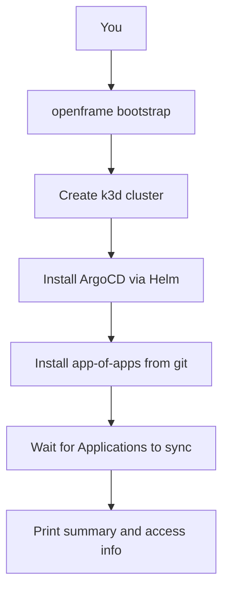

# Quick Start

OpenFrame CLI (`openframe`) is the Go-based command-line tool that bootstraps and manages the lifecycle of the [OpenFrame](https://openframe.ai) platform by [Flamingo](https://flamingo.run). It provisions a Kubernetes cluster — locally via k3d, or in the cloud via GKE/EKS through Terraform — and deploys the OpenFrame platform onto it using ArgoCD's app-of-apps pattern.

The platform's application code itself lives in a separate repository, [`flamingo-stack/openframe-oss-tenant`](https://github.com/flamingo-stack/openframe-oss-tenant), which this CLI clones and deploys. This Quick Start covers only the CLI: installing it and running your first `openframe bootstrap`.

> This repository publishes a single Go module, `github.com/flamingo-stack/openframe-cli`. Per the organization's code graph, it has no recorded upstream dependencies and no downstream consumers — it is a standalone, user-facing CLI binary distributed via GitHub Releases and `go install`, not a library consumed by other repositories.

## Hardware requirements

Before you start, make sure the machine (or the cluster you point the CLI at) meets these minimums:

| Resource | Minimum | Recommended |
|---|---|---|
| RAM | 24 GB | 32 GB |
| CPU Cores | 6 | 12 |
| Disk Space | 50 GB | 100 GB |

## TL;DR: 5-minute setup

### 1. Install the CLI

**macOS/Linux** — download the appropriate binary from the [Releases page](https://github.com/flamingo-stack/openframe-cli/releases), or build from source with Go:

```bash
go install github.com/flamingo-stack/openframe-cli@latest
```

**Windows** — download the AMD64 build directly and run it the same way you would on other operating systems:

```text
https://github.com/flamingo-stack/openframe-cli/releases/latest/download/openframe-cli_windows_amd64.zip
```

> On Windows, the native build re-executes itself inside WSL2 before any cluster command runs. This happens because the local cluster (Docker + k3d) and the native Kubernetes client used by the CLI need to share a network namespace that a native Windows process cannot reach reliably.

Confirm the binary is on your `$PATH` and runs:

```bash
openframe --help
```

### 2. Check prerequisites

The CLI shells out to external tools for cluster and platform operations (Docker, k3d, Helm, Terraform, gcloud, the AWS CLI). Some of these — k3d, Helm, mkcert, Terraform, infracost — are downloaded by the CLI itself, pinned to exact versions and verified against SHA256 digests before use. Check what is already installed and what is missing:

```bash
openframe prerequisites check
```

To install anything missing (auto-installs on macOS/Linux; on Windows it prints manual installation links instead):

```bash
openframe prerequisites install
```

### 3. Bootstrap the platform

The fastest path from zero to a running OpenFrame platform is the `bootstrap` command, which chains cluster creation and platform installation into one step:

```bash
openframe bootstrap
```

Running it with no arguments starts an interactive flow that creates a local k3d cluster and installs the full platform (ArgoCD plus the app-of-apps). You can also give the cluster an explicit name:

```bash
openframe bootstrap my-cluster
```

For CI/automation, skip all prompts and reuse an existing `openframe-helm-values.yaml`:

```bash
openframe bootstrap --non-interactive
```

Add `--verbose` to any of these if you want to see detailed ArgoCD sync progress while it installs.

## Basic "Hello World" example

A minimal, from-nothing session looks like this:

```bash
# 1. Confirm the CLI is installed
openframe --help

# 2. Check and install prerequisites (Docker, k3d, Helm, etc.)
openframe prerequisites check
openframe prerequisites install

# 3. Create a cluster and install OpenFrame in one step
openframe bootstrap hello-openframe

# 4. Once it finishes, check platform status
openframe app status

# 5. Get ArgoCD sign-in details
openframe app access
```

Behind the scenes, `bootstrap` runs the equivalent of `openframe cluster create` followed by `openframe app install`:

1. It validates the cluster name.
2. It creates a local k3d cluster and waits for a usable Kubernetes `rest.Config`.
3. It installs ArgoCD via Helm with the CLI's custom values.
4. It installs the app-of-apps by cloning the chart repository (from `flamingo-stack/openframe-oss-tenant` by default) and applying it through ArgoCD.
5. It waits for every ArgoCD Application to report `Synced`/`Healthy`.
6. It prints a closing summary card with the cluster name, each stage's result, and how to access the platform.

## Expected output

During `openframe bootstrap`, expect a sequence of staged progress output: cluster creation, ArgoCD installation, app-of-apps installation, then a wait loop while ArgoCD applications reconcile. On success you'll see a summary card confirming the cluster is ready.

Afterwards, `openframe app status` reports whether the cluster is reachable and lists each ArgoCD application with its sync and health state:

```text
Cluster reachable (3/3 nodes ready)

APPLICATION          SYNC      HEALTH
app-of-apps          Synced    Healthy
...

All applications Synced and Healthy.
```

`openframe app access` prints the ArgoCD admin credentials and how to reach the UI:

```text
ArgoCD access
  Username: admin
  Password: <printed here>
Open the ArgoCD UI:
  1. kubectl port-forward -n argocd svc/argocd-server 8080:443
  2. open https://localhost:8080
```

> Credentials shown by `openframe app access` are read live from your cluster — there is no default username/password baked into the CLI. Treat the printed password as a secret for that cluster.

Both `app status` and `app access` also support `--output json` or `--output yaml` for scripting, and `app status` additionally supports `--watch` (refreshes in place) and `--interactive` (a k9s-style TUI) when run in a real terminal.

## What `openframe bootstrap` just did



The platform's Helm charts and services come from the separate [`flamingo-stack/openframe-oss-tenant`](https://github.com/flamingo-stack/openframe-oss-tenant) repository, which `bootstrap`/`app install` clone at the configured ref (the default branch, or a specific branch/tag via `--ref`).

## Next steps

Once your first cluster is up, a few natural directions:

- Walk through cluster creation and platform installation as two separate, more controllable steps in [Create a new Kubernetes cluster with OpenFrame CLI](./how-to/create-a-new-kubernetes-cluster-with-openframe-cli.md) and [Install the OpenFrame platform onto a cluster](./how-to/install-the-openframe-platform-onto-a-cluster.md).
- Learn how to check on a running deployment in [Check the status of your OpenFrame cluster and apps](./how-to/check-the-status-of-your-openframe-cluster-and-apps.md).
- When you're done experimenting, see [Uninstall OpenFrame and delete a cluster](./how-to/uninstall-openframe-and-delete-a-cluster.md).
- To move to a new version of the CLI or the platform, see [Upgrade OpenFrame CLI and its installed apps](./how-to/upgrade-openframe-cli-and-its-installed-apps.md).
- For the full command reference and the CLI's internal architecture, see [Architecture Overview](../reference/architecture/overview.md) and [Ecosystem](../reference/architecture/ecosystem.md).
- If you want deeper background before diving in, read [Introduction](./introduction.md) and [Prerequisites](./prerequisites.md).
- To build the CLI from source or contribute changes, see [Development](../development/README.md), [Environment setup](../development/setup/environment.md), and [Contributing guidelines](../development/contributing/guidelines.md).

For community support and questions, the project is discussed on the OpenMSP Slack community rather than GitHub Issues or Discussions.
