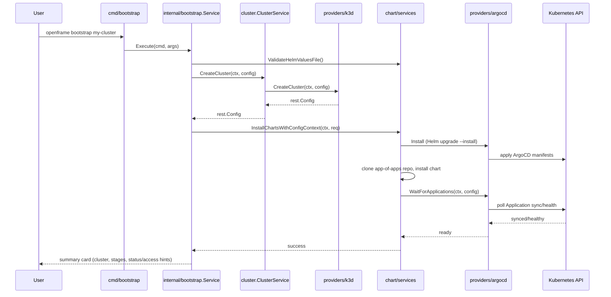

# Quick Start

OpenFrame CLI (`openframe`) is the bootstrap and lifecycle-management tool for the [OpenFrame](https://openframe.ai) platform built by [Flamingo](https://flamingo.run). It provisions a Kubernetes cluster — locally via k3d, or in the cloud via GKE/EKS through Terraform — and installs the OpenFrame platform onto it using ArgoCD's app-of-apps pattern.

The platform the CLI deploys lives in a separate repository, [`flamingo-stack/openframe-oss-tenant`](https://github.com/flamingo-stack/openframe-oss-tenant). This repository (`flamingo-stack/openframe-cli`) owns only cluster provisioning, platform install/upgrade/uninstall, prerequisite management, and self-update — it clones the app-of-apps chart from `openframe-oss-tenant` at install time rather than embedding its source.

> For a deeper architectural tour (components, data flow, dependency graph), see [Introduction](./introduction.md) and the [architecture overview](../reference/architecture/overview.md).

## Hardware requirements

Before you start, make sure the machine (or VM) you'll run the cluster on meets these minimums:

| | Minimum | Recommended |
|---|---|---|
| RAM | 24 GB | 32 GB |
| CPU cores | 6 | 12 |
| Disk | 50 GB | 100 GB |

The install wizard advises (but does not block) if your cluster looks smaller than this.

## TL;DR: 5-minute setup

### 1. Download the CLI binary

Grab the prebuilt binary for your platform from the [latest release](https://github.com/flamingo-stack/openframe-cli/releases/latest).

On Windows, download the amd64 archive directly:

```text
https://github.com/flamingo-stack/openframe-cli/releases/latest/download/openframe-cli_windows_amd64.zip
```

Unzip it and run the installer the same way as on other platforms (see the per-OS unzip/extract step below, then place `openframe` on your `$PATH`).

For macOS, Linux, and other platforms, download the matching archive from the same [Releases](https://github.com/flamingo-stack/openframe-cli/releases) page and extract it.

Alternatively, if you have a Go toolchain installed, you can build/install directly from source:

```bash
go install github.com/flamingo-stack/openframe-cli@latest
```

> `go.mod` pins this module to Go 1.26, with a toolchain directive forcing `go1.26.5` — a known crash in Go 1.26.0/1.26.1 on `windows/amd64` (corrupted return addresses during GC stack scanning) was fixed in 1.26.2. If you build from source, let Go resolve the toolchain from `go.mod` rather than overriding it.

### 2. Verify prerequisites

OpenFrame CLI shells out to a handful of external tools depending on the cluster type you choose (local k3d vs. cloud GKE/EKS): Docker and k3d for local clusters, Terraform plus `gcloud`/`aws` for cloud clusters, and Helm either way. Rather than guessing which ones you need, ask the CLI itself:

```bash
openframe prerequisites check
```

This reports what's missing. You can also install what's needed directly:

```bash
openframe prerequisites install
```

Or narrow either command to a specific cluster type (`k3d`, `eks`, or `gke`):

```bash
openframe prerequisites check --type k3d
```

### 3. Bootstrap a cluster and install the platform

The fastest path from zero to a running OpenFrame platform is the `bootstrap` command — it creates a local k3d cluster and installs ArgoCD + the app-of-apps in one step:

```bash
openframe bootstrap
```

Running it with no arguments launches the interactive wizard (cluster sizing, ingress, etc.). To give the cluster a name up front:

```bash
openframe bootstrap my-cluster
```

For CI/CD or any scripted environment, skip all prompts and reuse an existing `openframe-helm-values.yaml`:

```bash
openframe bootstrap --non-interactive
```

Add `--verbose` to any of the above to see detailed logs, including ArgoCD sync progress, while it runs.

### 4. Check it's working

```bash
openframe app status
```

That's the whole 5-minute path: download the binary, confirm prerequisites, run `bootstrap`, check `status`.

## Basic "Hello World" example

The closest thing to a "Hello World" for this CLI is confirming the binary runs and seeing the command tree. From a terminal with `openframe` on your `$PATH`:

```bash
openframe --help
```

This prints the root command's help, listing the top-level command groups (`bootstrap`, `cluster`, `app`, `prerequisites`, `update`). Running any command group with no subcommand (for example, `openframe cluster` or `openframe app`) also shows the logo and that group's own help text instead of erroring out.

A slightly more concrete "first real command" is listing your clusters — safe to run even before you've created one:

```bash
openframe cluster list
```

And to discover clusters you created outside the CLI (an existing GKE or EKS cluster reachable via your kubeconfig):

```bash
openframe cluster list --all
```

## Expected output and results

### `openframe prerequisites check`

Reports, tool by tool, whether each required dependency (Docker, k3d, Helm, Terraform, cloud CLIs, certificates) is present and at a usable version, without installing anything.

### `openframe bootstrap`

A full run walks through staged progress: cluster creation, then ArgoCD install, then the app-of-apps install, then waiting for ArgoCD Applications to reach `Synced`/`Healthy`. According to the bootstrap sequence, the flow is:



When it finishes successfully, you get a closing summary card naming the cluster, the stages that ran, and hints for checking status/accessing the platform.

### `openframe app status`

Reports cluster reachability (node count ready/total), then a table of ArgoCD applications with their `SYNC` and `HEALTH` columns, and a readiness summary line. If the platform is fully up, it also prints ArgoCD admin sign-in details (equivalent to running `openframe app access` separately). Example shape of a healthy report:

```text
Cluster reachable (3/3 nodes ready)

APPLICATION          SYNC      HEALTH
app-of-apps          Synced    Healthy
...

All applications Synced and Healthy.

ArgoCD access
  Username: admin
  Password: <redacted>
Open the ArgoCD UI:
  1. kubectl port-forward -n argocd svc/argocd-server 8080:443
  2. open https://localhost:8080
```

Pass `--watch` for an auto-refreshing view (every 3 seconds, until Ctrl+C), `--interactive`/`-i` for a k9s-style TUI to navigate apps and trigger syncs, or `--output json`/`--output yaml` for machine-readable output suited to scripts.

### `openframe app access`

Prints the ArgoCD admin username and password, plus the `kubectl port-forward` command to reach the UI locally — the same block shown above.

## Next steps

Once your first cluster and platform install are up, these guides walk through the individual pieces `bootstrap` combines, plus the commands for day-two operations:

- [Create a Kubernetes cluster with OpenFrame CLI](./how-to/create-a-kubernetes-cluster-with-openframe-cli.md) — using `openframe cluster create` directly, including the interactive wizard and cloud (GKE/EKS) options.
- [Install the OpenFrame platform onto a cluster](./how-to/install-the-openframe-platform-onto-a-cluster.md) — `openframe app install` against an existing cluster, including `--ref` to pin a branch or release tag.
- [Check the status of your OpenFrame cluster and app](./how-to/check-the-status-of-your-openframe-cluster-and-app.md) — deeper coverage of `openframe cluster status` and `openframe app status`.
- [Uninstall OpenFrame and delete a cluster](./how-to/uninstall-openframe-and-delete-a-cluster.md) — `openframe app uninstall` (keeps the cluster) versus `openframe cluster delete` (removes everything), plus `openframe cluster cleanup` for pruning unused images.
- [Update the OpenFrame CLI to the latest version](./how-to/update-the-openframe-cli-to-the-latest-version.md) — `openframe update`, including signature verification and rollback.

For a broader orientation before diving in, see [Introduction](./introduction.md) and [Prerequisites](./prerequisites.md). Once you're comfortable with the CLI commands, [First Steps](./first-steps.md) covers the next layer of day-to-day usage. If you plan to contribute to the CLI itself rather than just run it, start with [Development](../development/README.md), the [local development setup](../development/setup/local-development.md), and the [contributing guidelines](../development/contributing/guidelines.md).

For architectural background — how `cmd/`, `internal/cluster`, `internal/chart`, and the provider packages fit together — see the [architecture overview](../reference/architecture/overview.md), the [ecosystem reference](../reference/architecture/ecosystem.md), and the [architecture diagrams](../diagrams/architecture/README.md).

> This project does not use GitHub Issues or Discussions. Questions and community support happen on the [OpenMSP Slack community](https://www.openmsp.ai/).
