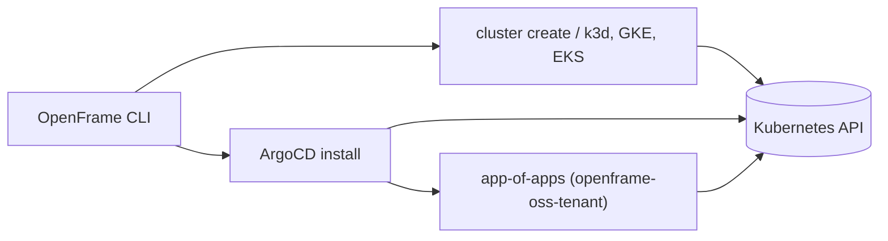

## Quick Start

OpenFrame CLI is a Go command-line tool that provisions a Kubernetes cluster (local k3d, or cloud GKE/EKS via Terraform) and deploys the OpenFrame platform onto it through ArgoCD's app-of-apps pattern. This page gets you from zero to a running OpenFrame platform in a single command.

> **Note on scope:** OpenFrame CLI (`flamingo-stack/openframe-cli`) drives the deployment process. The platform it installs — the services, charts, and application code that end up running on your cluster — lives in the separate **openframe-oss-tenant** repository (https://github.com/flamingo-stack/openframe-oss-tenant). This quick start only covers installing and running the CLI itself.

### Hardware requirements

Before you start, make sure your machine (or the target cluster) meets these requirements:

| | Minimum | Recommended |
|---|---|---|
| RAM | 24 GB | 32 GB |
| CPU cores | 6 | 12 |
| Disk | 50 GB | 100 GB |

The `openframe app install` command also warns (without blocking) if the target cluster reports less than roughly 6 CPU cores / 24GB RAM.

---

## TL;DR: 5-minute setup

### 1. Install the CLI

**Windows:**

Download the latest release archive and run the extracted binary:

```text
https://github.com/flamingo-stack/openframe-cli/releases/latest/download/openframe-cli_windows_amd64.zip
```

**macOS / Linux:**

Grab the matching archive for your platform from the releases page:

```text
https://github.com/flamingo-stack/openframe-cli/releases
```

Each release ships signed binaries: macOS binaries are codesigned and notarized, and Windows binaries are Authenticode-signed (see `scripts/sign-binary.sh`). Extract the archive and place the `openframe` binary on your `$PATH`.

Once installed, you can always check for a newer release and apply it in place:

```bash
openframe update check
openframe update
```

### 2. Run bootstrap

A single command creates a local k3d cluster and installs the full OpenFrame platform on it:

```bash
openframe bootstrap
```

This is equivalent to running `openframe cluster create` followed by `openframe app install`, but streamlined into one interactive flow (see `cmd/bootstrap/bootstrap.go` and `internal/bootstrap/service.go`).

```bash
# Give the cluster a specific name
openframe bootstrap my-cluster

# Non-interactive (CI/CD): reuses an existing openframe-helm-values.yaml
openframe bootstrap --non-interactive

# See everything happening under the hood, including ArgoCD sync progress
openframe bootstrap --verbose
```

### 3. Check status

```bash
openframe app status
```

That's it — you have a cluster with ArgoCD and the OpenFrame app-of-apps running.

---

## "Hello World": step by step

If you'd rather see each stage explicitly instead of running `bootstrap`, here is the same flow broken into its two underlying commands.

### Step 1 — Create a cluster

```bash
openframe cluster create
```

Run without flags, this opens an interactive wizard where you choose a cluster type (local k3d, or cloud GKE/EKS). Add `--skip-wizard` to create a cluster directly from flags and defaults, useful for scripting:

```bash
openframe cluster create --skip-wizard
```

The cluster command group also supports `list`, `status`, `use`, `delete`, and `cleanup` (see `cmd/cluster/cluster.go`). For local development, k3d is the fastest path since it runs entirely on Docker with no cloud billing involved.

### Step 2 — Install the OpenFrame platform

Once a cluster exists and is reachable, install ArgoCD and the app-of-apps onto it:

```bash
openframe app install
```

Run interactively (no arguments), this lets you pick which kube-context to target. You can also target a specific cluster directly:

```bash
openframe app install my-cluster
openframe app install --context k3d-my-cluster
```

Under the hood, `app install` (`cmd/app/install.go`) resolves a `rest.Config` for the target cluster, then calls `services.InstallChartsWithConfigContext`, which installs ArgoCD with pinned chart values and then the app-of-apps from the configured GitHub repository/ref (`chartmodels.RepoOSSTenant` by default, overridable with `--ref`).

```bash
# Deploy a specific release tag instead of the default branch
openframe app install --ref 1.0.48
```

### Step 3 — Watch it come up

```bash
openframe app status --watch
```

`--watch` re-renders the status every few seconds until the platform's ArgoCD applications are Synced and Healthy (`cmd/app/status.go`). Press Ctrl+C to stop watching.

---

## Expected output

### `openframe bootstrap`

A successful bootstrap prints a summary card listing the stages completed (cluster creation, ArgoCD install, app-of-apps sync), their timings, and access hints for the platform once everything is ready. Internally this follows the sequence described in `docs/diagrams/architecture/bootstrap-sequence.mmd`: cluster creation → ArgoCD Helm install → app-of-apps clone and install → wait for every ArgoCD `Application` to report Synced/Healthy.

### `openframe app status`

```text
Cluster reachable (3/3 nodes ready)
APPLICATION          SYNC      HEALTH
argocd               Synced    Healthy
app-of-apps          Synced    Healthy
...
All applications are Synced and Healthy.
```

If the platform is not yet installed, you'll instead see:

```text
No OpenFrame applications found — is it installed? Run: openframe app install
```

You can also request machine-readable output for scripting:

```bash
openframe app status --output json
openframe app status --output yaml
```

And drive an interactive terminal dashboard (k9s-style) to navigate applications and trigger syncs:

```bash
openframe app status --interactive
```

### `openframe app access`

Once the platform is installed, retrieve the ArgoCD sign-in details:

```bash
openframe app access
```

Expected output:

```text
ArgoCD access
  Username: admin
  Password: <redacted>
Open the ArgoCD UI:
  1. kubectl port-forward -n argocd svc/argocd-server 8080:443
  2. open https://localhost:8080
```

---

## Command reference at a glance

| Command | Purpose |
|---|---|
| `openframe bootstrap [cluster-name]` | Create a cluster and install OpenFrame in one step |
| `openframe cluster create [NAME]` | Create a k3d, GKE, or EKS cluster |
| `openframe cluster list` | List managed clusters |
| `openframe cluster status [NAME]` | Show cluster health and nodes |
| `openframe cluster use [NAME]` | Switch kube-context (and gcloud config for GKE) to a cluster |
| `openframe cluster delete [NAME]` | Delete a cluster |
| `openframe cluster cleanup [NAME]` | Prune unused container images from cluster nodes |
| `openframe app install [cluster-name]` | Install ArgoCD and the app-of-apps |
| `openframe app upgrade [cluster-name]` | Change the deployed git ref, or force a re-sync |
| `openframe app status` | Report platform readiness |
| `openframe app access` | Print ArgoCD admin credentials and UI access steps |
| `openframe app uninstall` | Remove ArgoCD + apps, keeping the cluster |
| `openframe prerequisites check\|install` | Verify or install required local tools |
| `openframe update [version]` | Update the CLI itself (`check`, `rollback` subcommands) |

A full architecture walkthrough — including the command-to-service dependency diagram and the app-status aggregation sequence — is available in `docs/reference/architecture/overview.md` and `docs/diagrams/architecture/README.md`.

---

## How this fits together



The CLI itself has no recorded upstream dependencies on other internal repositories and no recorded downstream consumers in the organization's dependency graph — it is a standalone, leaf artifact published as the Go module `github.com/flamingo-stack/openframe-cli`. The platform it deploys (charts, services, application code) is sourced from the separate `openframe-oss-tenant` repository at install time, via the git ref you pass with `--ref` (default branch otherwise).

---

## Next steps

Now that you have a cluster and the platform running:

- Work through the detailed how-to guides for each stage of the lifecycle: creating a cluster, installing the platform, checking status, updating the CLI, and uninstalling — see [Create a Kubernetes cluster with OpenFrame CLI](./how-to/create-a-kubernetes-cluster-with-openframe-cli.md), [Install the OpenFrame platform onto a cluster](./how-to/install-the-openframe-platform-onto-a-cluster.md), [Check the status of your OpenFrame cluster and app](./how-to/check-the-status-of-your-openframe-cluster-and-app.md), [Update the OpenFrame CLI to the latest version](./how-to/update-the-openframe-cli-to-the-latest-version.md), and [Uninstall OpenFrame and delete a cluster](./how-to/uninstall-openframe-and-delete-a-cluster.md).
- Read the [Introduction](./introduction.md) and [Prerequisites](./prerequisites.md) pages for background and tool requirements before diving deeper.
- Continue to [First Steps](./first-steps.md) for a guided walkthrough beyond the initial bootstrap.
- For contributors, see the [Development overview](../development/README.md), [environment setup](../development/setup/environment.md), [local development guide](../development/setup/local-development.md), [architecture docs](../development/architecture/README.md), [security notes](../development/security/README.md), [testing guide](../development/testing/README.md), and [contributing guidelines](../development/contributing/guidelines.md).
- For a deeper architectural reference, see [Architecture overview](../reference/architecture/overview.md), the [ecosystem graph](../reference/architecture/ecosystem.md), and the [architecture diagrams](../diagrams/architecture/README.md).

For community support and discussion, OpenFrame does not use GitHub Issues or Discussions — join the OpenMSP Slack community at https://www.openmsp.ai/.
