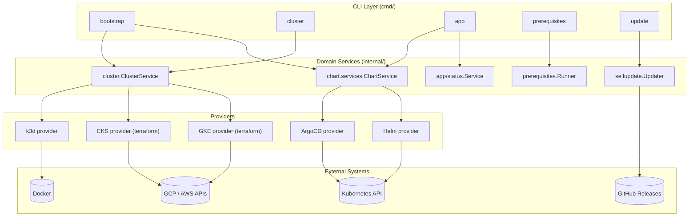
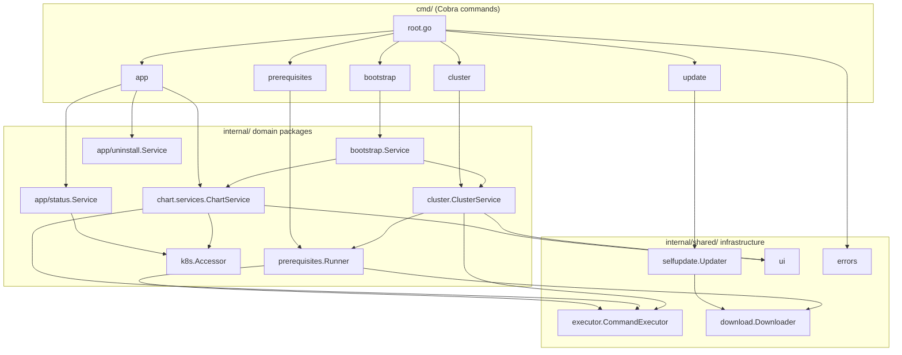
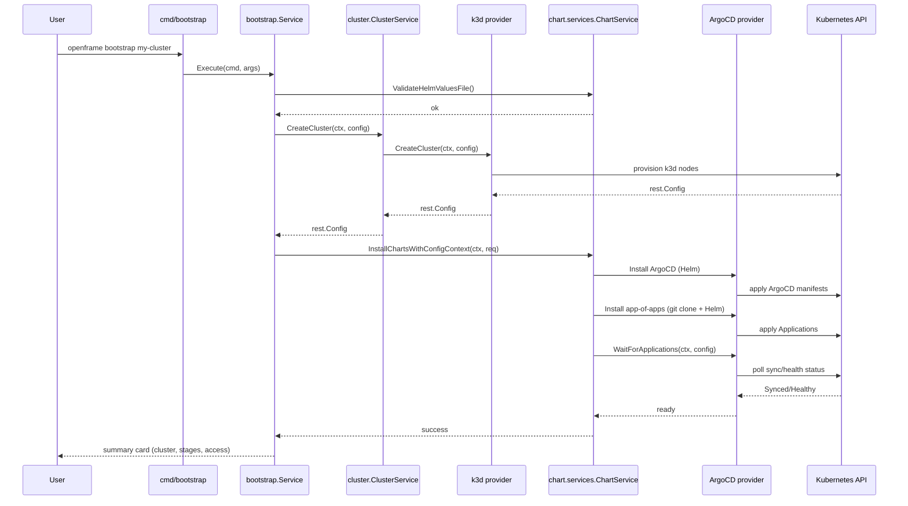

# openframe-cli Module Documentation

# OpenFrame CLI — Architecture Documentation

## Overview

OpenFrame CLI (`openframe`) is the Go-based command-line tool that bootstraps and manages the lifecycle of the [OpenFrame](https://openframe.ai) platform by [Flamingo](https://flamingo.run). It provisions Kubernetes clusters — locally via k3d or in the cloud via GKE/EKS through Terraform — and deploys the OpenFrame platform onto them using ArgoCD's app-of-apps pattern. It also manages prerequisites, status monitoring, upgrades, teardown, and its own self-update, with both interactive wizards and non-interactive flags for CI/automation.

The platform's application code itself lives in a separate repository, [`flamingo-stack/openframe-oss-tenant`](https://github.com/flamingo-stack/openframe-oss-tenant), which this CLI clones and deploys via the app-of-apps Helm chart.

## Architecture

The CLI is organized around three core abstractions — **cluster** (provisioning), **app** (platform deployment via ArgoCD), and **prerequisites** (tool verification/installation) — plus shared infrastructure for UI, command execution, verified downloads, and self-update.

### Architecture Diagram



On Windows, the native build re-executes itself inside WSL2 (`internal/shared/wsllauncher`) before any cluster command runs, because the local cluster (Docker + k3d) and the native Kubernetes client (`client-go`) must share a network namespace that a native Windows process cannot reach reliably.

## Core Components

| Component | Path | Responsibility |
|---|---|---|
| CLI entrypoint | `main.go`, `cmd/root.go` | Cobra root command, version metadata, global error/exit-code handling |
| Bootstrap | `cmd/bootstrap/`, `internal/bootstrap/` | One-shot "create cluster + install platform" flow with staged progress tracking |
| Cluster commands | `cmd/cluster/` | `create`, `delete`, `list`, `status`, `use`, `cleanup` subcommands |
| Cluster service | `internal/cluster/` | Cluster lifecycle orchestration, provider selection, registry of managed clusters |
| Cluster providers | `internal/cluster/providers/{k3d,eks,gke,terraform}` | Backend-specific cluster create/delete/status, unified behind the `provider.Provider` interface |
| Cluster discovery | `internal/cluster/discovery/` | Read-only discovery of external GKE/EKS clusters and gcloud/AWS auth flows |
| App commands | `cmd/app/` | `install`, `upgrade`, `status`, `access`, `uninstall` for the OpenFrame platform |
| Chart services | `internal/chart/` | ArgoCD + app-of-apps installation via Helm, git-based chart repo cloning, prerequisites |
| App status | `internal/app/status/`, `internal/app/status/tui/` | Aggregated platform health/sync report; k9s-style interactive TUI |
| App uninstall | `internal/app/uninstall/` | Ordered teardown of ArgoCD Applications, Helm releases, namespace |
| Prerequisites | `cmd/prerequisites/`, `internal/prerequisites/`, `internal/cluster/prerequisites/` | OS-aware tool detection/auto-install framework (Docker, k3d, helm, terraform, gcloud, aws) |
| Kubernetes access | `internal/k8s/` | Kubeconfig context handling, health/resource checks — read-only inspection of an existing cluster |
| Verified downloads | `internal/shared/download/` | SHA256-pinned, checksum-verified binary downloads (k3d, helm, mkcert, terraform, infracost) |
| Self-update | `internal/shared/selfupdate/`, `cmd/update/` | GitHub release check, cosign/Sigstore signature verification, in-place binary replacement, rollback |
| Command executor | `internal/shared/executor/` | Testable abstraction over external command execution (shell-out to docker/k3d/helm/terraform/gcloud/aws) |
| Shared UI | `internal/shared/ui/` | pterm/huh/bubbletea-based prompts, spinners, themed status printers, GitHub Actions annotations |
| Error handling | `internal/shared/errors/` | Structured error types, friendly hints, retry policy for transient failures |
| WSL launcher | `internal/shared/wsllauncher/` | Forwards the native Windows binary into WSL2 and auto-installs the Linux binary there |

## Component Relationships



## Data Flow

The sequence below shows the end-to-end `openframe bootstrap` flow, which chains cluster creation and platform installation.

### Bootstrap Sequence



## Key Files

| File | Purpose |
|---|---|
| `main.go` | Process entrypoint; maps errors to exit codes, preserving a failed external command's exit code |
| `cmd/root.go` | Builds the root Cobra command, resolves build-time version metadata, lists pinned dependency versions |
| `internal/bootstrap/service.go` | Orchestrates `cluster create` + `app install` as one staged flow with a step tracker and closing summary |
| `internal/cluster/service.go` | `ClusterService` — resolves the right provider, detects existing clusters, drives create/delete/status |
| `internal/cluster/provider/factory.go` | Selects the k3d/EKS/GKE backend from `models.ClusterType` |
| `internal/chart/services/chart_service.go` | Wires up ArgoCD + app-of-apps installation collaborators with dependency-injection seams for testing |
| `internal/chart/services/installer.go` | Core install sequence: ref preflight → ArgoCD install → app-of-apps install → wait for applications |
| `internal/app/status/status.go` | Aggregates cluster health, ArgoCD application sync/health, and admin password into one `Report` |
| `internal/app/uninstall/uninstall.go` | Safe-order teardown: delete Applications → uninstall Helm releases → clear finalizers → optional namespace delete |
| `internal/prerequisites/runner.go` | OS-aware prerequisite check/install runner (auto-installs on macOS/Linux, docs-only on Windows) |
| `internal/shared/download/verify.go` | Checksum-verified download substrate used by every pinned tool installer |
| `internal/shared/download/pins.go` | Pinned versions + SHA256 digests for k3d, mkcert, helm, terraform, infracost |
| `internal/shared/selfupdate/release.go`, `cosign.go` | GitHub release lookup and Sigstore/cosign signature verification for `openframe update` |
| `internal/shared/executor/executor.go` | `CommandExecutor` abstraction (and its mock) used everywhere external tools are shelled out to |
| `internal/shared/wsllauncher/launcher.go` | Re-execs the Windows binary inside WSL2, since cluster operations cannot run natively on Windows |
| `internal/k8s/accessor.go`, `restconfig.go`, `contexts.go` | Read-only cluster inspection: health, resource sufficiency, kubeconfig context handling |

## Dependencies

Per the organization's code graph, this repository publishes a single Go module artifact — `github.com/flamingo-stack/openframe-cli` — and the graph records **no upstream dependencies and no downstream consumers** within the organization's managed repositories. Index coverage is `full`, meaning this absence is confirmed, not a gap in visibility: no other repository in the organization imports from `openframe-cli`, and it does not consume any other internally-published artifact. It is a standalone, user-facing CLI binary distributed via GitHub Releases and `go install`, not a library.

Externally, `go.mod` and the source confirm the CLI is built on:

- **[spf13/cobra](https://github.com/spf13/cobra)** — command routing and flag parsing across the entire `cmd/` tree.
- **[kubernetes/client-go](https://github.com/kubernetes/client-go)** — native Kubernetes API access (health checks, resource queries, context resolution), replacing shelled-out `kubectl` calls.
- **[pterm/pterm](https://github.com/pterm/pterm)** — terminal rendering: tables, spinners, boxes, themed status printers.
- **[charmbracelet/huh](https://github.com/charmbracelet/huh)** and **[charmbracelet/bubbletea](https://github.com/charmbracelet/bubbletea)** — interactive prompts/wizards and the `app status --interactive` TUI.
- **[sigstore/sigstore-go](https://github.com/sigstore/sigstore-go)** — cosign keyless signature verification for self-update integrity, anchored via TUF to the public-good Sigstore trust root.
- **golang.org/x/mod/semver** — semantic version comparison driving update/downgrade decisions.
- **sigs.k8s.io/yaml** — JSON/YAML round-tripping for machine-readable (`--output json|yaml`) command output.

At runtime (not Go dependencies, but orchestrated via the `CommandExecutor` abstraction in `internal/shared/executor/`), the CLI shells out to: Docker, k3d, Helm, Terraform, gcloud, and the AWS CLI. The binaries for k3d, Helm, mkcert, Terraform, and infracost are downloaded by the CLI itself through `internal/shared/download/`, pinned to exact versions and verified against SHA256 digests before use — never fetched via an unverified `curl | bash`.

The platform this CLI deploys — the app-of-apps chart and its underlying services — lives in the separate [`flamingo-stack/openframe-oss-tenant`](https://github.com/flamingo-stack/openframe-oss-tenant) repository, cloned at install/upgrade time via the `GitHubRepo`/`GitHubBranch` configuration in `internal/chart/models/appofapps.go`.

## CLI Commands

```text
openframe bootstrap                    # k3d cluster + platform install in one step
openframe cluster create|delete|list|status|use|cleanup
openframe app install|upgrade|status|access|uninstall
openframe prerequisites check|install
openframe update [version]|check|rollback
```

### `openframe bootstrap [cluster-name]`
Creates a local k3d cluster and installs the full OpenFrame platform (ArgoCD + app-of-apps) in one step. Supports `--non-interactive` for CI, and `--verbose` for detailed ArgoCD sync progress.

### `openframe cluster`
- `create [NAME]` — creates a k3d, GKE, or EKS cluster (`--type`), interactively or with `--skip-wizard`. Cloud creates show a Terraform plan (and optional infracost estimate) before applying.
- `delete [NAME]` — destroys a cluster; cloud deletes require typed name confirmation unless `--force`.
- `list [--all]` — lists managed clusters; `--all` additionally discovers external GKE/EKS clusters (read-only).
- `status [NAME]` — detailed cluster health, nodes, and installed applications; supports `-o json|yaml`.
- `use [NAME]` — switches the active kubectl context (and gcloud configuration for GKE).
- `cleanup [NAME]` — prunes unused container images from cluster nodes without touching installed apps.

### `openframe app`
- `install [cluster-name]` — installs ArgoCD and the app-of-apps; supports `--ref` to deploy a specific branch or release tag.
- `upgrade [cluster-name]` — either re-deploys at a new `--ref` (Mode 1) or force re-syncs the current ref via ArgoCD (`--sync`, Mode 2, with optional `--prune`).
- `status [--watch|--interactive]` — reports cluster reachability and ArgoCD application sync/health; `--interactive` opens a k9s-style TUI.
- `access` — prints ArgoCD admin credentials and the port-forward command to reach the UI.
- `uninstall` — removes ArgoCD and app-of-apps Helm releases and Applications, leaving the cluster running.

### `openframe prerequisites`
- `check [--type k3d|eks|gke]` — reports which required tools are installed without changing anything.
- `install [--type k3d|eks|gke]` — installs missing tools (auto-installs on macOS/Linux; prints manual docs links on Windows).

### `openframe update`
- `update [version]` — updates to the latest release, or switches to a specific tagged version (up or down); every download is checksum- and signature-verified.
- `update check` — reports update availability without changing anything.
- `update rollback` — reverts to the previously-installed version, offline, with no download.

### Installation

```bash
# macOS/Linux: download from the Releases page and place on $PATH
# Or install from source:
go install github.com/flamingo-stack/openframe-cli@latest
```

Windows users download the AMD64 build directly:

```text
https://github.com/flamingo-stack/openframe-cli/releases/latest/download/openframe-cli_windows_amd64.zip
```

### Hardware Requirements

| Resource | Minimum | Recommended |
|---|---|---|
| RAM | 24 GB | 32 GB |
| CPU Cores | 6 | 12 |
| Disk Space | 50 GB | 100 GB |
