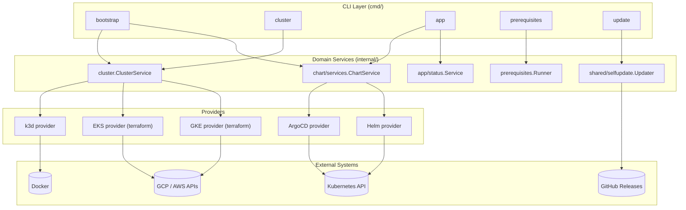
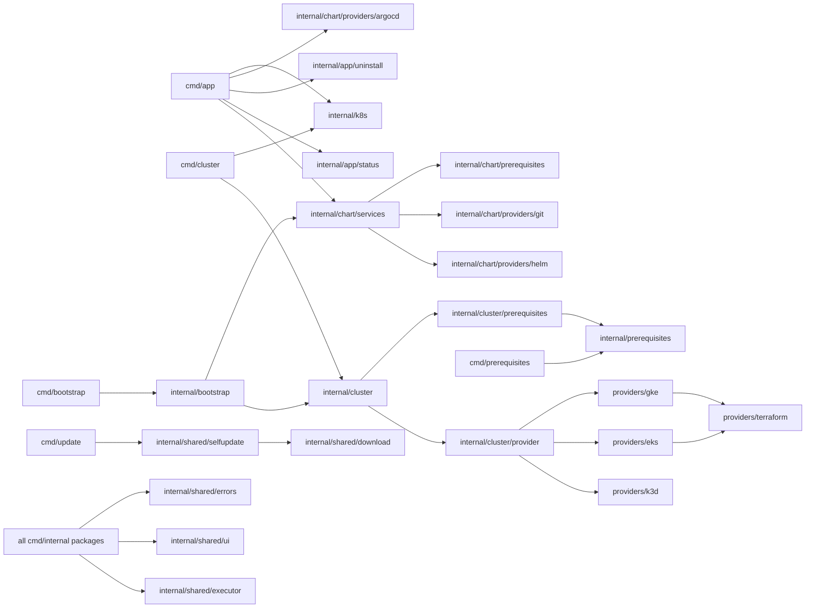
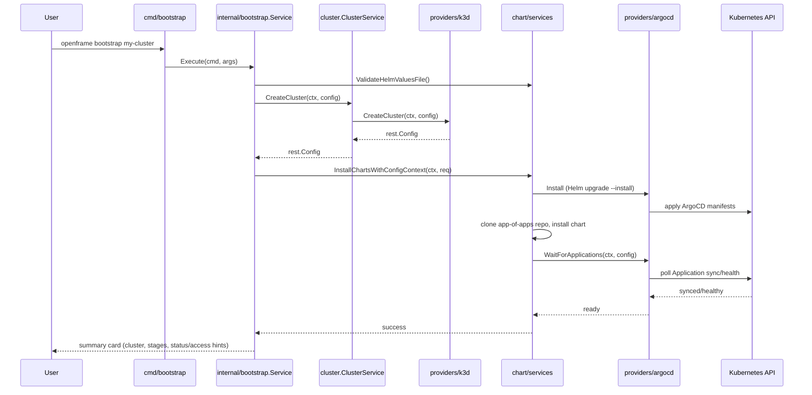

# openframe-cli Module Documentation

## Overview

**OpenFrame CLI** (`openframe`) is the bootstrap and lifecycle-management tool for the [OpenFrame](https://openframe.ai) platform built by [Flamingo](https://flamingo.run). It provisions Kubernetes clusters — locally via k3d or in the cloud via GKE/EKS through Terraform — and deploys OpenFrame onto them using ArgoCD's app-of-apps pattern, with both interactive wizards and non-interactive flags for CI/automation.

The CLI itself deploys the platform whose main code lives in the separate [`flamingo-stack/openframe-oss-tenant`](https://github.com/flamingo-stack/openframe-oss-tenant) repository; this repo owns only cluster provisioning, platform install/upgrade/uninstall, prerequisite management, and self-update.

## Architecture

OpenFrame CLI is organized around three core abstractions — **cluster** (provisioning), **app** (platform deployment via ArgoCD), and **prerequisites** (tool verification/installation) — plus shared infrastructure for UI, command execution, and self-update. Commands under `cmd/` are thin Cobra wrappers that delegate into domain services under `internal/`, which in turn drive provider-specific backends (k3d, EKS, GKE, Helm, ArgoCD) through a testable `CommandExecutor` abstraction.

### Architecture Diagram

## Core Components

| Component | Path | Responsibility |
|---|---|---|
| CLI entrypoint | `main.go`, `cmd/root.go` | Builds the root Cobra command, resolves build-time version info, exits with the failed child command's exit code |
| Bootstrap command | `cmd/bootstrap/`, `internal/bootstrap/` | One-shot "create cluster + install platform" flow with a staged progress tracker and closing summary |
| Cluster commands | `cmd/cluster/`, `internal/cluster/` | `create`/`delete`/`list`/`status`/`use`/`cleanup`; resolves the k3d/EKS/GKE backend via `internal/cluster/provider` |
| App commands | `cmd/app/`, `internal/app/` | `install`/`upgrade`/`status`/`access`/`uninstall` against ArgoCD + app-of-apps on an existing cluster |
| Chart services | `internal/chart/` | Installs ArgoCD and the app-of-apps Helm chart, clones the chart repo, validates helm values, orchestrates retries |
| Prerequisites framework | `internal/prerequisites/`, `internal/cluster/prerequisites/`, `internal/chart/prerequisites/` | OS-aware check/install of Docker, k3d, Helm, Terraform, cloud CLIs, certificates |
| Cluster providers | `internal/cluster/providers/{k3d,eks,gke,terraform}` | Backend-specific `Provider` implementations behind a single interface |
| Discovery | `internal/cluster/discovery/` | Finds external GKE/EKS clusters and handles gcloud/AWS auth flows |
| k8s access layer | `internal/k8s/` | Reads kubeconfig contexts, builds `rest.Config`, checks cluster health/capacity — read-only, separate from cluster creation |
| Self-update | `internal/shared/selfupdate/` | Checks GitHub releases, verifies cosign signatures + SHA256, applies/rolls back the binary |
| Verified downloads | `internal/shared/download/` | Pinned-version, checksum-verified installers for k3d, Helm, Terraform, mkcert, infracost (no `curl \| bash`) |
| Shared UI | `internal/shared/ui/` | pterm/huh/bubbletea wrappers: prompts, spinners, glyphs, `--silent`/`--plain`/`--verbose` contract, GitHub Actions annotations |
| Executor abstraction | `internal/shared/executor/` | `CommandExecutor` interface wrapping all external process calls; `MockCommandExecutor` for tests |
| WSL launcher | `internal/shared/wsllauncher/` | Forwards the native Windows build into WSL2, where Docker/k3d/client-go actually work |
| Error handling | `internal/shared/errors/` | Structured error rendering, retry policy, friendly hints, `AlreadyHandledError` sentinel |

## Component Relationships

## Data Flow

The sequence below traces `openframe bootstrap`, the CLI's flagship one-command flow: creating a local k3d cluster and installing the OpenFrame platform onto it.

### Bootstrap Sequence

## Key Files

| File | Purpose |
|---|---|
| `main.go` | Process entrypoint; preserves a failed external command's exit code for automation |
| `cmd/root.go` | Root Cobra command, version resolution (ldflags + VCS backfill), pinned-dependency reporting |
| `cmd/bootstrap/bootstrap.go` | `bootstrap` command: validates cluster name, delegates to `internal/bootstrap.Service` |
| `internal/bootstrap/service.go` | Staged create-cluster-then-install-charts orchestration with a step tracker and closing summary |
| `internal/cluster/service.go` | `ClusterService`: create/reuse/resume logic across k3d/EKS/GKE |
| `internal/cluster/provider/factory.go` | Single factory resolving a `Provider` by `ClusterType` |
| `internal/chart/services/chart_service.go` | Chart install orchestration: ArgoCD + app-of-apps, with injectable collaborators for tests |
| `internal/chart/services/installer.go` | `--ref` preflight, ArgoCD install, app-of-apps install, wait-for-applications sequencing |
| `internal/app/status/status.go` | Aggregates cluster health + ArgoCD application sync/health into one `Report` |
| `internal/app/uninstall/uninstall.go` | Safe-order platform removal (Applications → Helm releases → finalizers → namespace) |
| `internal/k8s/accessor.go`, `internal/k8s/contexts.go` | Read-only cluster health/capacity checks and kubeconfig context management |
| `internal/prerequisites/runner.go` | OS-aware check/install runner shared by cluster, app, and `prerequisites` commands |
| `internal/shared/download/pins.go` | Pinned versions + SHA256 checksums for k3d, Helm, Terraform, mkcert, infracost |
| `internal/shared/selfupdate/update.go`, `cosign.go` | Self-update logic and cosign/Sigstore signature verification |
| `internal/shared/executor/executor.go`, `mock.go` | `CommandExecutor` interface and its real/mock implementations |
| `internal/shared/wsllauncher/launcher.go` | Forwards the Windows build into WSL2 since Docker/k3d/client-go cannot run natively there |

## Dependencies

Per the organization's dependency graph (tool: `get_repo_ecosystem`, coverage: **full**), OpenFrame CLI:

- **Publishes** one artifact: the Go module `github.com/flamingo-stack/openframe-cli` (installable via `go install github.com/flamingo-stack/openframe-cli@latest`, or as prebuilt binaries from [Releases](https://github.com/flamingo-stack/openframe-cli/releases/latest)).
- **Has no recorded upstream dependencies** in the organization's own repositories — it depends only on third-party/external libraries (Cobra, client-go, pterm, huh, bubbletea, sigstore-go) and external CLI tools it shells out to (Docker, k3d, Helm, Terraform, gcloud, aws), none of which are managed repositories in this graph.
- **Has no recorded downstream consumers** — no other repository in the organization imports this module's Go symbols. This is expected: OpenFrame CLI is a standalone, user-facing binary, not a library other services import. Its only "consumer" relationship is operational: it deploys the platform whose source lives in the separate [`flamingo-stack/openframe-oss-tenant`](https://github.com/flamingo-stack/openframe-oss-tenant) repository, by cloning its app-of-apps chart at install/upgrade time (see `internal/chart/models/repos.go`'s `RepoOSSTenant` constant) — not via a code dependency.

Because index coverage is **full**, the absence of consumers above is a confirmed fact (every other managed repository has a fresh graph), not a gap in visibility.

### External (non-graph) dependencies

| Dependency | Used for |
|---|---|
| `github.com/spf13/cobra` | Command routing and flag parsing across the whole `cmd/` tree |
| `k8s.io/client-go` | Native Kubernetes API access (health checks, context resolution, ArgoCD/Helm operations) |
| `github.com/pterm/pterm` | Terminal rendering: tables, spinners, boxes, status printers, themed prefixes |
| `github.com/charmbracelet/huh`, `github.com/charmbracelet/bubbletea` | Interactive prompts/wizards and the `app status --interactive` TUI |
| `github.com/sigstore/sigstore-go` | Cosign keyless signature verification for self-update integrity |
| Docker, k3d, Helm, Terraform, gcloud, aws (external binaries) | Shelled out via the `CommandExecutor` abstraction; k3d/Helm/mkcert/Terraform/infracost are additionally pinned and checksum-verified by `internal/shared/download` |

## CLI Commands

| Command | Summary |
|---|---|
| `openframe bootstrap [cluster-name]` | Create a local k3d cluster and install the OpenFrame platform in one step (`--non-interactive` for CI) |
| `openframe cluster create [NAME]` | Create a k3d/GKE/EKS cluster (interactive wizard or `--skip-wizard` with flags like `--type`, `--nodes`, `--region`, `--project`, `--profile`, `--ha`, `--spot`) |
| `openframe cluster delete [NAME]` | Delete a cluster; cloud deletes require typed-name confirmation or `--force` |
| `openframe cluster list [--all]` | List managed clusters; `--all` additionally discovers external GKE/EKS clusters |
| `openframe cluster status [NAME]` | Detailed cluster health/resource info, `-o json\|yaml` supported |
| `openframe cluster use [NAME]` | Switch the kubectl context (and gcloud config, for GKE) to a cluster |
| `openframe cluster cleanup [NAME]` | Prune unused container images from cluster nodes (k3d only) |
| `openframe app install [cluster-name]` | Install ArgoCD + app-of-apps onto an existing cluster (`--ref` to pick a branch/tag) |
| `openframe app upgrade` | Change ref (`--ref`) or force a re-sync (`--sync`, optional `--prune`) of an installed platform |
| `openframe app status [--watch\|--interactive]` | Report/monitor ArgoCD application sync/health; `--interactive` opens a k9s-style TUI |
| `openframe app access` | Print ArgoCD admin credentials and how to reach the UI |
| `openframe app uninstall` | Remove ArgoCD + apps from a cluster, keeping the cluster itself |
| `openframe prerequisites check\|install [--type k3d\|eks\|gke]` | Report or install the tools required for a given cluster type |
| `openframe update [version]`, `update check`, `update rollback` | Self-update the CLI binary, with checksum + cosign signature verification and offline rollback |

